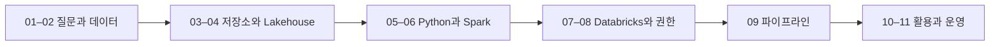

# Databricks 입문: 주문 데이터에서 분석까지

데이터 엔지니어링과 Databricks를 처음 접하는 개발자를 위한 한국어 교육 자료입니다. **“결제 완료 주문의 카테고리별 금액은 얼마인가?”**라는 질문 하나를 따라 데이터의 의미, 저장, 처리, 플랫폼, 권한, 파이프라인을 연결합니다.

Python 변수·조건문·반복문을 조금 알고 있다고 가정합니다. SQL과 데이터 플랫폼 경험은 없어도 됩니다. 문법이 낯설면 [시작 안내의 기초 준비](docs/course/00-start.md#prerequisites)부터 읽습니다.

**처음이라면 [00. 시작 안내](docs/course/00-start.md)부터 순서대로 읽으세요.** 기존의 긴 문서는 필요한 개념을 더 알아보는 심화 자료로 연결했습니다.

## 전체 학습 흐름

| 단계 | 학습 문서 | 끝나면 할 수 있는 일 |
| --- | --- | --- |
| 준비 | [00. 어떻게 공부할까요?](docs/course/00-start.md) | 자신의 환경에서 가능한 학습 범위를 고릅니다. |
| 문제 | [01. 데이터 엔지니어링은 왜 필요할까요?](docs/course/01-data-engineering.md) | 업무 질문을 입력·처리·결과로 나눕니다. |
| 기초 | [02. 행·열·키·SQL로 데이터를 읽습니다](docs/course/02-data-basics.md) | 한 행의 의미와 집계 기준을 설명합니다. |
| 저장 | [03. 파일은 어디에 있고, 누가 계산할까요?](docs/course/03-storage-and-compute.md) | 저장소·파일 형식·처리 엔진을 구분합니다. |
| 구조 | [04. DB에서 Lakehouse까지 연결합니다](docs/course/04-lakehouse.md) | 운영 DB·DW·마트·Lakehouse의 역할을 비교합니다. |
| 처리 | [05. Python으로 첫 집계를 만듭니다](docs/course/05-python.md) | CSV를 읽고 기대 결과를 검증합니다. **실습 1** |
| 확장 | [06. Spark는 일을 어떻게 나눌까요?](docs/course/06-spark.md) | DataFrame·지연 실행·결과 수집을 설명합니다. |
| 플랫폼 | [07. Databricks에서 코드를 실행합니다](docs/course/07-databricks.md) | 노트북에서 PySpark와 SQL 결과를 비교합니다. **실습 2** |
| 관리 | [08. Unity Catalog로 이름과 권한을 관리합니다](docs/course/08-unity-catalog.md) | 테이블 이름과 필요한 권한을 확인합니다. |
| 연결 | [09. Bronze → Silver → Gold를 만듭니다](docs/course/09-pipeline.md) | 검증과 재실행을 포함한 작은 파이프라인을 만듭니다. **실습 3** |
| 활용 | [10. 분석·ML·RAG는 어떤 데이터를 쓸까요?](docs/course/10-analytics-and-ai.md) | 데이터 제공과 모델 학습·추론을 구분합니다. |
| 정리 | [11. 운영 관점으로 복습하고 다음 단계를 고릅니다](docs/course/11-next-steps.md) | 지금 만든 것의 한계와 다음 학습 과제를 설명합니다. |

## 현재 제공하는 범위

전체 교육과정은 작성 중입니다. **입문 개념과 작은 배치 실습**을 먼저 연결했으며, 운영 가능한 서비스 구축 전체를 다루지는 않습니다.

| 범위 | 현재 상태 |
| --- | --- |
| 입문 본문 00–11, 공통 데이터, 확인 문제·해설 | 제공 |
| 로컬 Python 집계, PySpark·SQL 비교, 관리형 Delta 테이블 실습 | 코드·실행 안내·기대 결과 제공 |
| JDBC·저장소별 접근·런타임·거버넌스 상세 | 기존 심화 자료 제공, 각 환경 준비 필요 |
| 증분 적재·CDC·스트리밍·작업 자동화·장애 복구 | 개념 소개 및 후속 학습 과제; 완결 실습 미제공 |
| 대시보드 제작·모델 학습/배포·RAG 구현 | 역할과 데이터 흐름 소개; 완결 실습 미제공 |

## 필요한 자료 찾기

- [실습 안내와 실행 환경](docs/labs/README.md): 계정 없이 시작하는 실습부터 테이블 생성까지
- [공통 주문 데이터와 지표 정의](data/README.md): 모든 입문 실습의 입력과 정답
- [핵심 용어집](docs/glossary.md): 처음 만나는 용어를 짧게 복습
- [심화 자료 찾아보기](docs/reference/README.md): 기존 6개 문서와 입문 과정의 대응 관계
- [후속 교육과정](docs/roadmap.md): 제공된 내용과 앞으로 작성할 내용

자료를 수정하는 사람은 [재구성 원칙](docs/superpowers/specs/2026-11-11-beginner-course-design.md)과 [작업·검증 기록](docs/superpowers/plans/2026-11-11-beginner-course.md)을 참고합니다.
