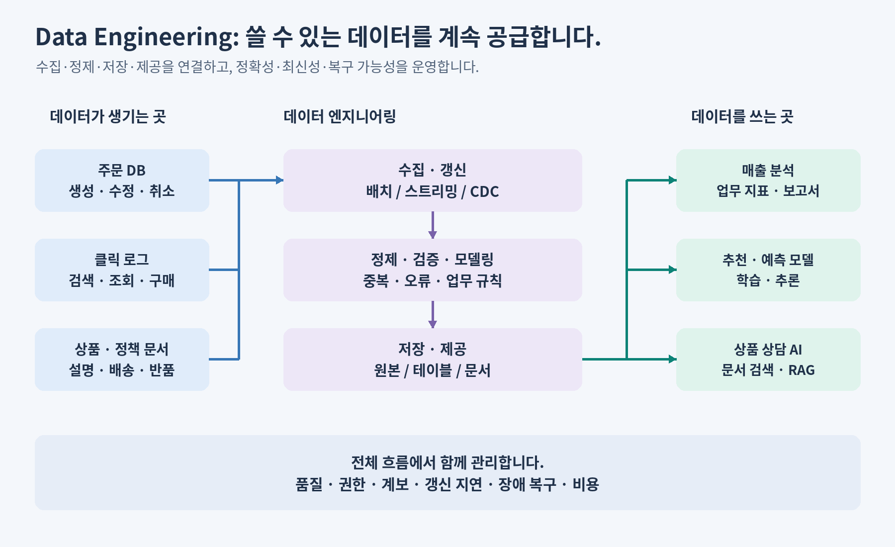

# 01. 데이터 엔지니어링은 왜 필요할까요?

**학습 목표:** 업무 질문을 데이터의 입력·처리·결과로 나눕니다.

**선수 지식:** [00. 시작 안내](00-start.md).

## 먼저 질문을 정합니다

쇼핑몰 담당자가 “어느 카테고리에서 결제 금액이 많이 발생했나요?”라고 묻습니다. 코드보다 먼저 다음 세 가지를 정해야 합니다.

| 결정 | 이번 과정의 약속 |
| --- | --- |
| 무엇을 읽나요? | 주문의 현재 상태를 담은 작은 스냅샷, 총 5행 |
| 어떤 행을 포함하나요? | `status`가 `paid`인 행만 포함 |
| 무엇을 계산하나요? | `category`별 `amount` 합계, 금액은 원 단위 정수 |

스냅샷은 **한 시점의 상태를 담은 데이터**입니다. 이 데이터에는 날짜나 환불 내역이 없습니다. 그래서 결과는 “현재 샘플의 결제 완료 금액”이며, “어제 매출”이나 “환불까지 반영한 순매출”은 아닙니다.

## 코드 한 번과 반복 가능한 데이터 제공

오늘 파일 하나를 손으로 계산하는 것은 어렵지 않습니다. 하지만 내일 새 주문이 들어오고, 어제 주문이 취소되고, 담당자가 바뀌면 같은 기준으로 다시 계산할 수 있어야 합니다.

**데이터 엔지니어링은 데이터를 수집·정리·저장하여 필요한 사람이 믿고 쓸 수 있도록 만드는 일**입니다. 한 번 답을 구하는 코드에 더해 갱신, 품질, 권한, 실패 복구를 다룹니다.



위 그림은 앞으로 확장할 전체 모습입니다. 이번 입문 실습에서는 주문 샘플과 카테고리별 집계에 집중합니다.

| 단계 | 이번 예제 | 매일 운영할 때 추가되는 질문 |
| --- | --- | --- |
| 수집 | 샘플 CSV를 읽음 | 새 데이터가 빠짐없이 도착했나요? |
| 정제·검증 | 상태·금액·주문 키를 확인 | 중복·잘못된 값은 어떻게 처리하나요? |
| 제공 | 카테고리별 합계를 만듦 | 같은 정의로 다른 팀도 조회할 수 있나요? |
| 운영 | 같은 입력을 다시 실행 | 실패 지점부터 복구해도 중복되지 않나요? |

## 파이프라인이란 무엇인가요?

파이프라인은 입력이 결과가 되기까지 연결된 처리 단계입니다.

```text
주문 읽기 → 데이터 확인 → paid 선택 → category로 묶기 → amount 합산 → 결과 제공
```

이 순서는 Python·SQL·Spark 중 무엇을 쓰더라도 먼저 이해해야 합니다. 도구는 이 처리를 구현하는 방법이고, 업무 규칙은 어떤 결과가 맞는지를 결정합니다.

## 확인 문제

1. 취소 주문을 포함한 합계와 제외한 합계 중 어느 것이 맞나요?
2. 결과가 한 번 맞았는데도 데이터 엔지니어링이 더 필요한 이유는 무엇인가요?

<details>
<summary>해설</summary>

1. 질문의 정의에 따라 다릅니다. 이 과정은 `paid`만 포함한다고 정했으므로 취소 주문을 제외합니다.
2. 새 입력, 중복, 장애, 권한, 갱신 시간을 관리하며 같은 정의의 결과를 반복해서 제공해야 하기 때문입니다.

</details>

**더 알아보기:** [데이터 엔지니어의 역할과 협업](../data-engineering-lakehouse-ai.md#what-is-data-engineering).

[이전: 00. 시작 안내](00-start.md) · [전체 목차](../../README.md) · [다음: 02. 데이터 기초](02-data-basics.md)
