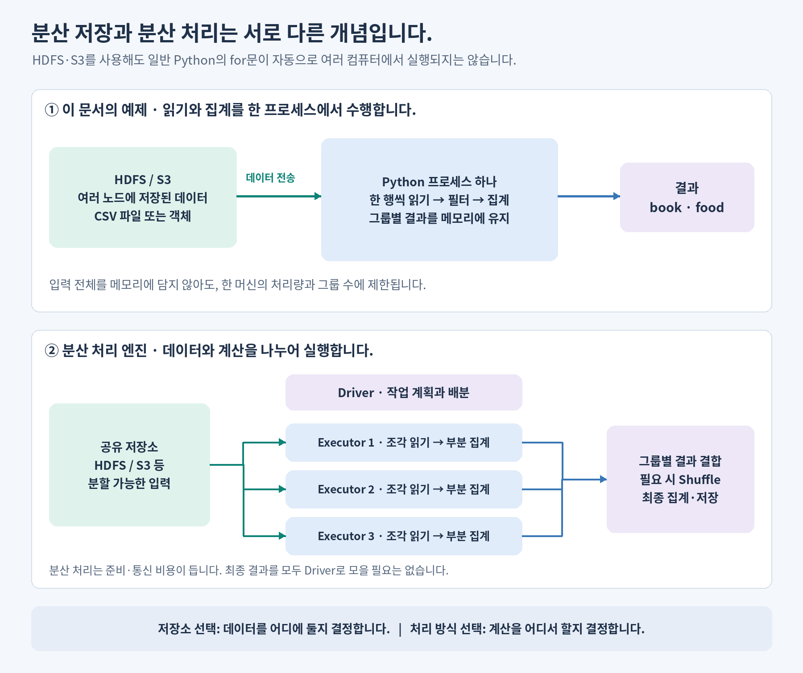

# 03. 파일은 어디에 있고, 누가 계산할까요?

**학습 목표:** 저장소·파일 형식·처리 엔진의 역할을 구분합니다.

**선수 지식:** [02장](02-data-basics.md)의 CSV와 자료형.

## 저장과 계산을 나누어 생각합니다

파일이 어디에 있는지와 누가 합계를 계산하는지는 서로 다른 질문입니다.

```text
저장소의 orders.csv → 읽기 → Python 또는 Spark의 계산 → 결과를 화면/저장소에 전달
```

| 질문 | 예 |
| --- | --- |
| 어디에 보관하나요? | 내 컴퓨터 디스크, 공유 저장소, S3 같은 객체 저장소 |
| 어떤 형식으로 표현하나요? | CSV, JSON, Parquet |
| 무엇이 계산하나요? | Python 코드, Spark 엔진, SQL 엔진 |

S3에 파일을 놓았다고 Python 반복문이 여러 컴퓨터에서 실행되지는 않습니다. 반대로 Spark는 작은 로컬 예제도 처리할 수 있습니다. **분산 저장과 분산 처리는 구분합니다.**



## 저장소는 주소와 접근 방법이 다릅니다

| 이름 | 첫 학습에서 기억할 점 | 경로 예시 |
| --- | --- | --- |
| Local Disk | 실행 중인 컴퓨터에 있는 파일 | `data/orders.csv` |
| NAS | 여러 컴퓨터가 공유하는 저장 시스템 | 마운트된 `/mnt/team/orders.csv` |
| NFS | 원격 파일을 공유하는 프로토콜; NAS가 제공할 수도 있음 | 마운트된 `/mnt/nfs/orders.csv` |
| HDFS | 파일 블록을 여러 서버에 보관하는 분산 파일 시스템 | HDFS 클라이언트로 접근 |
| S3 | 버킷과 키로 객체를 찾아 읽는 객체 저장소 | `s3://bucket/input/orders.csv` |

NAS와 NFS는 같은 종류의 제품 이름이 아닙니다. 또 `s3://...`를 Python 기본 `open()`에 넣는 것만으로 읽을 수는 없습니다. 저장소에 맞는 클라이언트와 권한이 필요합니다.

첫 실습은 로컬 파일로 충분합니다. NAS 마운트나 HDFS 클러스터 설치를 먼저 할 필요는 없습니다.

## 파일 형식은 저장소와 다릅니다

| 형식 | 특징 | 이번 과정에서의 위치 |
| --- | --- | --- |
| CSV | 행·열을 텍스트로 표현, 눈으로 확인하기 쉬움 | 공통 원본 샘플 |
| JSON | 이름과 값을 중첩된 구조로 표현 | 로그·문서 메타데이터를 이해할 때 확장 |
| Parquet | 열 단위 표현, 분석 시 필요한 열을 읽는 데 적합 | Lakehouse의 파일 기반을 이해할 때 등장 |

S3는 저장소이고 Parquet는 파일 형식이므로, “S3와 Parquet 중 무엇을 쓰나요?”는 선택지가 맞지 않는 질문입니다. S3에 Parquet 파일을 저장할 수 있습니다.

## 확인 문제

1. S3에 CSV를 올린 후 Python으로 읽으면 자동으로 분산 계산이 되나요?
2. 내 노트북에서 보이는 `data/orders.csv`가 원격 컴퓨트에서도 보이나요?

<details>
<summary>해설</summary>

1. 아닙니다. 저장소와 실행 방식은 별개입니다.
2. 보장되지 않습니다. 코드를 실행하는 컴퓨터와 그 컴퓨터가 접근할 수 있는 경로를 확인해야 합니다. 입문 Databricks 실습은 이 차이 때문에 작은 데이터를 셀에서 직접 생성합니다.

</details>

**더 알아보기:** [저장소별 장단점](../storage-systems-and-python.md#tradeoffs), [저장소별 Python 접근 예제](../storage-systems-and-python.md#shared-example).

[이전: 02. 데이터 기초](02-data-basics.md) · [전체 목차](../../README.md) · [다음: 04. Lakehouse](04-lakehouse.md)
