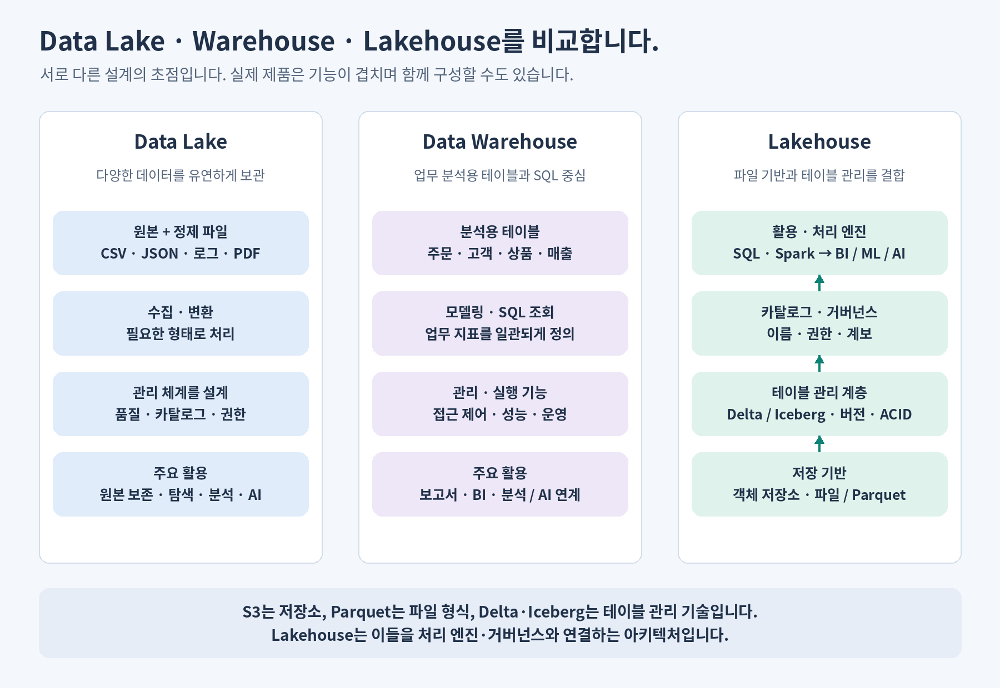

# 04. DB에서 Lakehouse까지 연결합니다

**학습 목표:** 운영 DB·DW·마트·Data Lake·Lakehouse가 맡는 일을 설명합니다.

**선수 지식:** [03장](03-storage-and-compute.md)의 저장소와 처리 엔진 구분.

## 주문을 받는 시스템과 분석하는 시스템

고객이 결제할 때는 주문 한 건을 빠르고 정확하게 기록해야 합니다. 분석가는 여러 달의 주문을 모아 카테고리별 추이를 보고 싶어 합니다. 같은 주문 데이터라도 요청의 모양이 다릅니다.

| 개념 | 목적 | 쇼핑몰 예 |
| --- | --- | --- |
| 운영 DB | 주문·결제 등 업무의 현재 상태를 읽고 변경 | 주문 한 건의 배송 상태 갱신 |
| Data Warehouse(DW) | 여러 원천을 분석 기준에 맞춰 통합 | 주문·고객·상품을 연결한 기간별 분석 |
| Data Mart | 특정 팀이나 주제가 쓰기 쉬운 범위로 제공 | 재무팀의 카테고리별 결제 금액 |

운영 처리를 OLTP, 분석 처리를 OLAP라고 부릅니다. DW도 넓은 의미에서는 데이터베이스이며, 마트가 반드시 별도 서버여야 하는 것은 아닙니다. 중요한 것은 목적과 데이터 정의입니다.

## 다양한 원본을 보관하는 Data Lake

주문 표뿐 아니라 클릭 로그, 상품 사진, PDF 설명서도 보관하려면 파일 중심의 저장 공간이 필요합니다. Data Lake는 이런 원본과 정제 데이터를 폭넓게 보관하는 구조입니다.

원본을 먼저 저장하고 필요할 때 구조를 해석하는 방식을 **Schema-on-Read**, 적재 전에 구조를 맞추는 방식을 **Schema-on-Write**라고 부릅니다. 이는 대표적인 설계 경향이며, 실제 시스템은 둘을 함께 사용할 수 있습니다.

원본이 많아져도 이름·품질·권한이 없으면 찾고 믿고 쓰기 어렵습니다. 파일 보관만으로 분석 시스템이 완성되지는 않습니다.

## Lakehouse는 역할들을 결합합니다

Lakehouse는 파일 기반 저장 위에 신뢰할 수 있는 테이블 관리와 분석 기능을 연결하는 아키텍처입니다. 하나의 파일 확장자나 특정 서버 이름이 아닙니다.

| 구성 요소 | 담당하는 역할 |
| --- | --- |
| S3 등 객체 저장소 | 파일을 보관 |
| Parquet 등 파일 형식 | 데이터를 파일 안에 표현 |
| Delta Lake 등 테이블 기술 | 데이터 파일과 로그를 통해 테이블의 일관된 변경·버전을 관리 |
| Spark·SQL 엔진 | 데이터를 읽고 변환·조회 |
| Unity Catalog 등 카탈로그 | 이름·권한·설명·계보를 관리 |
| Databricks | 이러한 기능을 함께 사용하는 플랫폼 |

이번 과정의 테이블 실습은 Delta Lake를 사용합니다. Delta 테이블은 단순히 CSV의 확장자를 바꾼 파일이 아닙니다. 데이터 파일과 트랜잭션 로그를 함께 관리합니다. 원리는 [Delta Lake 공식 개요](https://docs.delta.io/latest/index.html)에서 확인할 수 있습니다.

## 원본과 결과를 연결할 준비

09장에서는 원본 보관, 검증된 상세 데이터, 목적별 집계를 각각 Bronze·Silver·Gold라고 부릅니다. 이 이름은 저장소 종류가 아니라 데이터의 역할·품질 단계를 나타냅니다. 지금은 “원본과 집계 결과를 따로 남겨야 다시 설명하고 계산할 수 있다”는 점을 기억합니다.

## 확인 문제

1. Parquet 파일을 S3에 저장하면 권한·품질·테이블 이력이 자동으로 모두 해결되나요?
2. 카테고리별 집계만 남기면 취소 주문의 원인을 다시 분석할 수 있나요?

해설

1. 아닙니다. 저장·형식 외에 테이블 관리, 카탈로그, 품질 검증, 운영 구성이 필요합니다.
2. 상세 원본이 없으면 주문 단위로 확인하기 어렵습니다. 원본·정제 상세·집계의 역할을 나눠 보관해야 합니다.

**더 알아보기:** [DB·DW·마트와 팩트·차원 모델](../data-engineering-lakehouse-ai.md#db-mart-warehouse), [Lakehouse 구성 요소](../data-engineering-lakehouse-ai.md#architectures).

[이전: 03. 저장과 계산](03-storage-and-compute.md) · [전체 목차](../../README.md) · [다음: 05. Python 집계](05-python.md)
