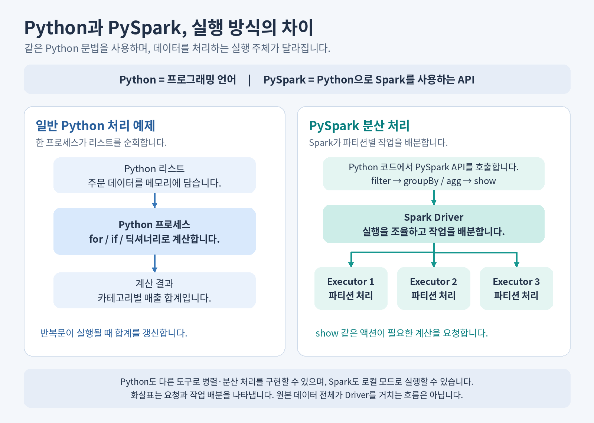

# 06. Spark는 일을 어떻게 나눌까요?

**학습 목표:** Python·PySpark의 관계, Driver·Executor, 지연 실행과 결과 수집을 설명합니다.

**선수 지식:** [05장](05-python.md)의 필터와 집계.

## 같은 질문, 다른 실행 방법

| 이름 | 역할 | 이번 예제에서 하는 일 |
| --- | --- | --- |
| Python | 프로그래밍 언어 | 반복문으로 직접 집계하거나 PySpark API를 호출 |
| pandas | Python 표 처리 라이브러리 | 한 컴퓨터의 DataFrame을 집계 |
| Spark | 분산 데이터 처리 엔진 | 데이터를 나눠 처리하고 결과를 결합 |
| PySpark | Spark를 사용하는 Python API | Python 문법으로 Spark의 처리 계획을 표현 |

PySpark는 Python의 대체 언어가 아닙니다. Python으로 Spark에 작업을 요청합니다. Spark는 로컬 실행도 가능하며, 무조건 여러 서버를 사용한다는 뜻은 아닙니다.

## Driver가 조율하고 Executor가 처리합니다



**파티션**은 나눠 처리하는 데이터 단위입니다. **Driver**는 실행 계획과 작업 배분을 조율하고, **Executor**는 배정받은 **Task**를 실행합니다. 파티션 수·Executor 수·서버 수는 같은 값일 필요가 없습니다.

카테고리별 집계는 각 부분의 합계를 구한 뒤 같은 카테고리끼리 결합할 수 있습니다. 이때 데이터를 파티션 사이에서 다시 나누는 과정이 **Shuffle**입니다. 계산 외에 통신과 결합 비용이 있으므로, 주문 다섯 건에서는 Spark가 더 빠를 것이라고 기대하지 않습니다.

## DataFrame은 처리 계획을 표현합니다

Spark DataFrame은 행·열 구조와 연산을 표현하는 객체입니다. 모든 결과가 이미 Python 메모리에 들어 있다는 뜻은 아닙니다. 아래 코드는 개념 설명이며, 전체 실행은 07장 실습에서 합니다.

```python
from pyspark.sql import functions as F

sales_df = (
    orders_df
    .filter(F.col("status") == "paid")
    .groupBy("category")
    .agg(F.sum("amount").alias("total_amount"))
)
sales_df.show()
```

| 코드 | 의미 | 분류 |
| --- | --- | --- |
| `filter(...)` | 결제 완료 행 선택 | Transformation: 변환 계획 |
| `groupBy(...).agg(...)` | 카테고리별 금액 합산 | Transformation: 변환 계획 |
| `show()` | 결과 일부 표시를 요청 | Action: 실행 요청 |

필요할 때 계산을 실행하는 방식을 **지연 실행**이라고 합니다. Spark는 전체 계획을 보고 필요한 열·조건·연산을 고려해 실행을 최적화할 수 있습니다. 지연 실행이 스키마 확인 같은 모든 준비 작업까지 미룬다는 뜻은 아닙니다. [Spark DataFrame 공식 안내](https://spark.apache.org/docs/latest/api/python/getting_started/quickstart_df.html)

## 분산 처리 뒤 결과를 어디로 보낼까요?

| 목적 | 예 | 주의할 점 |
| --- | --- | --- |
| 일부 결과 확인 | `show(20)` | 표시할 행을 제한하지만 계산 비용까지 항상 작아지는 것은 아님 |
| 행 수 확인 | `count()` | 숫자 하나를 받지만 원본을 읽는 비용은 있을 수 있음 |
| 전체 결과를 Python으로 수집 | `collect()`, `toPandas()` | 결과 전체가 수신 프로세스 메모리에 들어가야 함 |
| 큰 결과 보관 | 테이블·파일로 쓰기 | 전체 결과를 Python 리스트로 모으지 않고 저장 |

**입력이 큰지와 반환 결과가 큰지를 구분합니다.** 이번 두 행의 집계는 수집해 비교할 수 있지만, 수억 행 원본을 수집하면 메모리가 부족할 수 있습니다. 이를 OOM이라고 합니다. Spark Connect에서는 원격 Spark와 연결된 클라이언트의 수신 메모리도 고려합니다.

## 확인 문제

1. `sales_df`를 정의하면 결과가 모두 Python 리스트로 계산되어 있나요?
2. Executor를 늘리면 `toPandas()`의 메모리 문제도 자동으로 해결되나요?
3. 같은 다섯 행을 집계할 때 Spark가 느리다면 잘못 실행된 것인가요?

<details>
<summary>해설</summary>

1. 아닙니다. 변환은 처리 계획을 만들고, 결과 조회·저장 같은 Action이 계산을 요청합니다.
2. 아닙니다. 전체 결과를 받는 프로세스의 메모리 한계는 별도입니다.
3. 아닙니다. 작은 작업에서는 준비·통신 비용이 계산에서 절약한 시간보다 클 수 있습니다.

</details>

**더 알아보기:** [지연 실행과 OOM](../python-vs-pyspark.md#transformations-and-actions), [JVM·Python worker·Spark Connect](../python-pyspark-runtime.md).

[이전: 05. Python 집계](05-python.md) · [전체 목차](../../README.md) · [다음: 07. Databricks](07-databricks.md)
