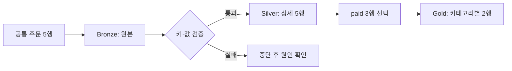

# 09. Bronze → Silver → Gold를 만듭니다

**학습 목표:** 원본·검증된 상세·집계 테이블을 연결하고 재실행 결과를 확인합니다.

**선수 지식:** [08장](08-unity-catalog.md)의 테이블 이름과 권한. 실습 3에는 관리형 테이블 생성이 가능한 개인 연습 스키마가 필요합니다.

## 왜 세 단계로 나누나요?

결과 합계만 남기면 오류가 생겼을 때 어디에서 잘못되었는지 확인하기 어렵습니다. 원본과 중간 결과를 나누면 다시 계산하거나 업무 기준을 바꾸기 쉽습니다.

| 단계 | 역할 | 이번 실습의 테이블 | 행 수 |
| --- | --- | --- | --- |
| Bronze | 받은 원본을 보관 | `edu_bronze_orders` | 5 |
| Silver | 자료형·키·값이 유효한 상세 데이터 | `edu_silver_orders` | 5 |
| Gold | 특정 질문에 맞춘 집계 결과 | `edu_gold_category_sales` | 2 |

Silver에는 정상적인 취소 주문도 남깁니다. Gold를 만들 때만 `paid`를 선택합니다. Bronze·Silver·Gold는 논리적 역할이므로 세 서버나 세 카탈로그를 반드시 만들어야 하는 것은 아닙니다. 이번에는 한 개인 스키마 안의 테이블 이름으로 구분합니다. [Medallion 아키텍처](https://docs.databricks.com/aws/en/lakehouse/medallion)

## 무엇을 검증하나요?

| 규칙 | 이유 | 이번 실습의 처리 |
| --- | --- | --- |
| 주문 ID는 존재하며 중복되지 않음 | 중복 합산 방지 | 실패하면 중단 |
| 금액은 존재하며 0 이상 | 누락·음수 입력을 이번 샘플의 오류로 정의 | 실패하면 중단 |
| 카테고리는 비어 있지 않음 | 분류 기준 누락 방지 | 실패하면 중단 |
| 상태는 `paid` 또는 `cancelled` | 알 수 없는 상태를 임의로 제외하지 않음 | 실패하면 중단 |

실무에서는 오류 행 격리, 원본 수정 요청, 변경 시각에 따른 중복 해소 등 정책을 정합니다. 이 샘플에는 변경 시각이 없으므로 중복 중 어느 행이 최신인지 판단하지 않습니다. 무조건 하나를 지우는 대신 중단합니다.

## 실습 3: 이름 있는 테이블로 남깁니다

[실습 3 안내](../labs/03-medallion.md)에 따라 [SQL 노트북](../../labs/03_medallion.sql)을 실행합니다. 실습 2의 세션 상태에 의존하지 않도록 입력부터 다시 생성합니다.

1. 개인 연습 카탈로그·스키마를 선택합니다.
2. 같은 주문 다섯 건을 Bronze 테이블로 만듭니다.
3. 검증 쿼리가 통과하면 Silver 테이블을 만듭니다.
4. Gold에서 카테고리별 금액을 구합니다.
5. 행 수·합계를 확인하고 처음부터 다시 실행해 비교합니다.

`CREATE OR REPLACE TABLE ... AS SELECT ...`는 조회 결과로 테이블을 만들거나 기존 내용을 교체합니다. `USING DELTA`는 테이블 형식을 지정합니다. 저장 경로를 지정하지 않으므로 관리형 테이블이 됩니다. [테이블 생성 구문](https://docs.databricks.com/aws/en/sql/language-manual/sql-ref-syntax-ddl-create-table-using)

## 재실행을 이해합니다

같은 입력으로 다시 실행해도 Gold는 book=20000, food=15000이어야 합니다. 이번 실습은 **전체 스냅샷을 교체**하기 때문에 반복 실행으로 금액을 덧붙이지 않습니다. 같은 입력을 반복 반영해도 결과 데이터가 같다는 성질을 멱등성이라고 합니다. 테이블 이력과 실행 시각까지 동일하다는 뜻은 아닙니다.

이 방식은 작은 전체 스냅샷 연습입니다. 새 주문만 오는 **증분 입력**에 그대로 적용하면 기존 주문이 사라집니다. 또 세 테이블 전체를 하나의 트랜잭션으로 묶은 것이 아니므로 중간 실패 시 새 Bronze와 이전 Gold가 함께 남을 수 있습니다. 실패한 실행의 결과를 최신이라고 공개하지 않는 운영 설계는 후속 과정입니다.

## 확인 문제

1. Silver가 3행이어야 하나요, 5행이어야 하나요?
2. 같은 결과를 매번 추가 저장하면 어떤 문제가 있나요?
3. 검증 셀에서 오류가 나면 Silver 생성 셀을 따로 실행해도 되나요?

해설

1. 취소도 유효한 상태이므로 Silver는 5행입니다. `paid` 필터는 Gold에서 적용합니다.
2. 같은 스냅샷을 중복 반영해 집계가 부풀 수 있습니다. 입력의 의미와 쓰기 방식을 함께 설계해야 합니다.
3. 안 됩니다. 원인을 해결하고 처음부터 다시 실행합니다. 검증을 건너뛰면 품질 조건이 보장되지 않습니다.

**더 알아보기:** [데이터 품질과 계층](../data-engineering-lakehouse-ai.md#medallion), [후속 과정의 증분 처리·복구](../roadmap.md).

[이전: 08. Unity Catalog](08-unity-catalog.md) · [전체 목차](../../README.md) · [다음: 10. 분석·AI](10-analytics-and-ai.md)
