# Data Engineering에서 Lakehouse와 AI까지

> **심화 참고 자료입니다.** 처음 배우는 경우 [01. 데이터 엔지니어링](course/01-data-engineering.md) → [04. Lakehouse](course/04-lakehouse.md) → [09. 파이프라인](course/09-pipeline.md) → [10. 분석·AI](course/10-analytics-and-ai.md) 순서의 입문 본문을 먼저 읽습니다. 이 문서는 각 주제의 상세 설명을 제공합니다. [전체 학습 순서](../README.md) · [심화 자료 색인](reference/README.md)

**Data Engineering은 데이터를 수집·정리·저장하고, 필요한 사람이 필요한 시점에 믿고 사용할 수 있도록 시스템을 만드는 일입니다.** 분석 보고서와 AI 모델은 이 시스템이 공급하는 데이터를 사용합니다.

이 문서는 온라인 쇼핑몰을 예로 들어 **그림 13장**으로 역할·기술셋·저장 구조·AI 연결을 설명합니다. 도구 이름은 구현 예시이며, 모든 제품을 동시에 도입하거나 배워야 한다는 뜻은 아닙니다.

<a id="contents"></a>

## 목차

- [1. Data Engineering은 어떤 일을 합니까?](#what-is-data-engineering)
- [2. 어떤 기술셋을 어떤 순서로 배웁니까?](#skills)
- [3. DB·Data Mart·Data Warehouse는 어떻게 다릅니까?](#db-mart-warehouse)
- [4. Data Warehouse와 Data Lake는 어떻게 다릅니까?](#warehouse-vs-lake)
- [5. Data Lake·Warehouse·Lakehouse는 어떻게 다릅니까?](#architectures)
- [6. 원본 데이터를 믿을 수 있는 데이터로 만듭니다](#medallion)
- [7. Lakehouse는 AI의 학습과 추론에 데이터를 공급합니다](#machine-learning)
- [8. 생성형 AI의 RAG에서도 데이터 파이프라인이 필요합니다](#rag)
- [9. Databricks에서는 어떻게 연결합니까?](#databricks)
- [10. 용어집](#glossary)

<a id="what-is-data-engineering"></a>

## 1. Data Engineering은 어떤 일을 합니까?

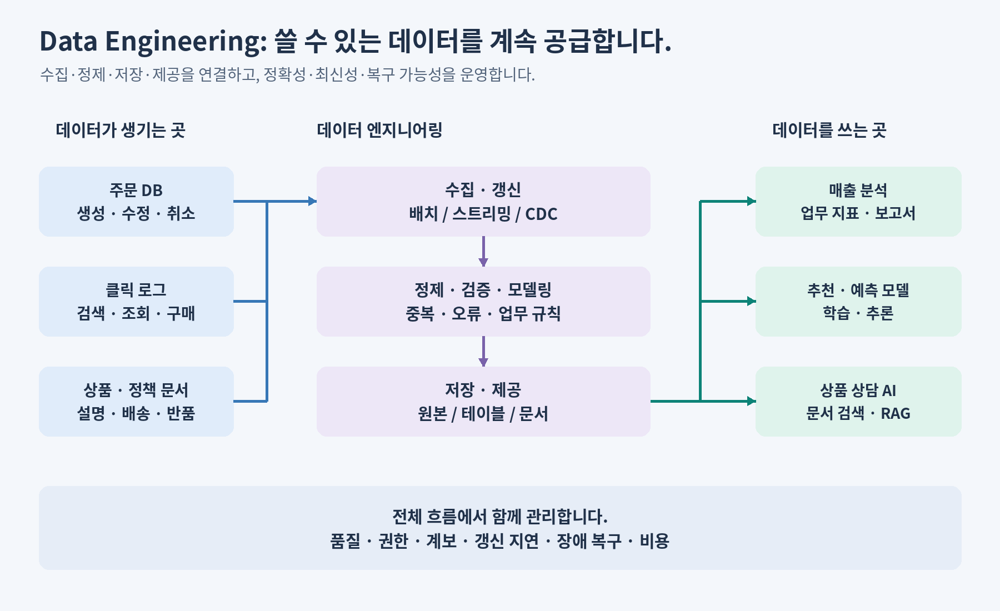

쇼핑몰에서 “어제 매출은 얼마입니까?”와 “이 고객에게 무엇을 추천합니까?”에 답하려면 주문·취소·고객·상품 데이터가 연결되어야 합니다. 데이터 엔지니어는 이 연결을 반복 가능하고 안정적인 파이프라인으로 구현합니다. [Databricks의 Data Engineering 개요](https://docs.databricks.com/aws/en/data-engineering/)

| 업무 | 쇼핑몰에서 확인하는 질문 |
| --- | --- |
| 수집·갱신 | 새 주문과 주문 취소를 빠뜨리지 않고 가져옵니까? |
| 정제·모델링 | 같은 주문의 중복을 제거하고, 상품·고객과 올바르게 연결합니까? |
| 품질·제공 | 매출 정의가 일관되며, 사용자가 데이터를 이해하고 조회할 수 있습니까? |
| 운영·복구 | 실패한 작업을 다시 실행해도 매출이 두 번 더해지지 않습니까? |
| 권한·비용 | 필요한 사용자에게만 제공하고, 처리량과 비용을 관리합니까? |

**한 번 실행되는 집계 코드와, 매일 정확한 결과를 제공하는 시스템은 요구 사항이 다릅니다.** 최신성·완전성·정확성·복구 가능성까지 고려해야 합니다.

| 협업 역할 | 주로 책임지는 결과 |
| --- | --- |
| 데이터 엔지니어 | 안정적인 수집·변환·제공 파이프라인과 데이터 품질입니다. |
| 데이터 분석가·Analytics Engineer | 지표 정의, 분석용 모델, 보고서와 비즈니스 해석입니다. |
| 데이터 과학자 | 가설 검증, 특징·모델 실험, 예측 성능 평가입니다. |
| ML·AI 엔지니어 | 모델·AI 애플리케이션의 배포, 서빙, 성능·품질 운영입니다. |

역할의 경계는 조직마다 다르며, 작은 팀에서는 한 사람이 여러 역할을 수행합니다.

<a id="skills"></a>

## 2. 어떤 기술셋을 어떤 순서로 배웁니까?

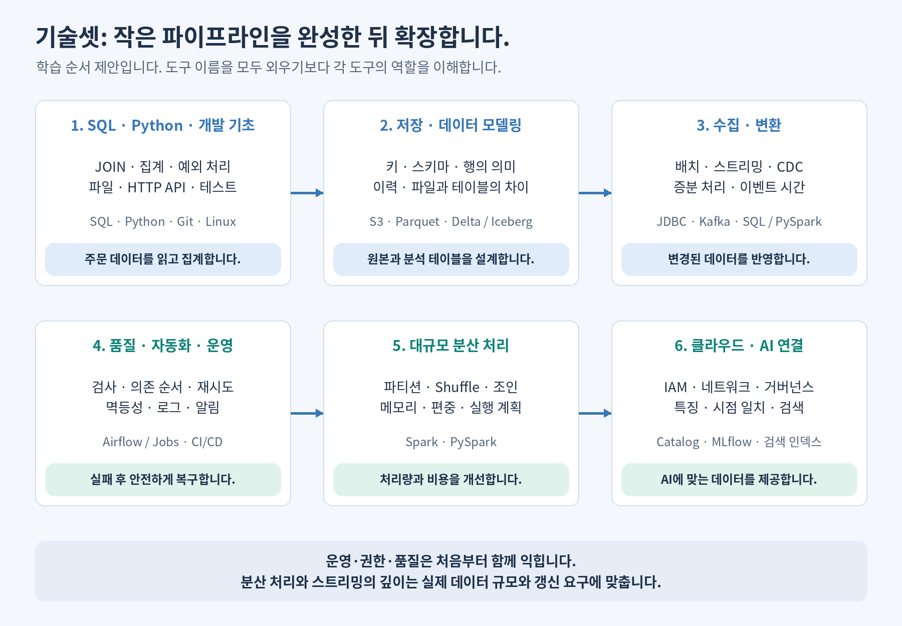

**처음에는 SQL·Python으로 작은 파이프라인을 끝까지 만들어 봅니다.** 데이터 크기나 갱신 주기 때문에 한계가 생기면 분산 처리·스트리밍으로 확장합니다. 아래 순서는 이 교육 과정의 학습 제안입니다.

| 역량 | 알아야 할 개념 | 도구·기술 예시 |
| --- | --- | --- |
| SQL·데이터베이스 | JOIN, GROUP BY, 윈도 함수, NULL, 키, 트랜잭션, 실행 계획입니다. | SQL, PostgreSQL, MySQL입니다. |
| Python·개발 기초 | 파일·API 처리, 함수, 예외, 테스트, 패키지·환경 관리입니다. | Python, Git, Linux 셸, HTTP입니다. |
| 저장·데이터 모델링 | 파일과 테이블의 차이, 스키마, 행의 의미인 grain, 이력, 파티션입니다. | S3, Parquet, Delta Lake, Apache Iceberg입니다. |
| 수집·변환 | 배치·스트리밍, CDC, ETL·ELT, 증분 처리, 이벤트 시간입니다. | JDBC, Kafka, SQL, PySpark입니다. |
| 작업 조율·품질·운영 | 의존 순서, 재시도, 멱등성, 재처리, 품질 검사, 로그·알림입니다. | Airflow 또는 Lakeflow Jobs, CI/CD입니다. |
| 분산 처리 | 파티션, Shuffle, 데이터 편중, 메모리, 조인 전략입니다. | Spark, PySpark, Structured Streaming입니다. |
| 클라우드·거버넌스 | IAM, 네트워크, 암호화, 카탈로그, 계보, 보존 정책, 비용입니다. | 클라우드 저장·컴퓨팅, Unity Catalog, IaC입니다. |
| AI 데이터 제공 | 특징·레이블, 시점 일치, 학습·평가 분리, 문서 청킹·검색, 갱신입니다. | MLflow, 특징 테이블, 임베딩·검색 인덱스입니다. |

SQL은 데이터 변환에, Spark는 분산 계산에, Kafka는 이벤트 전달·보관에, Airflow·Jobs는 작업 실행 순서 조율에 사용합니다. 역할이 다른 도구이므로 하나가 나머지를 모두 대체하는 관계는 아닙니다. [Kafka 개요](https://kafka.apache.org/intro/), [Airflow 구조](https://airflow.apache.org/docs/apache-airflow/stable/core-concepts/overview.html), [Lakeflow Jobs](https://docs.databricks.com/aws/en/jobs/)

입문 실습의 완료 기준은 **“주문 데이터를 매일 읽어 집계하고, 중복·오류를 검사하며, 실패 후 다시 실행해도 같은 결과를 만든다”**로 잡습니다. 기존 자료의 [Python·PySpark](python-vs-pyspark.md), [저장소](storage-systems-and-python.md), [런타임 구조](python-pyspark-runtime.md)를 함께 활용합니다.

<a id="db-mart-warehouse"></a>

## 3. DB·Data Mart·Data Warehouse는 어떻게 다릅니까?

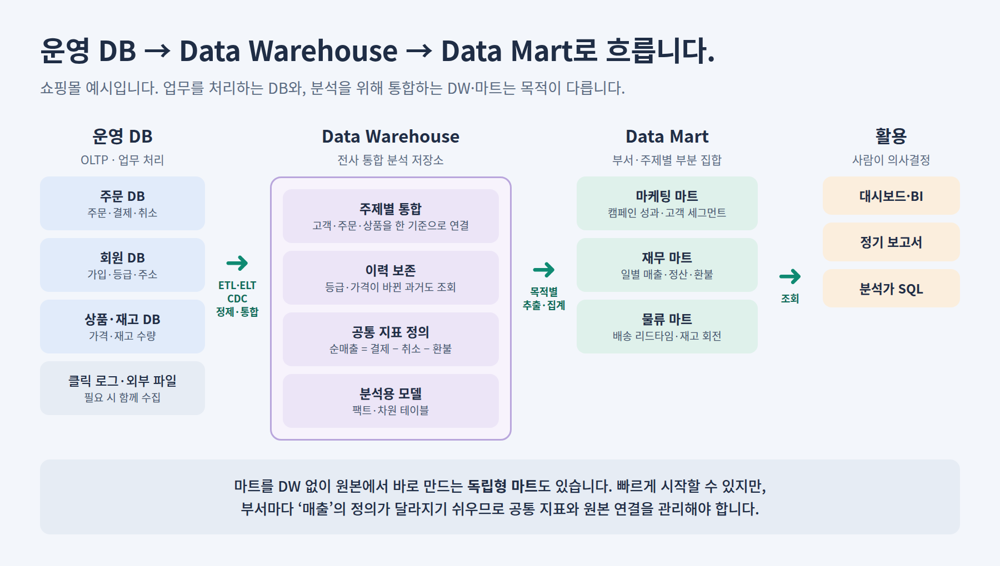

**운영 DB는 업무를 실행하고, Data Warehouse는 전사 데이터를 분석용으로 통합하며, Data Mart는 특정 부서·주제가 쓰기 쉽게 범위를 좁힙니다.** 셋 다 데이터를 저장하지만, 누가 어떤 질문을 하는지가 다르기 때문에 설계도 달라집니다.

쇼핑몰에서 고객이 주문 버튼을 누르면 **주문 DB**에 주문이 저장됩니다. 밤사이 주문·회원·상품 DB의 데이터가 **Data Warehouse(DW)**로 모여 하나의 기준으로 연결됩니다. 마케팅팀은 DW에서 캠페인·고객 데이터만 추린 **마케팅 마트**를 사용합니다.

### 운영 DB와 DW는 질문의 모양이 다릅니다

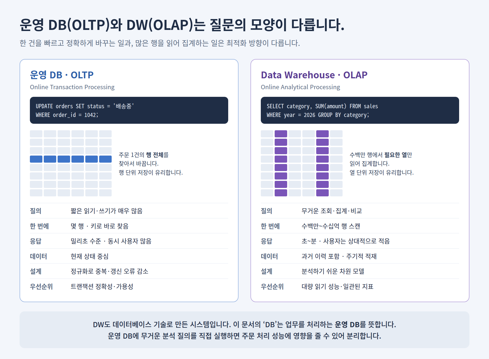

| 구분 | 운영 DB · OLTP | Data Warehouse · OLAP |
| --- | --- | --- |
| 대표 질의 | `UPDATE orders SET status = '배송중' WHERE order_id = 1042` | `SELECT category, SUM(amount) ... GROUP BY category` |
| 한 번에 다루는 양 | 키로 찾은 몇 개의 행입니다. | 수백만~수십억 행을 스캔합니다. |
| 요청 특성 | 짧은 읽기·쓰기가 매우 많고, 빠른 응답이 필요합니다. | 상대적으로 적은 수의 무거운 조회·집계입니다. |
| 데이터 시점 | 현재 상태가 중심입니다. | 과거 이력을 보존하고 주기적·증분으로 적재합니다. |
| 설계 | 정규화로 중복과 갱신 오류를 줄입니다. | 분석하기 쉬운 팩트·차원 모델을 사용합니다. |
| 저장 방식 경향 | 행 단위 저장이 유리합니다. | 필요한 열만 읽는 열 단위 저장이 유리합니다. |

**운영 DB에 무거운 분석 질의를 직접 실행하면 주문 처리 성능에 영향을 줄 수 있습니다.** 그래서 분석용 데이터를 DW로 분리합니다. 이 문서의 “DB”는 업무를 처리하는 운영 DB를 뜻합니다. DW도 넓은 의미로는 데이터베이스 기술로 구현한 시스템입니다. [OLTP와 OLAP 비교](https://aws.amazon.com/compare/the-difference-between-olap-and-oltp/)

### DW와 마트는 팩트와 차원으로 모델링합니다

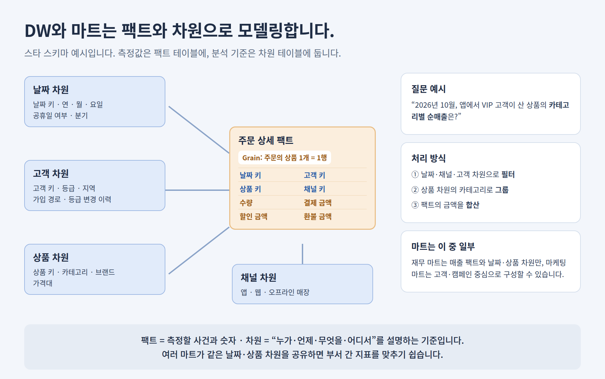

**팩트 테이블은 측정할 사건과 숫자를, 차원 테이블은 “누가·언제·무엇을·어디서”라는 분석 기준을 담습니다.** 팩트를 가운데 두고 차원을 둘러 연결한 모양을 **스타 스키마**라고 합니다. [Kimball 차원 모델링 기법](https://www.kimballgroup.com/data-warehouse-business-intelligence-resources/kimball-techniques/dimensional-modeling-techniques/)

- 주문 상세 팩트의 grain을 “주문의 상품 1개 = 1행”으로 먼저 정합니다. grain이 모호하면 매출이 중복 합산됩니다.
- 고객 등급처럼 시간이 지나며 바뀌는 속성은 변경 이력을 남겨야 “구매 당시 VIP였던 고객”의 매출을 계산할 수 있습니다.
- 여러 마트가 같은 날짜·상품 차원을 공유하면 마케팅과 재무의 상품별 매출을 같은 기준으로 비교할 수 있습니다.

### 세 가지를 한 번에 비교합니다

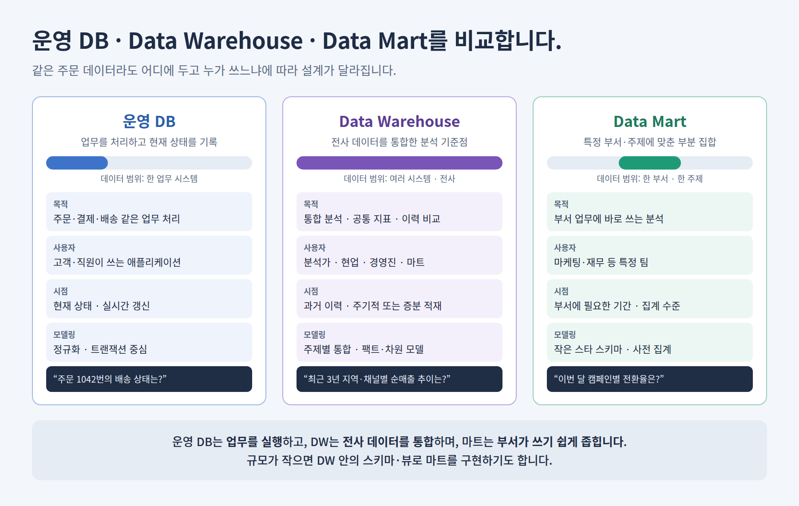

| 구분 | 운영 DB | Data Warehouse | Data Mart |
| --- | --- | --- | --- |
| 목적 | 주문·결제·배송 같은 업무를 처리합니다. | 여러 시스템의 데이터를 통합하여 전사 분석 기준을 제공합니다. | 특정 부서·주제의 분석을 쉽고 빠르게 합니다. |
| 데이터 범위 | 한 업무 시스템입니다. | 여러 시스템·전사입니다. | DW 또는 원본의 일부입니다. |
| 주 사용자 | 고객·직원이 사용하는 애플리케이션입니다. | 분석가·현업·경영진, 그리고 마트입니다. | 마케팅·재무·물류 등 특정 팀입니다. |
| 데이터 시점 | 현재 상태를 실시간으로 갱신합니다. | 과거 이력을 포함하고 주기적·증분으로 적재합니다. | 부서에 필요한 기간과 집계 수준입니다. |
| 모델링 | 정규화·트랜잭션 중심입니다. | 주제별 통합, 팩트·차원 모델입니다. | 작은 스타 스키마, 사전 집계 테이블입니다. |
| 대표 질문 | “주문 1042번의 배송 상태는?” | “최근 3년 지역·채널별 순매출 추이는?” | “이번 달 캠페인별 전환율은?” |

Data Warehouse를 처음 정의한 Bill Inmon은 DW의 특징을 **주제 중심·통합·시간에 따른 변화 보존·비휘발성**으로 설명했습니다. 비휘발성은 분석용 데이터를 업무 처리처럼 수시로 덮어쓰지 않고 이력으로 쌓는다는 뜻입니다.

마트를 만드는 방식은 두 가지입니다.

| 방식 | 설명 | 고려할 점 |
| --- | --- | --- |
| 종속형 마트 | DW에서 필요한 부분을 추출하여 만듭니다. | 지표 정의가 DW와 일치하지만, DW 구축이 먼저 필요합니다. |
| 독립형 마트 | 원본 DB에서 직접 만듭니다. | 빠르게 시작할 수 있지만, 부서마다 “매출” 정의가 달라지기 쉽습니다. |

규모가 작으면 마트를 별도 시스템으로 만들지 않고 DW 안의 스키마나 뷰로 구현하기도 합니다. **중요한 것은 저장 위치보다 “누가 어떤 정의로 데이터를 쓰는가”를 관리하는 것입니다.**

<a id="warehouse-vs-lake"></a>

## 4. Data Warehouse와 Data Lake는 어떻게 다릅니까?

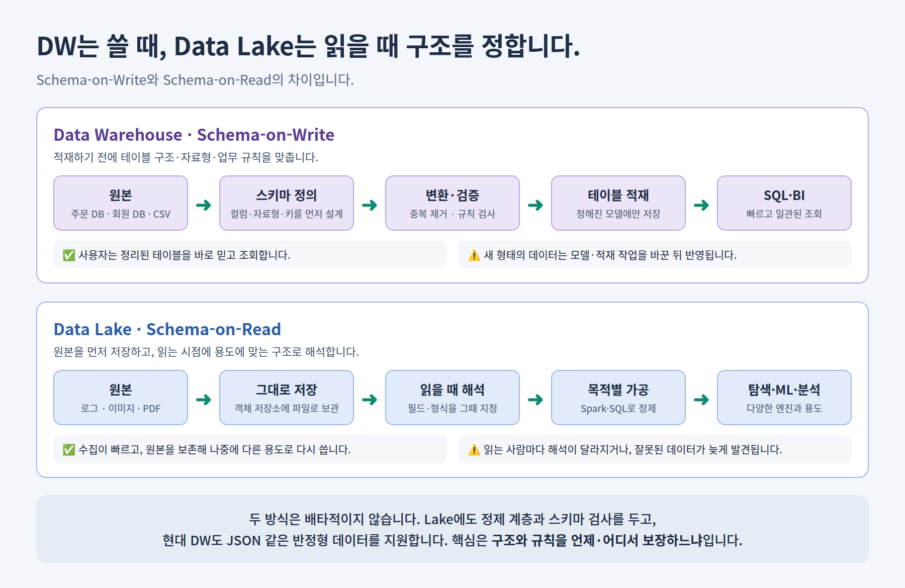

**DW는 데이터를 저장하기 전에 구조와 규칙을 맞추고(Schema-on-Write), Data Lake는 먼저 저장한 뒤 읽을 때 구조를 정합니다(Schema-on-Read).** 이 시점의 차이가 유연성·신뢰성·사용자를 가릅니다.

쇼핑몰에 새로 “앱 클릭 로그”가 들어온다고 가정합니다.

- **DW**: 로그의 어떤 필드를 어떤 컬럼·자료형으로 저장할지 먼저 설계하고 적재 작업을 만듭니다. 이후 분석가는 정리된 테이블을 바로 조회합니다.
- **Data Lake**: 로그 JSON을 객체 저장소에 그대로 쌓습니다. 데이터 과학자가 필요해지면 그때 필드를 골라 해석합니다. 나중에 다른 용도가 생겨도 원본에서 다시 시작할 수 있습니다.

```python
# Data Lake: 저장된 JSON을 읽는 시점에 구조를 해석합니다.
clicks = spark.read.json("s3://shop-lake/raw/app_clicks/2026/11/10/")
clicks.select("user_id", "page", "event_time").where("page = 'product'")
```

```sql
-- Data Warehouse: 적재하기 전에 구조를 정의합니다.
CREATE TABLE fact_click (
  click_date_key INT, customer_key BIGINT, page VARCHAR(50), event_time TIMESTAMP
);
```

### 두 구조를 항목별로 비교합니다

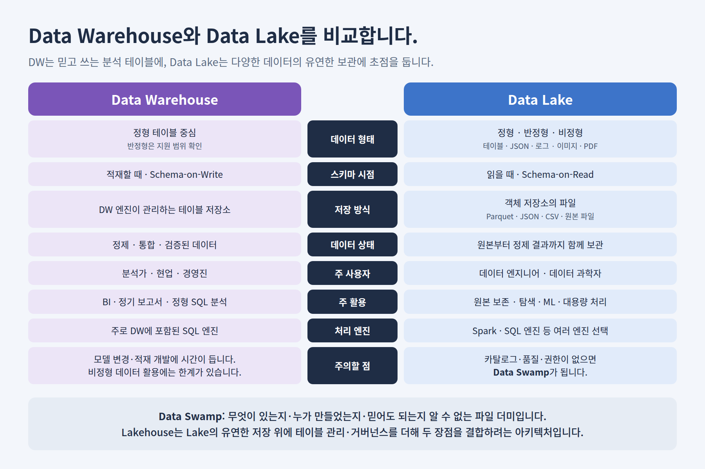

| 항목 | Data Warehouse | Data Lake |
| --- | --- | --- |
| 데이터 형태 | 정형 테이블이 중심이며, 반정형 지원 범위는 제품마다 다릅니다. | 정형·반정형·비정형(로그·이미지·PDF)을 모두 보관합니다. |
| 스키마 시점 | 적재할 때 정합니다(Schema-on-Write). | 읽을 때 정합니다(Schema-on-Read). |
| 저장 방식 | DW 엔진이 관리하는 테이블 저장소입니다. | 객체 저장소의 파일(Parquet·JSON·CSV·원본 파일)입니다. |
| 데이터 상태 | 정제·통합·검증된 데이터입니다. | 원본부터 정제 결과까지 함께 보관합니다. |
| 주 사용자 | 분석가·현업·경영진입니다. | 데이터 엔지니어·데이터 과학자입니다. |
| 주 활용 | BI·정기 보고서·정형 SQL 분석입니다. | 원본 보존·탐색·ML·대용량 처리입니다. |
| 처리 엔진 | 주로 DW에 포함된 SQL 엔진입니다. | Spark·SQL 엔진 등 여러 엔진을 선택합니다. |
| 주의할 점 | 모델 변경·적재 개발에 시간이 들고, 비정형 데이터 활용에 한계가 있습니다. | 카탈로그·품질·권한 관리가 없으면 Data Swamp가 됩니다. |

**Data Swamp는 무엇이 있는지, 누가 만들었는지, 믿어도 되는지 알 수 없는 파일 더미가 된 Data Lake를 말합니다.** 파일을 많이 모으는 것만으로는 가치가 생기지 않습니다. 카탈로그·소유자·품질 검사·접근 권한을 함께 설계해야 합니다.

두 구조는 서로를 대체하기보다 함께 쓰는 경우가 많았습니다. 원본은 Lake에 보관하고, 정제한 일부를 DW로 다시 적재하여 BI에 제공하는 식입니다. 이 구성은 데이터 복사·적재 지연·이중 관리 부담을 만들었고, **이 문제를 줄이려는 시도가 다음 절의 Lakehouse입니다.** [Data Warehouse 개요](https://aws.amazon.com/what-is/data-warehouse/), [Data Lake와 DW 비교](https://aws.amazon.com/compare/the-difference-between-a-data-warehouse-data-lake-and-data-mart/)

<a id="architectures"></a>

## 5. Data Lake·Warehouse·Lakehouse는 어떻게 다릅니까?

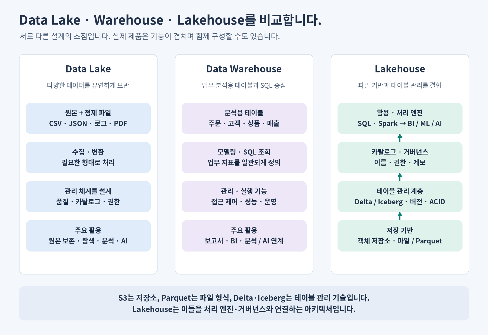

| 구조 | 중심 생각 | 장점 | 설계할 때 고려할 점 |
| --- | --- | --- | --- |
| Data Lake | 정형·반정형·비정형 데이터를 유연하게 보관합니다. | 원본 보존과 다양한 활용에 유리합니다. | 발견·품질·권한 관리를 설계하지 않으면 사용하기 어려운 파일이 쌓입니다. |
| Data Warehouse | 분석용 테이블과 업무 지표를 체계적으로 관리합니다. | SQL 분석과 일관된 보고에 적합합니다. | 모델·적재 방식·원본과의 연결을 관리해야 합니다. |
| Lakehouse | Lake의 저장 기반에 신뢰할 수 있는 테이블 관리와 분석 기능을 결합합니다. | BI와 ML이 공통 데이터 기반을 활용할 수 있습니다. | 테이블 형식·엔진·카탈로그의 호환성과 운영 구성이 필요합니다. |

Data Lake에도 품질·권한 관리를 적용할 수 있고, 현대적인 Warehouse도 AI 기능을 제공할 수 있습니다. 세 구조를 “나쁜 과거 → 좋은 미래”로만 구분하기보다 데이터 종류와 활용 목적에 맞춰 비교합니다. [Data Lake 개요](https://aws.amazon.com/what-is/data-lake/), [Lakehouse 개념](https://www.databricks.com/blog/what-is-data-lakehouse)

### S3·Parquet·Delta Lake·Lakehouse의 역할은 다릅니다

| 구성 요소 | 역할 |
| --- | --- |
| S3 같은 객체 저장소 | 파일·객체를 저장합니다. |
| Parquet 같은 파일 형식 | 열 단위로 데이터를 표현하고 저장합니다. |
| Delta Lake·Iceberg 같은 테이블 관리 기술 | 여러 파일을 테이블의 일관된 버전으로 관리하고, 스키마·트랜잭션 기능을 제공합니다. |
| 카탈로그·거버넌스 | 데이터의 이름·설명·소유자·접근 권한·계보를 관리합니다. |
| Spark·SQL 등의 엔진 | 데이터를 읽고 변환·조회합니다. |
| Lakehouse | 이 구성 요소를 연결하여 분석·AI에 활용하는 아키텍처입니다. |

**파일을 S3에 올렸다는 사실만으로 Lakehouse의 모든 기능이 생기지는 않습니다.** Delta Lake와 Iceberg는 대표적인 선택지이며, 둘을 반드시 함께 사용해야 하는 것은 아닙니다. PDF·이미지 원본은 파일로 보관하고, 그 위치·메타데이터·추출 결과를 테이블로 관리할 수도 있습니다. [Delta Lake](https://delta.io/), [Apache Iceberg](https://iceberg.apache.org/docs/latest/)

<a id="medallion"></a>

## 6. 원본 데이터를 믿을 수 있는 데이터로 만듭니다

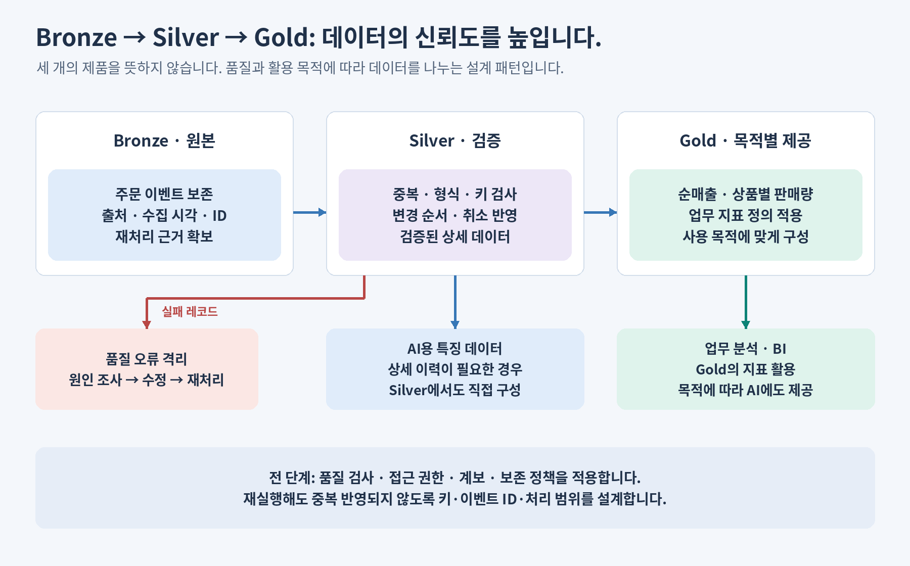

Bronze·Silver·Gold는 데이터 품질과 용도를 단계적으로 구분하는 **Medallion 설계 패턴**입니다. 반드시 세 개의 저장 시스템을 설치해야 하는 규칙은 아닙니다. [Databricks Medallion 가이드](https://docs.databricks.com/aws/en/lakehouse/medallion)

| 계층 | 쇼핑몰 예시 | 확인하는 내용 |
| --- | --- | --- |
| Bronze · 원본 | 주문 생성·수정·취소 이벤트를 수집합니다. | 출처·수집 시각·이벤트 ID를 남기고, 보존 정책 범위에서 재처리할 근거를 확보합니다. |
| Silver · 검증 | 주문 키와 변경 순서를 기준으로 상태를 정리합니다. | 중복, 필수 값, 금액·시간 형식, 상품 연결, 취소 반영을 검사합니다. |
| Gold · 목적별 제공 | 일별 순매출·상품별 판매량 등을 만듭니다. | 지표 정의와 집계 기준을 사용자와 합의합니다. |

실패한 레코드는 정책에 따라 격리하고 원인을 확인합니다. 재실행 시에는 주문 키·이벤트 ID·처리 범위 등을 사용하여 **이미 처리한 데이터가 중복 반영되지 않도록** 설계합니다.

AI가 항상 Gold 집계만 사용하는 것은 아닙니다. 고객별 구매 이력을 학습하려면 Silver의 상세 데이터가 더 적합할 수 있습니다. 또 AI 입력에서 특정 컬럼의 누락이 중요한 경우, 전체 행 수만 확인하는 검사로는 품질을 보장할 수 없습니다.

<a id="machine-learning"></a>

## 7. Lakehouse는 AI의 학습과 추론에 데이터를 공급합니다

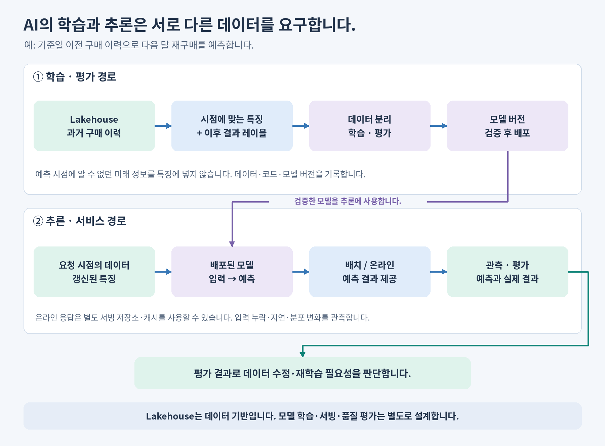

**Lakehouse는 AI 모델 자체가 아니라 학습·평가·추론에 사용할 데이터를 관리하는 기반입니다.** 작은 실험은 CSV나 데이터베이스로도 시작할 수 있습니다. 데이터·사용자·파이프라인이 늘어날 때 공통 관리 기반의 가치가 커집니다.

쇼핑몰의 “다음 달 고객 재구매 예측”을 예로 들면 다음과 같습니다.

| 단계 | 데이터 엔지니어링과 AI의 연결 |
| --- | --- |
| 학습 데이터 | 예측 기준일 이전의 구매 횟수·금액을 특징으로 만들고, 이후 재구매 여부를 레이블로 연결합니다. |
| 학습·평가 | 학습·평가 데이터를 분리하고, 사용한 데이터 버전·변환 코드·모델·지표를 기록합니다. |
| 추론 | 배포한 모델에 요청 시점의 특징을 공급합니다. 배치 예측과 온라인 예측의 갱신·응답 요구는 다릅니다. |
| 운영·개선 | 누락·지연·분포 변화와 실제 예측 품질을 확인하여 데이터 수정이나 재학습 여부를 판단합니다. |

**미래에 알게 된 정보를 과거의 특징에 넣으면 데이터 누출이 발생합니다.** 예를 들어 6월 1일 예측을 학습하면서 6월 구매 금액을 입력으로 사용하면 실제 운영에서 재현할 수 없는 성능이 나옵니다. 시점에 맞는 특징 연결과 데이터 분리 설계가 필요합니다. [시점 일치 특징 연결](https://docs.databricks.com/aws/en/machine-learning/feature-store/time-series)

Lakehouse의 테이블 버전은 재현성에 도움이 되지만, 원본 파일·테이블 이력의 보존 기간과 코드·특징 정의·모델 버전도 함께 관리해야 합니다. 온라인 추론은 낮은 지연 시간이 필요하므로 별도의 서빙 저장소나 캐시를 연결하기도 합니다. 실험·모델 관리에는 [MLflow](https://mlflow.org/docs/latest/ml/) 같은 도구를 사용할 수 있습니다.

<a id="rag"></a>

## 8. 생성형 AI의 RAG에서도 데이터 파이프라인이 필요합니다

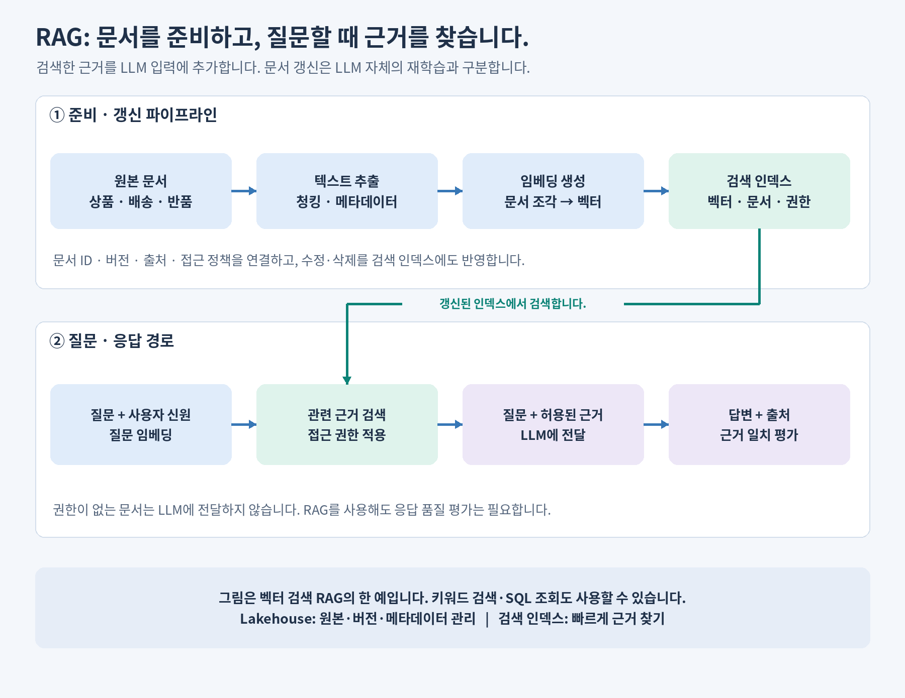

RAG는 질문에 관련된 자료를 검색하여 LLM의 입력에 함께 넣는 방식입니다. 쇼핑몰에서는 상품 설명·배송 규정·반품 정책을 근거로 상담 답변을 생성할 수 있습니다. **RAG의 문서 갱신은 LLM 자체를 다시 학습시키는 작업과 구분합니다.** [Databricks RAG 개요](https://docs.databricks.com/aws/en/agents/retrieval-augmented-generation)

| 구분 | 처리하는 내용 |
| --- | --- |
| 문서 준비·갱신 | 텍스트 추출 → 청킹 → 임베딩 생성 → 검색 인덱스 갱신을 수행합니다. 문서 ID·버전·출처·권한을 함께 관리합니다. |
| 질문·응답 | 질문과 사용자 신원을 받고, 접근 가능한 근거를 검색하여 질문과 함께 LLM에 전달합니다. |
| 품질·운영 | 관련 문서 검색 여부, 답변의 근거 일치, 출처, 응답 시간, 오래되거나 삭제된 문서 반영 여부를 확인합니다. |

그림은 **벡터 검색을 사용하는 RAG의 한 예**입니다. RAG에는 키워드 검색이나 SQL 조회도 사용할 수 있습니다. 검색 인덱스는 검색을 빠르게 하기 위한 파생 데이터이므로, 원본·버전·권한을 관리하는 저장소와 연결해야 합니다.

문서를 새로 저장하는 것만으로 검색 결과가 즉시 최신 상태가 되지는 않습니다. 인덱스 갱신·삭제를 반영하고, **검색 결과를 LLM에 전달하기 전에 사용자 접근 권한을 적용**해야 합니다. 검색을 붙였다고 답변의 정확성이 보장되지는 않으므로 평가도 필요합니다.

<a id="databricks"></a>

## 9. Databricks에서는 어떻게 연결합니까?

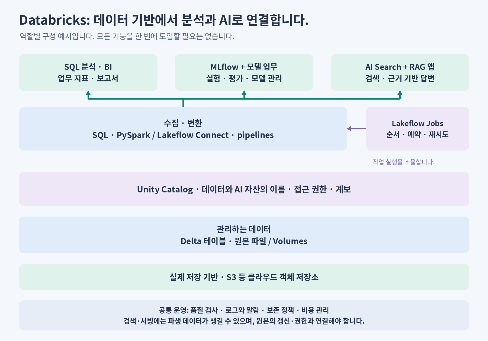

아래는 역할을 이해하기 위한 구성 예시입니다. 기능 사용 가능 여부는 클라우드·워크스페이스 구성에 따라 확인합니다.

| 역할 | Databricks 구성 예시 |
| --- | --- |
| 원본·파일·테이블 저장 | 클라우드 객체 저장소, 파일용 Volumes, Delta 테이블을 사용합니다. |
| 수집·변환 | SQL·PySpark, Lakeflow Connect·pipelines 등을 사용합니다. |
| 실행 순서·재시도 | Lakeflow Jobs로 작업 의존성과 실행을 관리합니다. |
| 이름·권한·계보 | Unity Catalog로 데이터·AI 자산의 접근과 메타데이터를 관리합니다. |
| 분석·모델 | SQL 분석에 데이터를 제공하고, MLflow로 실험·모델을 관리합니다. |
| RAG 검색 | AI Search의 검색 인덱스 등을 연결합니다. 문서별 접근 정책은 애플리케이션 설계에서도 확인합니다. |

Unity Catalog는 [별도 문서](unity-catalog.md)에서 자세히 설명합니다. 제품의 역할은 [Data Engineering](https://docs.databricks.com/aws/en/data-engineering/), [Unity Catalog](https://docs.databricks.com/aws/en/data-governance/unity-catalog/), [Lakeflow Jobs](https://docs.databricks.com/aws/en/jobs/), [AI Search](https://docs.databricks.com/aws/en/ai-search/ai-search) 공식 문서를 참고합니다. AI Search는 이전에 Vector Search라는 이름으로 제공된 기능입니다.

### 학습 결과물은 작은 쇼핑몰 데이터 파이프라인으로 만듭니다

1. 주문 CSV를 읽고, SQL·Python으로 주문 수와 매출을 계산합니다.
2. 원본·검증·집계 데이터를 나누고, 중복 주문·취소·지연 도착 데이터를 반영합니다.
3. 작업을 예약하고, 실패 후 재실행해도 결과가 같으며 오류가 발견되는지 확인합니다.
4. 데이터 규모가 커지면 같은 흐름을 PySpark로 확장하고 실행 계획·비용을 비교합니다.
5. 구매 특징 테이블 또는 상품 문서 검색을 연결하여 AI가 사용하는 데이터가 어디서 왔는지 설명합니다.

<a id="glossary"></a>

## 10. 용어집

| 용어 | 의미 |
| --- | --- |
| Data Engineering | 데이터를 안정적으로 수집·변환·저장·제공하는 시스템을 설계하고 운영하는 일입니다. |
| 파이프라인 | 수집부터 제공까지 여러 처리 단계를 연결한 흐름입니다. |
| 배치 / 스트리밍 | 일정 범위의 데이터를 묶어서 처리하는 방식과, 도착하는 데이터를 지속적으로 처리하는 방식입니다. |
| CDC | Change Data Capture의 약어이며, 원본 데이터의 생성·수정·삭제 변경을 포착하는 방식입니다. |
| ETL / ELT | 추출·변환·적재와 추출·적재·변환의 순서를 각각 뜻합니다. 배치·스트리밍 여부와는 다른 구분입니다. |
| 증분 처리 | 전체 데이터를 매번 처리하는 대신 새로 추가되거나 변경된 범위를 처리하는 방식입니다. |
| 이벤트 시간 | 데이터 수집 시각과 구분되는, 실제 사건이 발생한 시각입니다. |
| 스키마 | 컬럼 이름·자료형 등 데이터 구조에 대한 정의입니다. |
| Grain | 테이블의 한 행이 어떤 대상을 어떤 수준으로 나타내는지에 대한 정의입니다. |
| 파티션 / Shuffle | 데이터를 나눈 단위와, 분산 계산 중 데이터를 작업자 사이에 재분배하는 과정입니다. |
| 운영 DB | 주문·결제처럼 업무를 처리하고 현재 상태를 기록하는 데이터베이스입니다. |
| OLTP / OLAP | 짧은 트랜잭션을 많이 처리하는 업무 처리 방식과, 대량 데이터를 조회·집계하는 분석 처리 방식입니다. |
| 정규화 | 중복을 줄이고 갱신 오류를 막기 위해 데이터를 여러 테이블로 나누는 설계 방식입니다. |
| 행 단위 / 열 단위 저장 | 한 행의 값을 함께 저장하는 방식과, 같은 열의 값을 함께 저장하는 방식입니다. |
| Data Mart | 특정 부서·주제의 분석에 맞춰 DW나 원본에서 필요한 부분만 구성한 데이터 집합입니다. |
| 종속형 / 독립형 마트 | DW에서 추출하여 만든 마트와, 원본에서 직접 만든 마트입니다. |
| 팩트 / 차원 테이블 | 측정할 사건과 숫자를 담는 테이블과, 분석 기준(누가·언제·무엇을·어디서)을 담는 테이블입니다. |
| 스타 스키마 | 팩트 테이블을 중심으로 차원 테이블을 연결한 분석용 모델입니다. |
| Schema-on-Write / Schema-on-Read | 저장하기 전에 구조를 정하는 방식과, 읽는 시점에 구조를 해석하는 방식입니다. |
| Data Swamp | 카탈로그·품질·권한 관리가 없어 찾기 어렵고 믿기 어려운 파일 더미가 된 Data Lake입니다. |
| Data Lake | 다양한 형태의 원본·정제 데이터를 보관하고 활용하는 데이터 저장 기반입니다. |
| Data Warehouse | 업무 분석용 데이터와 지표를 체계적으로 관리·조회하는 시스템입니다. |
| Lakehouse | Lake의 저장 기반과 신뢰할 수 있는 테이블 관리·분석 기능을 결합한 아키텍처입니다. |
| 객체 저장소 | 버킷·키 등으로 식별하는 객체 단위로 데이터를 저장하는 시스템입니다. |
| Parquet | 열 단위로 데이터를 저장하는 파일 형식입니다. |
| Delta Lake / Iceberg | 파일 기반 테이블의 메타데이터·버전·변경을 관리하는 대표적인 기술입니다. |
| ACID | 트랜잭션의 원자성·일관성·격리성·지속성을 뜻합니다. 업무 데이터의 정확성을 자동 보장한다는 뜻은 아닙니다. |
| Medallion | 데이터 품질과 용도를 Bronze·Silver·Gold 등 계층으로 나누는 설계 패턴입니다. |
| 오케스트레이션 / DAG | 작업 순서·실행을 조율하는 일과, 의존성을 순환 없는 방향 그래프로 표현한 구조입니다. |
| 멱등성 | 같은 처리를 반복해도 의도한 최종 상태가 달라지지 않는 성질입니다. |
| 재처리 / Backfill | 데이터를 다시 처리하는 일과, 누락되었거나 추가로 필요한 과거 기간을 채우는 작업입니다. |
| 최신성 / 완전성 | 필요한 시점까지 갱신되었는지와, 기대한 데이터가 빠짐없이 들어왔는지를 뜻합니다. |
| 관측 가능성 | 로그·지표 등으로 시스템의 상태와 문제 원인을 파악할 수 있는 성질입니다. |
| CI/CD / IaC | 변경의 검증·배포를 자동화하는 방식과, 인프라 구성을 코드로 관리하는 방식입니다. |
| 카탈로그 | 데이터·AI 자산의 이름과 메타데이터를 관리하는 체계입니다. |
| 거버넌스 | 데이터의 소유·정의·품질·권한·보존 등 관리 원칙과 운영 체계입니다. |
| 계보 | 데이터가 어디서 왔고 어떤 변환을 거쳐 사용되는지 나타내는 관계입니다. |
| IAM | 사용자·서비스의 신원과 접근 권한을 관리하는 체계입니다. |
| BI | Business Intelligence의 약어이며, 데이터로 업무 현황을 분석하고 의사결정을 지원하는 활동입니다. |
| AI / ML | 인공지능과, 데이터를 통해 모델을 학습하는 머신러닝을 뜻합니다. |
| 특징 / 레이블 | 예측에 사용하는 입력과, 학습·평가에 사용하는 정답 또는 목표값입니다. |
| 학습 / 추론 | 데이터로 모델을 만드는 과정과, 모델에 입력을 넣어 예측·출력을 얻는 과정입니다. |
| 데이터 누출 | 예측 시점에 알 수 없는 정보나 평가 데이터의 정보가 학습에 들어가는 문제입니다. |
| 시점 일치 | 특정 예측 시점에 실제로 알 수 있었던 데이터로 특징을 구성하는 성질입니다. |
| Drift | 입력 데이터나 입력과 결과의 관계 등이 시간에 따라 변하는 현상입니다. |
| 서빙 | 모델·데이터를 실제 요청이나 배치 작업에서 사용할 수 있도록 제공하는 일입니다. |
| MLOps | 모델의 개발·배포·모니터링·갱신을 반복 가능하게 운영하는 활동입니다. |
| LLM | 대규모 언어 모델이며, 텍스트 등의 입력을 바탕으로 응답을 생성합니다. |
| RAG | 관련 자료를 검색하여 모델 입력에 추가하고 응답을 생성하는 방식입니다. |
| 청킹 / 임베딩 | 문서를 검색에 적합한 조각으로 나누는 일과, 내용의 특징을 수치 벡터로 표현하는 일입니다. |
| 벡터 검색 / 인덱스 | 벡터의 유사도로 관련 항목을 찾는 방식과, 검색을 빠르게 하기 위한 자료 구조입니다. |
| Unity Catalog / Volumes | Databricks의 데이터·AI 거버넌스 기능과, 파일을 관리·접근하는 카탈로그 객체입니다. |
| MLflow | 실험·모델·AI 애플리케이션의 추적·평가·관리 등에 사용하는 플랫폼입니다. |

[목차로 돌아갑니다](#contents) · [전체 교육 목차로 돌아갑니다](../README.md)
