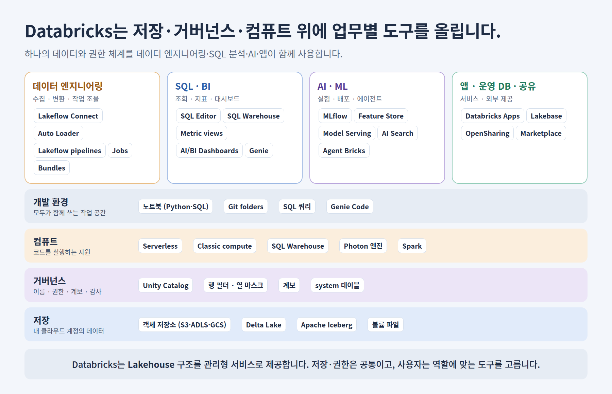
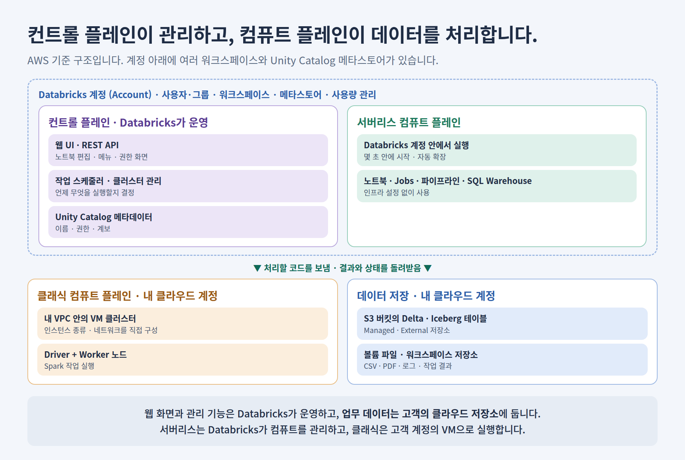
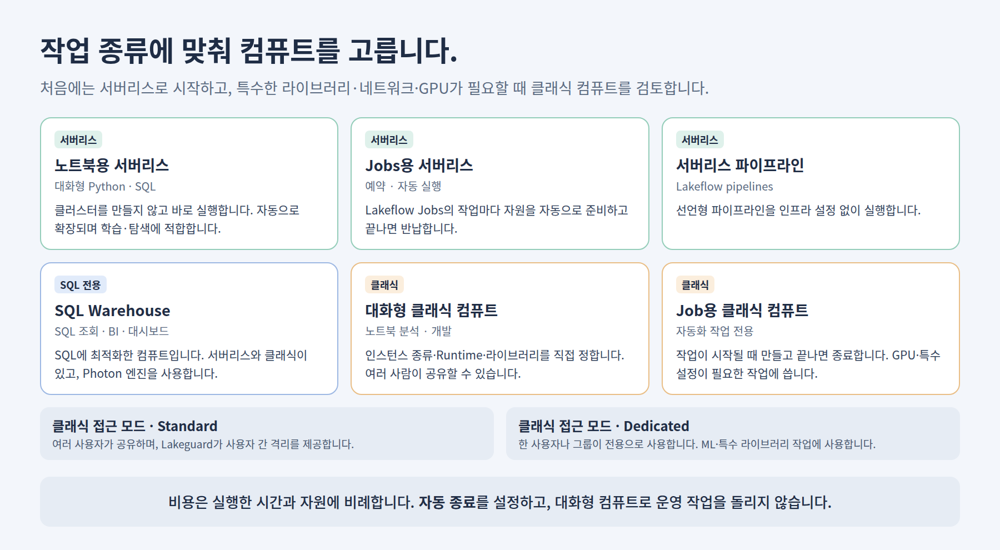
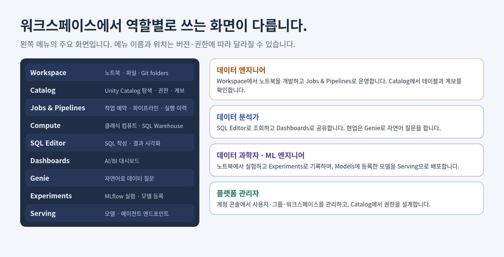
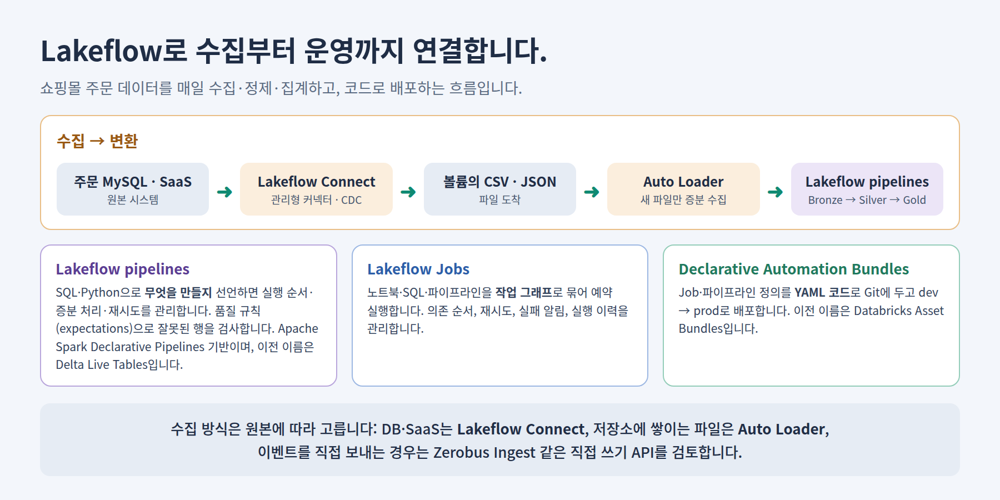
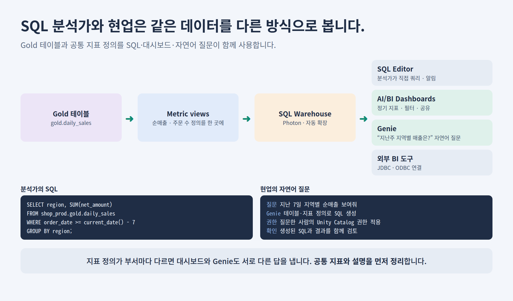
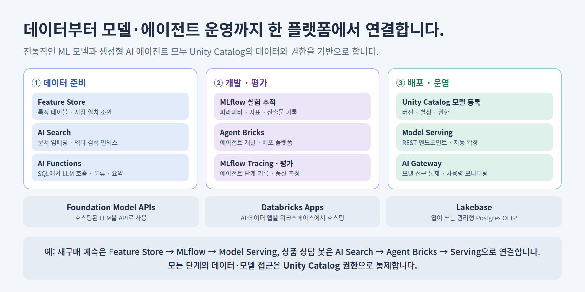
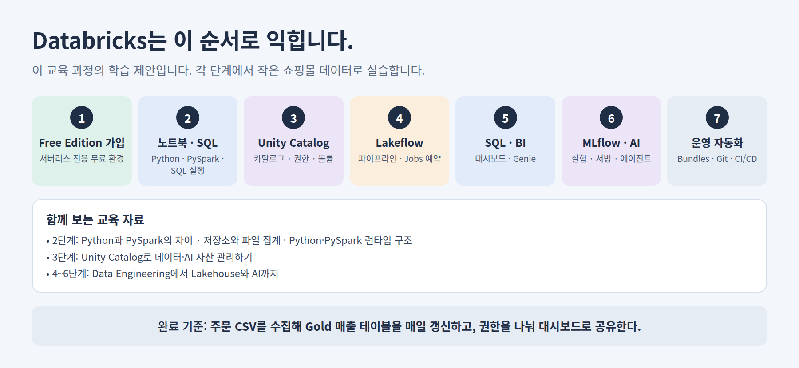

# Databricks 플랫폼 한눈에 보기

**Databricks는 클라우드 저장소의 데이터를 하나의 권한 체계로 관리하면서, 데이터 엔지니어링·SQL 분석·AI·앱 개발을 한 플랫폼에서 하도록 만든 관리형 데이터·AI 플랫폼입니다.** Apache Spark를 만든 사람들이 세운 회사의 제품이며, 앞 문서에서 설명한 Lakehouse 구조를 서비스로 제공합니다.

이 문서는 온라인 쇼핑몰 데이터를 예로 들어 **그림 8장**으로 플랫폼 구성·아키텍처·컴퓨트·화면·업무별 도구·학습 순서를 정리합니다. 제품 이름과 메뉴는 자주 바뀌므로 2026년 11월 기준 공식 문서 표기를 따르고, 바뀐 이름은 이전 이름을 함께 적습니다. 사용 가능한 기능은 클라우드·리전·요금제에 따라 확인합니다.

<a id="contents"></a>

## 목차

- [1. Databricks는 무엇입니까?](#what)
- [2. 플랫폼은 어떤 층으로 구성됩니까?](#platform-map)
- [3. 계정·워크스페이스·컨트롤 플레인·컴퓨트 플레인](#architecture)
- [4. 어떤 컴퓨트를 선택합니까?](#compute)
- [5. 워크스페이스 화면과 역할별 사용법](#workspace)
- [6. 데이터 엔지니어링: Lakeflow](#data-engineering)
- [7. SQL 분석과 BI](#sql-bi)
- [8. AI·ML과 생성형 AI](#ai)
- [9. 비용과 운영에서 주의할 점](#cost-ops)
- [10. 어떤 순서로 배웁니까?](#learning-path)
- [11. 용어집](#glossary)

<a id="what"></a>

## 1. Databricks는 무엇입니까?

Spark로 대용량 데이터를 처리하려면 원래 서버 구성, 클러스터 관리, 라이브러리 설치, 작업 예약, 권한 관리, BI 도구 연결을 각각 해결해야 했습니다. Databricks는 이것을 관리형 서비스로 묶어 **사용자가 데이터와 코드에 집중하도록** 합니다.

| 구분 | Spark를 직접 운영할 때 | Databricks를 사용할 때 |
| --- | --- | --- |
| 클러스터 | 서버·네트워크·Spark 설치와 업그레이드를 직접 합니다. | 서버리스로 바로 실행하거나, 설정값으로 클러스터를 만듭니다. |
| 개발 | 로컬 IDE·Jupyter 등 도구를 따로 구성합니다. | 브라우저의 노트북·SQL 편집기·Git folders를 사용합니다. |
| 작업 예약 | Airflow·cron 등을 별도로 운영합니다. | Lakeflow Jobs로 예약·재시도·알림을 관리합니다. |
| 테이블 관리 | 파일 형식·메타스토어·동시 쓰기를 직접 설계합니다. | Delta Lake·Iceberg 테이블과 Unity Catalog를 사용합니다. |
| 권한·감사 | 저장소·DB·BI 도구마다 따로 관리합니다. | Unity Catalog 한 곳에서 관리합니다. |
| 분석·AI | BI·ML 도구를 따로 연결합니다. | SQL Warehouse·대시보드·MLflow·Model Serving이 함께 있습니다. |

**Databricks는 데이터를 자체 저장소에 가두는 방식이 아니라, 클라우드 객체 저장소의 개방형 형식(Delta Lake·Iceberg·Parquet) 위에서 동작합니다.** AWS·Azure·Google Cloud에서 제공되며, 이 교육 자료의 예시는 AWS 기준입니다. [Databricks 소개](https://docs.databricks.com/aws/en/introduction/)

| 사용 사례 | 쇼핑몰 예시 |
| --- | --- |
| ETL·데이터 엔지니어링 | 주문·회원·클릭 로그를 매일 수집하고 Bronze·Silver·Gold로 정리합니다. |
| 데이터 웨어하우징·BI | 일별 매출·지역별 실적 대시보드를 만듭니다. |
| ML·AI | 재구매 예측 모델, 상품 상담 에이전트를 만듭니다. |
| 실시간 분석 | 주문 이벤트를 스트리밍으로 받아 이상 주문을 탐지합니다. |
| 거버넌스·공유 | 개인정보 열을 가리고, 협력사에 매출 데이터를 공유합니다. |
| 운영 데이터베이스 | 앱이 쓰는 Postgres DB(Lakebase)를 분석 데이터와 연결합니다. |

<a id="platform-map"></a>

## 2. 플랫폼은 어떤 층으로 구성됩니까?



| 층 | 역할 | 주요 구성 요소 |
| --- | --- | --- |
| 저장 | 실제 데이터 파일을 보관합니다. | S3 등 객체 저장소, Delta Lake, Apache Iceberg, 볼륨 |
| 거버넌스 | 이름·권한·계보·감사를 관리합니다. | Unity Catalog ([별도 문서](unity-catalog.md)) |
| 컴퓨트 | 코드를 실행합니다. | 서버리스 컴퓨트, 클래식 컴퓨트, SQL Warehouse, Photon |
| 개발 환경 | 코드를 작성하고 협업합니다. | 노트북, SQL 편집기, Git folders |
| 업무 도구 | 역할별로 결과를 만듭니다. | Lakeflow, AI/BI Dashboards, Genie, MLflow, Model Serving, Agent Bricks, Databricks Apps, Lakebase |

**아래 세 층(저장·거버넌스·컴퓨트)이 공통이라는 점이 핵심입니다.** 데이터 엔지니어가 만든 Gold 테이블을 분석가는 SQL로, 데이터 과학자는 노트북으로, 현업은 Genie로 같은 권한 규칙 아래에서 사용합니다. 테이블을 도구마다 복사하지 않아도 됩니다.

<a id="architecture"></a>

## 3. 계정·워크스페이스·컨트롤 플레인·컴퓨트 플레인



| 개념 | 설명 |
| --- | --- |
| 계정 (Account) | 조직 전체를 관리하는 최상위 단위입니다. 사용자·그룹, 워크스페이스, Unity Catalog 메타스토어, 사용량을 관리합니다. |
| 워크스페이스 | 사용자가 노트북·작업·대시보드를 만들고 실행하는 작업 공간입니다. 한 계정에 여러 개를 둘 수 있습니다. |
| 컨트롤 플레인 | Databricks가 운영하는 백엔드입니다. 웹 애플리케이션, 작업 스케줄러, 클러스터 관리 등이 여기에 있습니다. |
| 서버리스 컴퓨트 플레인 | Databricks 계정 안에서 실행되는 컴퓨트입니다. 워크스페이스와 같은 리전에서 실행됩니다. |
| 클래식 컴퓨트 플레인 | 고객 클라우드 계정의 네트워크(VPC) 안에 만든 VM에서 실행되는 컴퓨트입니다. |

**사용자가 브라우저에서 셀을 실행하면, 컨트롤 플레인이 코드를 컴퓨트 플레인에 보내고, 컴퓨트가 저장소의 데이터를 읽어 처리한 뒤 결과를 돌려줍니다.** [상위 수준 아키텍처](https://docs.databricks.com/aws/en/getting-started/high-level-architecture)

클래식 워크스페이스는 고객의 S3 버킷을 워크스페이스 저장소로 사용합니다. 서버리스 워크스페이스는 Databricks가 관리하는 기본 저장소(default storage)를 사용할 수 있습니다. 워크스페이스 저장소에는 노트북·작업 결과·로그 같은 시스템 데이터도 있으므로 임의로 삭제하거나 수정하지 않습니다.

<a id="compute"></a>

## 4. 어떤 컴퓨트를 선택합니까?



| 컴퓨트 | 용도 | 선택 기준 |
| --- | --- | --- |
| 노트북용 서버리스 | 대화형 Python·SQL 개발·탐색 | 학습과 일반 개발의 기본 선택입니다. |
| Jobs용 서버리스 | 예약·자동 실행 작업 | 인프라 설정 없이 운영 작업을 돌릴 때 사용합니다. |
| 서버리스 파이프라인 | Lakeflow pipelines 실행 | 선언형 파이프라인의 기본 선택입니다. |
| SQL Warehouse | SQL 조회·대시보드·BI 도구 연결 | 분석가·대시보드용입니다. 서버리스와 클래식이 있습니다. |
| 클래식 컴퓨트 (대화형) | 특수 라이브러리·네트워크가 필요한 개발 | 인스턴스·Runtime·라이브러리를 직접 정해야 할 때 사용합니다. |
| 클래식 컴퓨트 (Job용) | GPU·특수 설정이 필요한 자동화 작업 | 작업 시작 시 만들고 끝나면 종료합니다. |

**처음에는 서버리스로 시작합니다.** 서버리스는 몇 초 안에 시작되고 자동으로 확장됩니다. 특정 인스턴스 종류, GPU, 사설 네트워크 구성, 서버리스에서 지원하지 않는 라이브러리가 필요할 때 클래식 컴퓨트를 검토합니다. [컴퓨트 개요](https://docs.databricks.com/aws/en/compute/)

클래식 컴퓨트의 **접근 모드**는 다음과 같습니다.

| 접근 모드 | 설명 |
| --- | --- |
| Standard | 여러 사용자가 공유합니다. Lakeguard가 사용자 간 코드·데이터를 격리하고 Unity Catalog 권한을 적용합니다. |
| Dedicated | 한 사용자나 그룹이 전용으로 사용합니다. ML 라이브러리·RDD API처럼 공유 모드에서 제한되는 작업에 사용합니다. |

**Photon**은 SQL과 DataFrame 처리를 빠르게 하는 Databricks의 실행 엔진입니다. 코드를 바꾸지 않아도 지원되는 연산은 Photon으로 실행됩니다. Python과 PySpark의 실행 구조는 [Python·PySpark 런타임 구조](python-pyspark-runtime.md)를 참고합니다.

<a id="workspace"></a>

## 5. 워크스페이스 화면과 역할별 사용법



| 화면 | 하는 일 |
| --- | --- |
| Workspace | 노트북·파일·폴더를 관리하고, Git folders로 Git 저장소와 동기화합니다. |
| Catalog | Unity Catalog의 카탈로그·스키마·테이블을 탐색하고 권한·계보를 확인합니다. |
| Jobs & Pipelines | 작업과 파이프라인을 만들고 실행 이력·실패를 확인합니다. |
| Compute | 클래식 컴퓨트와 SQL Warehouse를 관리합니다. |
| SQL Editor · Dashboards | SQL을 작성하고 결과를 대시보드로 공유합니다. |
| Genie | 자연어로 데이터에 질문합니다. |
| Experiments · Models · Serving | MLflow 실험을 기록하고, 모델을 등록·배포합니다. |

메뉴 이름과 위치는 제품 업데이트와 사용자 권한에 따라 달라질 수 있습니다. 화면을 외우기보다 **“이 일은 어느 층의 어떤 도구가 담당하는가”** 를 기준으로 찾습니다.

### 노트북은 여러 언어를 함께 씁니다

노트북의 기본 언어를 Python으로 두고, 셀 단위로 SQL을 섞어 쓸 수 있습니다. Databricks 노트북에는 `spark` 세션이 미리 준비되어 있습니다.

```python
# Python 셀: Unity Catalog 테이블을 DataFrame으로 읽습니다.
orders = spark.table("shop_dev.sales.orders")
display(orders.groupBy("region").sum("amount"))
```

```sql
%sql
-- SQL 셀: 같은 테이블을 SQL로 조회합니다.
SELECT region, SUM(amount) AS total FROM shop_dev.sales.orders GROUP BY region;
```

<a id="data-engineering"></a>

## 6. 데이터 엔지니어링: Lakeflow



**Lakeflow는 Databricks의 데이터 엔지니어링 도구 묶음입니다.** 수집·변환·작업 조율을 담당합니다.

| 도구 | 역할 | 쇼핑몰 예시 |
| --- | --- | --- |
| Lakeflow Connect | DB·SaaS 등에서 데이터를 가져오는 관리형 커넥터입니다. | 주문 MySQL의 변경 내용을 수집합니다. |
| Auto Loader | 클라우드 저장소·볼륨에 새로 도착한 파일만 증분으로 읽습니다. | 매일 올라오는 정산 CSV를 수집합니다. |
| Lakeflow pipelines | SQL·Python으로 테이블 간 변환을 선언하면 실행 순서·증분 처리·재시도를 관리합니다. Apache Spark Declarative Pipelines 기반이며, 이전 이름은 Delta Live Tables입니다. | Bronze → Silver → Gold 매출 테이블을 만듭니다. |
| Lakeflow Jobs | 노트북·SQL·파이프라인을 작업 그래프로 묶어 예약·재시도·알림을 관리합니다. | 매일 새벽 수집 → 변환 → 대시보드 갱신을 실행합니다. |
| Declarative Automation Bundles | Job·파이프라인 정의를 YAML 코드로 관리하고 환경별로 배포합니다. 이전 이름은 Databricks Asset Bundles입니다. | dev에서 검증한 파이프라인을 prod로 배포합니다. |

```python
# Auto Loader: 볼륨에 새로 들어온 주문 CSV만 읽어 Bronze 테이블에 추가합니다.
(spark.readStream.format("cloudFiles")
    .option("cloudFiles.format", "csv")
    .option("cloudFiles.schemaLocation", "/Volumes/shop_dev/raw/checkpoints/orders_schema")
    .load("/Volumes/shop_dev/raw/landing/orders/")
  .writeStream
    .option("checkpointLocation", "/Volumes/shop_dev/raw/checkpoints/orders")
    .trigger(availableNow=True)          # 지금까지 도착한 파일을 처리하고 종료합니다.
    .toTable("shop_dev.raw.orders"))
```

```sql
-- Lakeflow pipelines (SQL): 품질 규칙을 선언하고 Silver 테이블을 만듭니다.
CREATE OR REFRESH STREAMING TABLE sales_orders (
  CONSTRAINT valid_amount EXPECT (amount > 0) ON VIOLATION DROP ROW
)
AS SELECT * FROM STREAM(shop_dev.raw.orders);
```

`EXPECT`로 정한 품질 규칙(expectations)은 위반한 행을 기록만 할지, 버릴지, 파이프라인을 멈출지 정할 수 있습니다. 수집·변환 설계 원칙은 [Lakehouse와 AI 문서의 Medallion 설명](data-engineering-lakehouse-ai.md#medallion)을 참고합니다. [Lakeflow Connect](https://docs.databricks.com/aws/en/ingestion/overview), [Lakeflow pipelines](https://docs.databricks.com/aws/en/ldp/), [Lakeflow Jobs](https://docs.databricks.com/aws/en/jobs/), [Bundles](https://docs.databricks.com/aws/en/dev-tools/bundles/)

<a id="sql-bi"></a>

## 7. SQL 분석과 BI



| 도구 | 역할 |
| --- | --- |
| SQL Warehouse | SQL 조회에 최적화한 컴퓨트입니다. 대시보드와 외부 BI 도구(JDBC·ODBC)도 이것으로 조회합니다. |
| SQL Editor | SQL을 작성·저장하고 결과를 시각화하며, 조건에 따라 알림을 보냅니다. |
| Metric views | 순매출·주문 수 같은 업무 지표를 한 번 정의하고 여러 차원으로 조회합니다. |
| AI/BI Dashboards | 지표·필터·차트를 대시보드로 만들어 공유합니다. AI 보조 작성 기능을 제공합니다. |
| Genie | 현업 사용자가 자연어로 질문하면 데이터 정의를 바탕으로 SQL을 만들어 답합니다. 질문한 사람의 Unity Catalog 권한이 적용됩니다. |

**Genie와 대시보드의 정확도는 데이터의 설명·지표 정의 품질에 달려 있습니다.** 테이블·열 설명(COMMENT), 공통 지표 정의, 예시 질문을 먼저 정리합니다. 생성된 SQL을 확인할 수 있으므로 중요한 수치는 SQL을 함께 검토합니다. [Genie](https://docs.databricks.com/aws/en/genie/)

<a id="ai"></a>

## 8. AI·ML과 생성형 AI



| 단계 | 도구 | 역할 |
| --- | --- | --- |
| 데이터 준비 | Feature Store | 특징 테이블을 관리하고 학습·서빙에 같은 특징을 공급합니다. |
| | AI Search | 문서 임베딩과 벡터 검색 인덱스를 관리합니다. 이전 이름은 Vector Search입니다. |
| | AI Functions | SQL에서 LLM을 호출하여 분류·요약·추출을 합니다. |
| 개발·평가 | MLflow | 실험의 파라미터·지표·모델을 기록하고, 에이전트 실행 단계를 추적(Tracing)·평가합니다. |
| | Agent Bricks | 에이전트를 개발·배포하는 Databricks의 에이전트 개발 플랫폼입니다. |
| 배포·운영 | Unity Catalog 모델 | 모델 버전·별칭·권한을 관리합니다. |
| | Model Serving | 모델과 LLM을 REST 엔드포인트로 배포합니다. |
| | AI Gateway | 모델 접근을 통제하고 사용량을 모니터링합니다. |
| 공통 | Foundation Model APIs | Databricks가 호스팅하는 LLM을 API로 사용합니다. |
| 애플리케이션 | Databricks Apps · Lakebase | 데이터·AI 앱을 호스팅하고, 앱이 쓰는 관리형 Postgres OLTP DB를 제공합니다. |

```python
import mlflow
from sklearn.linear_model import LogisticRegression

mlflow.set_registry_uri("databricks-uc")           # 모델을 Unity Catalog에 등록합니다.
with mlflow.start_run():
    model = LogisticRegression().fit(X_train, y_train)
    mlflow.log_metric("accuracy", model.score(X_test, y_test))
    mlflow.sklearn.log_model(model, name="model", input_example=X_train[:5],
                             registered_model_name="shop_dev.ml.repurchase_model")
```

학습 데이터의 시점 일치, RAG의 문서 갱신·권한 같은 데이터 측면의 설계는 [Lakehouse와 AI 문서](data-engineering-lakehouse-ai.md#machine-learning)를 참고합니다. [Databricks의 AI·ML](https://docs.databricks.com/aws/en/machine-learning/), [Agent Bricks](https://docs.databricks.com/aws/en/generative-ai/agent-bricks/)

<a id="cost-ops"></a>

## 9. 비용과 운영에서 주의할 점

Databricks 비용은 주로 **사용한 컴퓨트 양(DBU)과 클라우드 자원**에서 발생합니다. 저장 비용은 클라우드 저장소 요금으로 별도 발생합니다.

| 주의할 점 | 권장 방법 |
| --- | --- |
| 대화형 컴퓨트를 켜 둔 채 방치합니다. | 자동 종료 시간을 짧게 설정하고, 가능하면 서버리스를 사용합니다. |
| 운영 작업을 대화형 컴퓨트에서 실행합니다. | Jobs용 서버리스나 Job 전용 컴퓨트로 실행합니다. |
| `collect()`·`toPandas()`로 대용량 데이터를 Driver로 가져옵니다. | 집계·필터 후 필요한 결과만 가져옵니다. [Driver OOM 설명](python-vs-pyspark.md) |
| 작은 파일이 계속 쌓입니다. | Managed 테이블의 자동 최적화를 활용하고 적재 방식을 점검합니다. |
| 사용량을 모릅니다. | `system.billing.usage` 테이블과 예산 알림으로 팀·작업별 사용량을 확인합니다. |
| 노트북에서 수동으로 운영합니다. | Git folders·Bundles로 코드와 배포를 관리합니다. |

```sql
-- 최근 30일 동안 어떤 종류의 작업이 사용량을 많이 썼습니까?
SELECT billing_origin_product, SUM(usage_quantity) AS dbus
FROM system.billing.usage
WHERE usage_date >= current_date() - 30
GROUP BY billing_origin_product
ORDER BY dbus DESC;
```

<a id="learning-path"></a>

## 10. 어떤 순서로 배웁니까?



**학습은 Databricks Free Edition에서 시작할 수 있습니다.** Free Edition은 학생·교육자·입문자를 위한 무료 버전이며, 서버리스 전용·사용량 제한 환경입니다. 이전의 Community Edition을 대체했습니다. 일부 기능은 제한되므로 기업 기능 실습은 조직의 워크스페이스에서 진행합니다. [Free Edition](https://docs.databricks.com/aws/en/getting-started/free-edition)

| 단계 | 실습 내용 | 함께 보는 자료 |
| --- | --- | --- |
| 1. Free Edition 가입 | 워크스페이스에 들어가 메뉴를 둘러봅니다. | 이 문서 5절 |
| 2. 노트북·SQL | 주문 CSV를 읽어 Python·PySpark·SQL로 집계합니다. | [Python vs PySpark](python-vs-pyspark.md), [저장소](storage-systems-and-python.md), [런타임](python-pyspark-runtime.md) |
| 3. Unity Catalog | 카탈로그·스키마·볼륨을 만들고 권한을 나눕니다. | [Unity Catalog](unity-catalog.md) |
| 4. Lakeflow | Auto Loader와 파이프라인으로 Bronze·Silver·Gold를 만들고 Job으로 예약합니다. | [Lakehouse와 AI](data-engineering-lakehouse-ai.md) |
| 5. SQL·BI | 매출 대시보드를 만들고 Genie에 질문합니다. | 이 문서 7절 |
| 6. MLflow·AI | 재구매 예측 실험을 기록하거나 상품 문서 검색을 만들어 봅니다. | 이 문서 8절 |
| 7. 운영 자동화 | Git folders와 Bundles로 dev → prod 배포를 구성합니다. | 이 문서 6절 |

<a id="glossary"></a>

## 11. 용어집

| 용어 | 의미 |
| --- | --- |
| Databricks | 데이터 엔지니어링·분석·AI를 한 플랫폼에서 제공하는 관리형 데이터·AI 플랫폼입니다. |
| Lakehouse | Data Lake의 저장 기반에 테이블 관리·거버넌스·분석 기능을 결합한 아키텍처입니다. |
| 계정 / 워크스페이스 | 조직 전체를 관리하는 최상위 단위와, 사용자가 작업하는 공간입니다. |
| 컨트롤 플레인 / 컴퓨트 플레인 | Databricks가 운영하는 관리 백엔드와, 데이터를 실제로 처리하는 컴퓨트 영역입니다. |
| 서버리스 / 클래식 컴퓨트 | Databricks가 관리하는 즉시 실행형 컴퓨트와, 고객 클라우드 계정의 VM으로 만드는 컴퓨트입니다. |
| SQL Warehouse | SQL 조회·BI에 최적화한 컴퓨트입니다. |
| Photon | SQL·DataFrame 처리를 빠르게 하는 Databricks의 실행 엔진입니다. |
| Databricks Runtime | 컴퓨트에 설치되는 Spark·라이브러리 묶음입니다. ML용 Runtime도 있습니다. |
| 접근 모드 (Standard / Dedicated) | 클래식 컴퓨트를 여러 사용자가 격리된 상태로 공유하는 방식과, 한 사용자·그룹이 전용으로 쓰는 방식입니다. |
| Lakeguard | 공유 컴퓨트에서 사용자 간 격리와 거버넌스를 제공하는 Databricks 보안 기능입니다. |
| DBU | Databricks 사용량을 계산하는 단위입니다. |
| 노트북 / Git folders | 코드·결과·설명을 셀 단위로 작성하는 문서와, Git 저장소와 동기화하는 폴더입니다. |
| Lakeflow | 수집·변환·작업 조율을 담당하는 Databricks 데이터 엔지니어링 도구 묶음입니다. |
| Lakeflow Connect | DB·SaaS 등에서 데이터를 수집하는 관리형 커넥터입니다. |
| Auto Loader | 저장소에 새로 도착한 파일을 증분으로 읽는 기능입니다. |
| Lakeflow pipelines | 선언형으로 데이터 파이프라인을 만드는 기능입니다. 이전 이름은 Delta Live Tables입니다. |
| Expectations | 파이프라인에서 데이터 품질 규칙을 선언하는 기능입니다. |
| Lakeflow Jobs | 작업의 순서·예약·재시도·알림을 관리하는 오케스트레이션 기능입니다. |
| Declarative Automation Bundles | Job·파이프라인 등을 코드로 정의하고 배포하는 기능입니다. 이전 이름은 Databricks Asset Bundles입니다. |
| Metric views | 업무 지표를 한 번 정의하고 여러 차원에서 조회하게 하는 객체입니다. |
| AI/BI Dashboards | Databricks의 대시보드 기능입니다. |
| Genie | 자연어로 데이터에 질문하는 Databricks의 AI 기능입니다. |
| MLflow | 실험·모델·에이전트의 추적·평가·관리 플랫폼입니다. |
| Feature Store | 특징 테이블을 관리하고 학습·서빙에 공급하는 기능입니다. |
| Model Serving | 모델·LLM을 REST 엔드포인트로 배포하는 기능입니다. |
| AI Gateway | 모델 접근 통제와 사용량 모니터링 기능입니다. |
| AI Search | 벡터 검색 인덱스를 제공하는 기능입니다. 이전 이름은 Vector Search입니다. |
| Agent Bricks | Databricks의 에이전트 개발·배포 플랫폼입니다. |
| Foundation Model APIs | Databricks가 호스팅하는 LLM을 API로 사용하는 기능입니다. |
| Databricks Apps / Lakebase | 데이터·AI 앱 호스팅 기능과, 관리형 Postgres OLTP 데이터베이스입니다. |
| OpenSharing / Marketplace | 조직 외부와 데이터를 공유하는 기능과, 데이터·AI 자산을 찾고 제공하는 마켓플레이스입니다. |
| Free Edition | 학습·실험용 무료 Databricks 환경입니다. 서버리스 전용이며 사용량이 제한됩니다. |

[목차로 돌아갑니다](#contents) · [전체 교육 목차로 돌아갑니다](../README.md)
