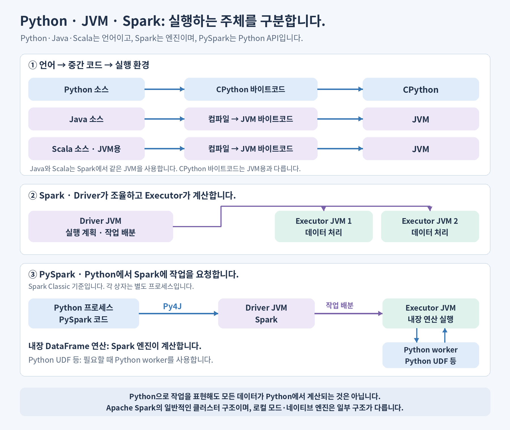
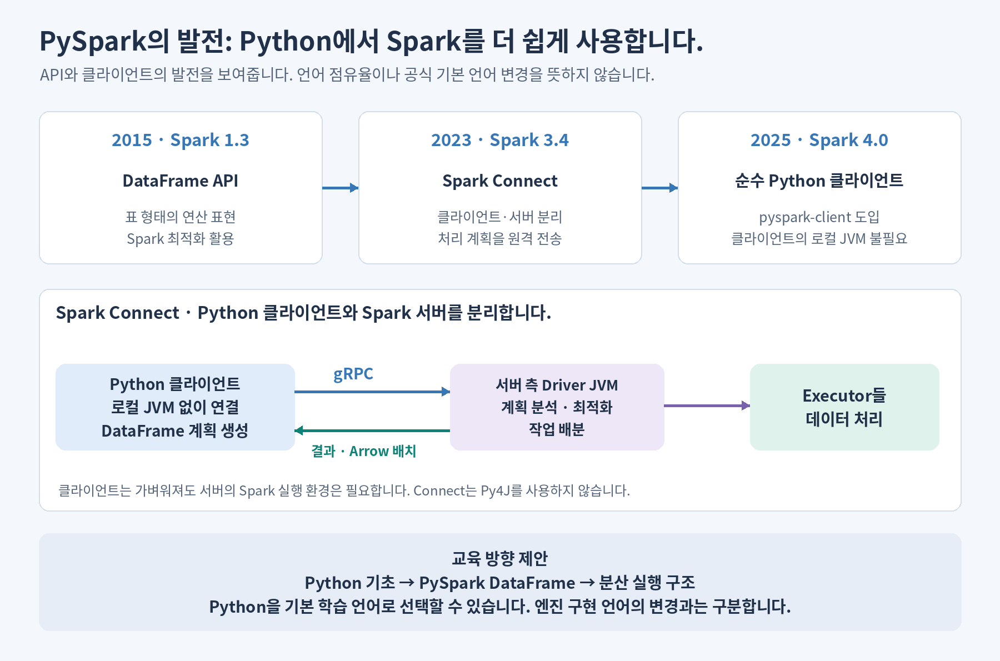

# Python·PySpark와 JVM의 런타임 구조 이해하기

> **심화 참고 자료입니다.** [06. Spark](course/06-spark.md)를 읽은 뒤 실행 내부가 궁금할 때 참고합니다. JVM·Py4J·Python worker 지식은 첫 집계 실습의 필수 조건이 아닙니다. [전체 학습 순서](../README.md) · [심화 자료 색인](reference/README.md)

**Python으로 코드를 작성하는 것과, Python이 모든 데이터를 직접 계산하는 것은 다릅니다.** PySpark는 Python에서 Spark에 작업을 요청하는 API이며, 실제 실행 위치는 사용하는 연산과 연결 방식에 따라 달라집니다.

이 문서는 일반적인 CPython과 Apache Spark의 구조를 기준으로 설명합니다. 그림에서는 OS·네트워크·세부 스레드 구성을 생략합니다.

## 목차

- [1. 언어·런타임·엔진·API를 구분합니다](#roles)
- [2. 실행 구조를 그림으로 비교합니다](#runtime-comparison)
- [3. PySpark의 계산은 어디에서 실행됩니까?](#execution-location)
- [4. 시간에 따라 Python으로 Spark를 사용하는 경로가 발전합니다](#evolution)
- [5. 용어집](#glossary)

## 1. 언어·런타임·엔진·API를 구분합니다

런타임은 **프로그램을 실제로 실행하는 환경**입니다. 먼저 같은 수준의 개념끼리 구분하면 구조를 이해하기 쉽습니다.

| 이름 | 분류 | 실행 구조의 핵심 |
| --- | --- | --- |
| Python | 프로그래밍 언어입니다. | 대표적인 구현체인 CPython이 Python 코드를 실행합니다. |
| Java | 프로그래밍 언어입니다. | 일반적으로 JVM 바이트코드로 컴파일하여 JVM에서 실행합니다. |
| Scala | 프로그래밍 언어입니다. | Spark에서 사용하는 Scala도 JVM 바이트코드로 컴파일하여 JVM에서 실행합니다. |
| Spark | 분산 처리 엔진입니다. | Driver가 작업을 조율하고 Executor들이 데이터를 처리합니다. |
| PySpark | Spark의 Python API입니다. | Python 프로세스에서 Spark에 작업을 요청합니다. 필요한 경우 작업자 측 Python 프로세스도 사용합니다. |

**Java와 Scala는 언어가 다르지만 Spark에서는 같은 JVM 실행 환경을 사용합니다.** Scala에는 다른 실행 대상도 있으나 이 문서에서는 JVM만 다룹니다. [JVM 개요](https://dev.java/learn/jvm/), [Scala의 실행 대상](https://docs.scala-lang.org/scala3/book/scala-features.html)

Spark의 핵심 JVM 코드는 주로 Scala로 구현되어 있으며 Java 코드도 사용합니다. 사용자는 Python·Scala·Java·SQL 등의 인터페이스로 Spark를 이용합니다. 구현 언어와 사용자가 선택하는 언어는 구분합니다. [Spark 소스 저장소](https://github.com/apache/spark), [PySpark 개요](https://spark.apache.org/docs/latest/api/python/index.html)

## 2. 실행 구조를 그림으로 비교합니다

### Python·Java·Scala의 실행 경로입니다

| 코드 | 실행 경로 | 기억할 점 |
| --- | --- | --- |
| Python | 소스 → CPython 바이트코드 → CPython 실행입니다. | Python도 내부적으로 바이트코드를 만듭니다. |
| Java | 소스 → Java 컴파일러 → JVM 바이트코드 → JVM 실행입니다. | JVM은 코드를 해석하고, JIT 등으로 실행을 최적화할 수 있습니다. |
| JVM용 Scala | 소스 → Scala 컴파일러 → JVM 바이트코드 → JVM 실행입니다. | Java 라이브러리와 같은 JVM 환경에서 동작할 수 있습니다. |

CPython의 바이트코드는 JVM 바이트코드와 형식·실행 환경이 다릅니다. 또한 Python 라이브러리가 내부에서 C·C++ 같은 네이티브 코드를 호출할 수도 있으므로, Python 문법으로 작성했다는 사실만으로 처리 성능을 판단하지 않습니다. [Python 바이트코드](https://docs.python.org/3/glossary.html#term-bytecode), [Python 확장 모듈](https://docs.python.org/3/extending/extending.html), [JVM 실행](https://dev.java/learn/jvm/)

### Spark와 PySpark의 실행 경로입니다

Spark의 일반적인 클러스터 실행에서는 **Driver JVM이 계획·작업 배분을 담당하고, 여러 Executor JVM이 Task를 실행합니다.** Scala·Java의 Spark 애플리케이션은 JVM 안에서 Spark API를 호출합니다. 로컬 모드에서는 구성 요소가 한 JVM 안에서 동작할 수 있습니다. [Spark 클러스터 구조](https://spark.apache.org/docs/latest/cluster-overview.html)

그림의 **Spark Classic** 방식에서는 Python 프로세스가 **Py4J**를 통해 Driver JVM과 통신합니다. Python 프로세스와 JVM은 별도 프로세스이며, Py4J는 Python 프로그램 전체를 Java 프로그램으로 번역하는 도구가 아닙니다. [PySpark 실행 구조](https://spark.apache.org/docs/latest/api/python/user_guide/bugbusting.html)

## 3. PySpark의 계산은 어디에서 실행됩니까?

**일반 Python 계산, Spark의 내장 연산, Python 사용자 정의 함수는 실행 위치가 다릅니다.**

| 작성한 코드·연산 | 실제 계산 위치 | 의미 |
| --- | --- | --- |
| Python의 `sum([10, 20, 30])` | 코드를 실행한 Python 프로세스입니다. | 노트북에 작성해도 자동으로 분산되지 않습니다. |
| PySpark의 `df.groupBy("category").sum("amount")` | Action 시 Spark 엔진이 Executor에서 집계를 수행합니다. | Python으로 처리 계획을 표현하며, 집계 자체에 Python worker가 필요한 것은 아닙니다. |
| Python UDF 또는 pandas UDF | Executor와 연결된 별도의 Python worker에서 사용자 함수를 실행합니다. | JVM과 Python 사이의 데이터 전달·변환 비용을 고려합니다. |

내장 DataFrame 연산만 사용하는 일반적인 경로에서는 데이터 행마다 Python 함수를 호출하지 않습니다. Python UDF·Python RDD 연산 등 Python 실행이 필요한 경로에서는 Python worker를 사용합니다. 따라서 **같은 실행 계획을 만드는 내장 연산은 PySpark로 작성했다는 이유만으로 Scala보다 항상 느리다고 할 수 없습니다.** 전체 시간에는 계획 생성·통신·데이터 이동 등도 영향을 줍니다. [PySpark의 Python worker](https://spark.apache.org/docs/latest/api/python/user_guide/bugbusting.html), [Python UDF와 Arrow](https://spark.apache.org/docs/latest/api/python/user_guide/udfandudtf.html)

`groupBy().sum()`은 집계 계획을 구성합니다. 계산 시작과 결과 수집은 앞 문서의 [지연 실행·Action·Driver OOM](python-vs-pyspark.md#transformations-and-actions)을 참고합니다. Databricks의 Photon 같은 네이티브 실행 엔진을 사용하는 환경에서는 일부 연산의 실제 실행 경로가 이 JVM 중심 그림과 달라질 수 있습니다. [Photon 개요](https://docs.databricks.com/aws/en/compute/photon)

## 4. 시간에 따라 Python으로 Spark를 사용하는 경로가 발전합니다

**확인할 수 있는 변화는 Python API와 클라이언트 사용성의 발전입니다.** 이를 Spark 엔진 전체가 Python으로 전환된다는 뜻으로 해석하지 않습니다.

| 시점 | 변화 | Python 개발자에게 주는 의미 |
| --- | --- | --- |
| 2015년 · Spark 1.3 | DataFrame API를 도입합니다. | Python에서도 표 형태의 연산을 표현하고 Spark의 최적화를 활용하는 경로가 마련됩니다. |
| 2023년 · Spark 3.4 | Spark Connect를 도입합니다. | 클라이언트와 서버를 분리하고, DataFrame의 처리 계획을 원격 Spark에 전달합니다. |
| 2025년 · Spark 4.0 | 순수 Python Spark Connect 클라이언트 패키지를 도입합니다. | `pyspark-client`를 사용하는 클라이언트 환경에서 로컬 JRE·Spark JAR 의존성을 줄일 수 있습니다. |

연도와 기능은 공식 [Spark 1.3 발표](https://spark.apache.org/news/spark-1-3-0-released.html)·[릴리스 노트](https://spark.apache.org/releases/spark-release-1-3-0.html), [Spark 3.4 발표](https://spark.apache.org/news/spark-3-4-0-released.html)·[릴리스 노트](https://spark.apache.org/releases/spark-release-3-4-0.html), [Spark 4.0 발표](https://spark.apache.org/news/spark-4-0-0-released.html)·[릴리스 노트](https://spark.apache.org/releases/spark-release-4-0-0.html)를 기준으로 정리합니다. 이 표는 주요 변화의 예시이며 언어별 사용 점유율을 나타내지 않습니다.

### Spark Connect에서는 연결 구조가 달라집니다

| 항목 | Spark Classic의 PySpark | Spark Connect의 Python 클라이언트 |
| --- | --- | --- |
| 연결 방식 | Python ↔ Py4J ↔ Driver JVM입니다. | Python 클라이언트 ↔ gRPC ↔ 서버 측 Driver입니다. |
| 전달하는 요청 | JVM 객체의 메서드 호출 등입니다. | DataFrame 연산으로 만든 논리 계획 등입니다. |
| 클라이언트의 JVM | Python 애플리케이션 측에 연결할 JVM이 필요합니다. | 순수 Python 클라이언트는 로컬 JVM 없이 원격 서버에 연결합니다. |
| 지원 범위 | DataFrame·RDD·SparkContext 등을 사용합니다. | DataFrame 중심이며 RDD·SparkContext는 지원하지 않습니다. |

Spark Connect는 Py4J를 사용하지 않습니다. 서버가 받은 계획을 최적화하고 Executor에 작업을 배분하며, 결과는 Arrow 형식의 배치로 클라이언트에 돌아옵니다. **클라이언트에 Java가 필요 없다는 것은 서버의 Spark 실행 환경까지 없어진다는 뜻은 아닙니다.** [Spark Connect 구조](https://spark.apache.org/docs/latest/spark-connect-overview.html), [순수 Python 클라이언트 설치](https://spark.apache.org/docs/latest/api/python/getting_started/install.html#python-spark-connect-client)

### 교육에서는 Python을 기본 학습 언어로 선택할 수 있습니다

이 교육 과정에서는 **Python 기초 → PySpark DataFrame → 분산 실행 구조** 순서를 기본 학습 경로로 제안합니다. Python 문법을 이어서 사용하면서 Spark의 데이터 처리 방식을 배울 수 있기 때문입니다.

앞으로도 PySpark가 Spark를 처음 배우는 주요 진입점으로 자리 잡을 수 있다는 전망은 가능합니다. 다만 **공식 기본 언어의 변경이나 Scala·Java API의 대체가 확정되었다고 단정하지 않습니다.** 이 문서의 교육 방향에 대한 판단이며, 공식 문서는 PySpark를 Spark의 Python API로 설명합니다. [PySpark 개요](https://spark.apache.org/docs/latest/api/python/index.html)

## 5. 용어집

| 용어 | 의미 |
| --- | --- |
| 런타임 | 프로그램을 실제로 실행하는 환경입니다. |
| CPython | Python 언어의 대표적인 구현체입니다. |
| JVM | Java Virtual Machine의 약어이며, JVM 바이트코드를 실행하는 가상 머신입니다. |
| 바이트코드 | 실행 환경이 처리할 수 있도록 소스 코드를 변환한 중간 표현입니다. CPython과 JVM의 형식은 다릅니다. |
| 컴파일러 | 소스 코드를 바이트코드나 기계어 등 다른 표현으로 변환하는 도구입니다. |
| JIT | Just-In-Time의 약어이며, 실행 중 코드를 기계어로 컴파일하는 방식입니다. |
| 네이티브 코드 | 대상 CPU에서 실행할 기계어로 컴파일된 코드입니다. |
| API | 다른 프로그램이나 라이브러리의 기능을 사용하기 위한 인터페이스입니다. |
| Spark | 작업을 나누고 실행 계획과 분산 처리를 관리하는 엔진입니다. |
| PySpark | Python에서 Spark 기능을 사용하는 API입니다. |
| Driver | Spark 애플리케이션의 계획·작업 배분을 조율하는 역할입니다. |
| Executor | Spark의 작업을 실행하고 데이터를 처리하는 프로세스입니다. |
| Task | Executor가 실행하는 작업 단위입니다. |
| Python worker | Executor와 데이터를 주고받으며 Python 사용자 함수 등을 실행하는 별도 프로세스입니다. |
| Py4J | Python에서 JVM 객체와 상호작용할 수 있게 하는 연결 도구입니다. |
| Spark Classic | Spark Connect와 구분하는 기존 Spark 애플리케이션 연결·실행 방식입니다. |
| Spark Connect | 클라이언트와 Spark 서버를 분리하여 원격으로 처리 계획을 전달하는 구조입니다. |
| gRPC | 클라이언트와 서버 사이에서 원격 호출과 데이터 전송을 수행하는 통신 프레임워크입니다. |
| 논리 계획 | 어떤 데이터를 어떤 연산으로 처리할지를 표현한 계획입니다. |
| DataFrame | 이름을 가진 열로 구성된 데이터를 다루는 Spark의 API입니다. |
| RDD | Resilient Distributed Dataset의 약어이며, Spark의 저수준 분산 데이터 추상화입니다. |
| SparkContext | Spark 애플리케이션과 클러스터 실행을 연결하는 핵심 객체입니다. |
| UDF / pandas UDF | 사용자 정의 함수와, pandas 데이터를 이용해 실행하는 Python 사용자 정의 함수입니다. |
| Apache Arrow | 열 단위 메모리 형식과 데이터 교환을 위한 기술입니다. |
| JRE / JAR | Java 실행 환경과, JVM 클래스·리소스를 묶는 배포 파일 형식입니다. |
| Photon | Databricks의 네이티브 벡터화 실행 엔진입니다. |

[목차로 돌아갑니다](#contents) · [전체 교육 목차로 돌아갑니다](../README.md)
