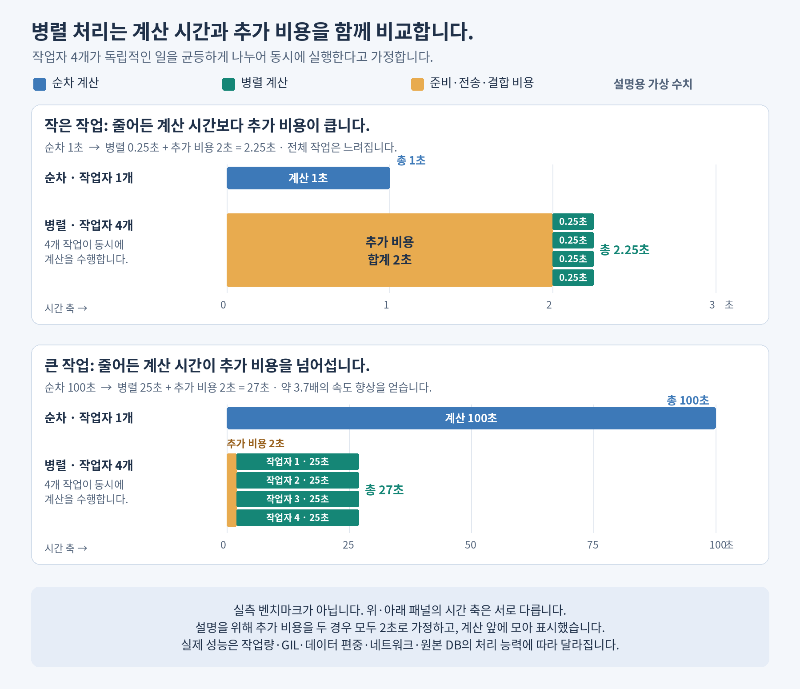
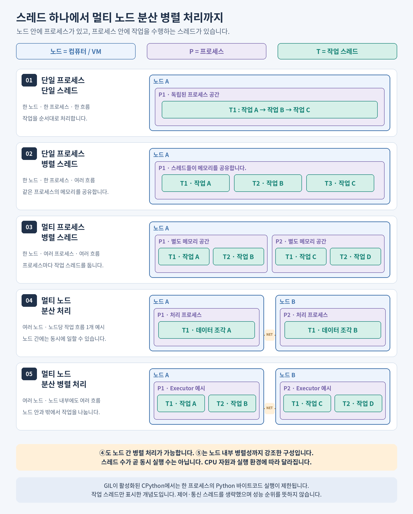
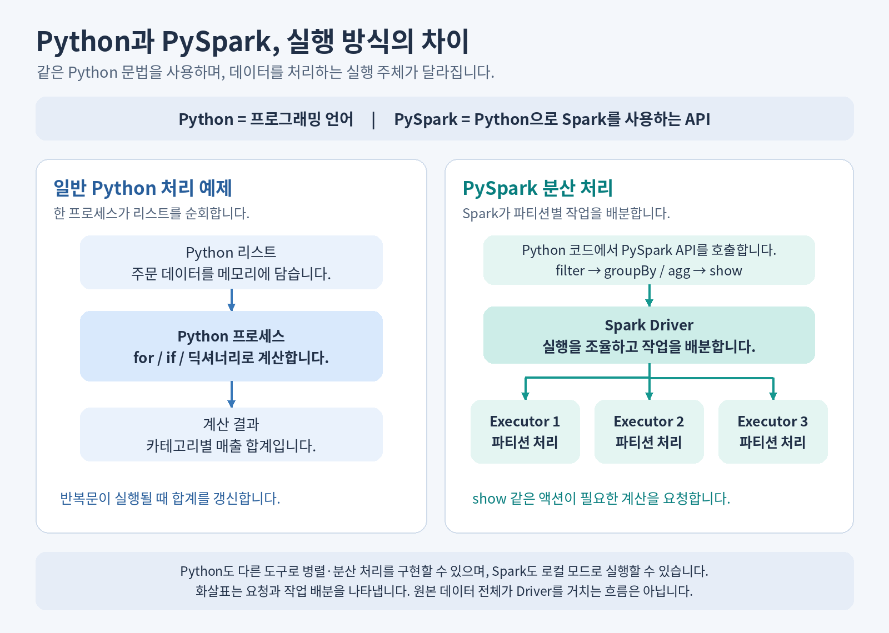
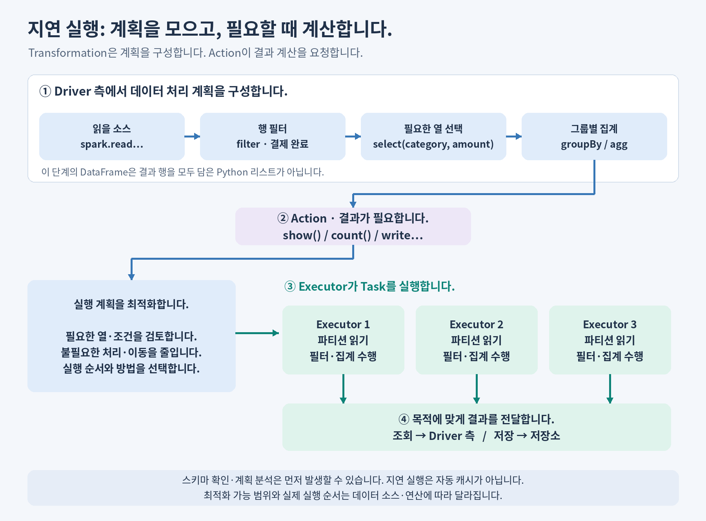
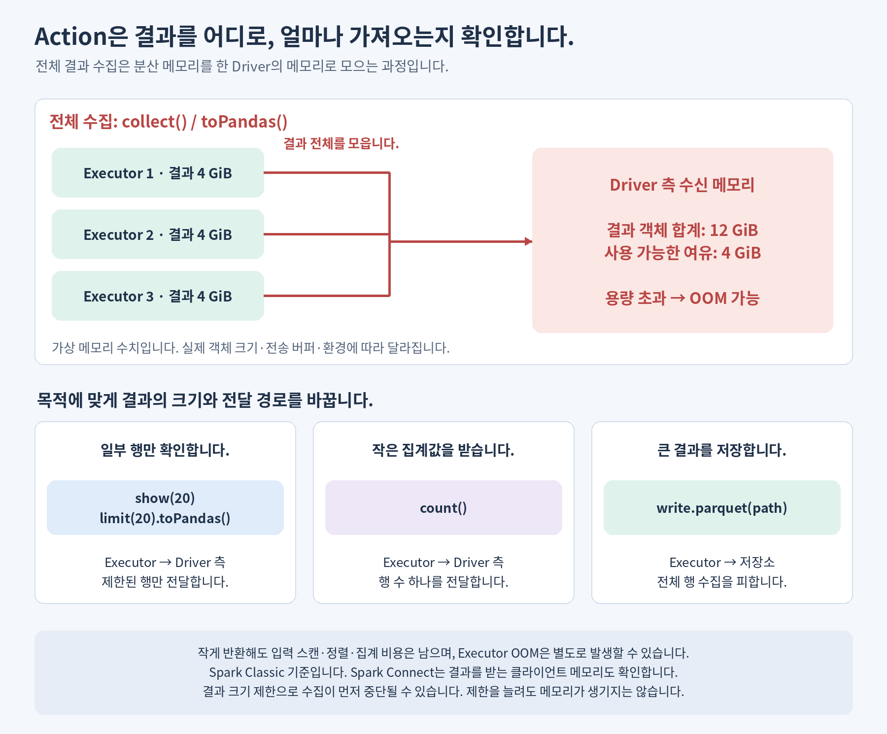
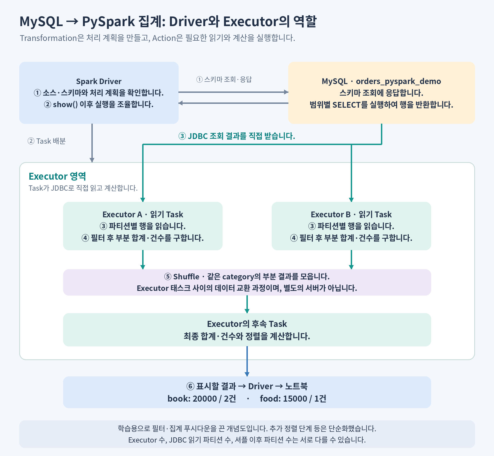
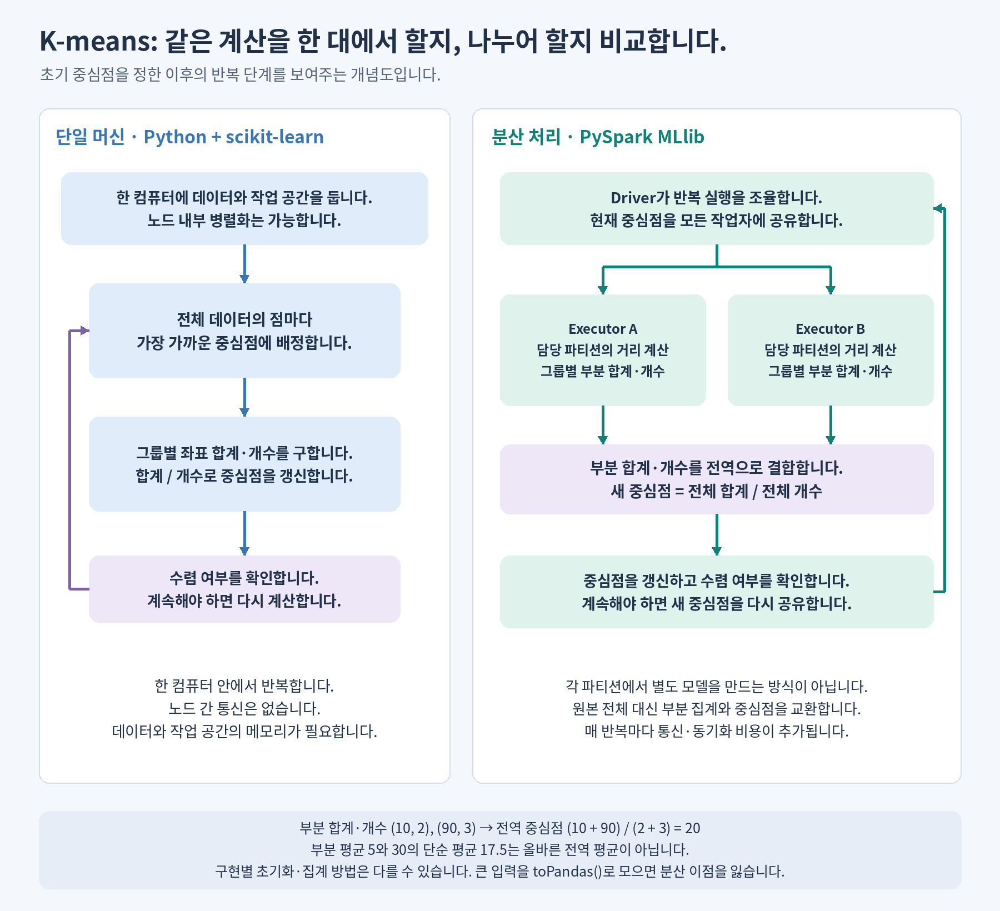

# Python과 PySpark의 차이 이해하기

> **심화 참고 자료입니다.** 처음 배우는 경우 [05. Python 집계](course/05-python.md)와 [06. Spark](course/06-spark.md)를 먼저 읽습니다. 아래 JDBC·GIL·K-means는 첫 완주 이후의 선택 주제입니다. [전체 학습 순서](../README.md) · [심화 자료 색인](reference/README.md)

Databricks를 처음 접하는 개발자를 위한 자료입니다. Python의 변수·반복문·함수 기초를 전제로 하며, **개념 → 그림 → 순수 Python·pandas·PySpark 실습 → MySQL·알고리즘 확장** 순서로 학습합니다.

처음 읽을 때는 1~5절을 따라갑니다. MySQL 환경을 준비한 뒤 6절을 실습하고, 7절에서 분산 알고리즘으로 확장합니다. 낯선 용어는 하단 용어집에서 확인합니다.

<a id="contents"></a>

## 목차

- [학습 목표](#learning-objectives)
- [1. Python, pandas, Spark, PySpark의 관계](#tools-and-language)
- [2. 작은 데이터와 큰 데이터의 병렬 처리](#parallel-processing-benefits)
- [3. 다섯 가지 실행 구조와 Driver·Executor](#execution-models)
- [4. 지연 실행, Transformation·Action과 Driver OOM](#transformations-and-actions)
- [5. 순수 Python → Python + pandas → PySpark 기본 실습](#basic-examples)
- [6. MySQL 데이터 읽기와 집계 실습](#mysql-examples)
- [7. K-means: 단일 머신과 분산 처리 비교](#distributed-clustering)
- [8. PySpark의 선택 기준과 실무 주의점](#why-pyspark)
- [9. 이해도 확인과 해설](#review-questions)
- [10. 용어집](#glossary)

<a id="learning-objectives"></a>

## 학습 목표

- Python·pandas·PySpark의 실행 위치와 병렬 처리 방식을 구분합니다.
- 지연 실행의 이유를 이해하고, 결과 크기에 맞는 Action을 선택합니다.
- 같은 집계를 세 방식으로 구현하고, MySQL과 K-means의 분산 처리 흐름을 설명합니다.

<a id="tools-and-language"></a>

## 1. Python은 언어이고, PySpark는 Spark를 사용하는 API입니다

**PySpark도 Python 문법으로 작성합니다. 차이는 데이터를 처리하는 도구와 실행 방식입니다.**

| 이름 | 역할 |
| --- | --- |
| Python | 변수·조건문·반복문 등으로 프로그램을 작성하는 범용 언어입니다. |
| pandas | 한 컴퓨터에서 표 형태의 데이터를 처리하는 Python 라이브러리입니다. |
| Apache Spark | 데이터를 나누고 실행 계획과 작업 배분을 관리하는 처리 엔진입니다. |
| PySpark | Python에서 Spark 기능을 사용하는 API입니다. |
| Databricks | 노트북과 컴퓨팅 환경 등으로 데이터 작업을 개발·실행하는 플랫폼입니다. |

Databricks의 Python 노트북에서도 일반 Python 코드가 자동으로 분산되지는 않습니다. Python은 다른 도구로 병렬·분산 처리를 구현할 수 있으며, Spark도 로컬 실행이 가능합니다. 정의와 기능 범위는 [Python 튜토리얼](https://docs.python.org/3/tutorial/)과 [PySpark 개요](https://spark.apache.org/docs/latest/api/python/)를 참고합니다.

<a id="parallel-processing-benefits"></a>

## 2. 데이터가 커지면 병렬 처리가 유리할 수 있습니다

**독립적인 일을 나누면 계산 시간이 줄어들지만, 준비·전송·결과 결합에 추가 비용이 듭니다.** 이를 오버헤드라고 합니다.



그림은 동일한 성능의 작업자 네 개가 균등하게 일을 나누고, 추가 비용은 2초라고 가정한 **설명용 예시**입니다. 특정 Python·PySpark 프로그램의 벤치마크가 아닙니다.

| 상황 | 병렬 처리의 결과 |
| --- | --- |
| 작은 작업 | `1 / 4 + 2 = 2.25초`입니다. 계산으로 절약한 시간보다 추가 비용이 큽니다. |
| 큰 작업 | `100 / 4 + 2 = 27초`입니다. 100초 대비 약 3.7배의 속도 향상을 얻습니다. |

```text
병렬 처리 시간 ≈ 나눌 수 없는 부분 + (나눌 수 있는 부분 / N) + 추가 비용
```

`N`은 실제로 동시에 활용하는 작업자 수입니다. 데이터가 작아도 계산이 무겁거나 I/O 대기가 길면 이득이 있고, 데이터가 커도 네트워크·원본 DB·불균등한 작업량이 병목이면 이득이 줄어듭니다. 관련 요소는 [Python 작업 풀](https://docs.python.org/3/library/concurrent.futures.html)과 [Spark 튜닝 문서](https://spark.apache.org/docs/latest/tuning.html)를 참고합니다.

<a id="execution-models"></a>

## 3. 프로세스·스레드·노드와 실행 구조를 구분합니다

### 먼저 실행 자원을 구분합니다

| 용어 | 의미 |
| --- | --- |
| 노드·클러스터 | 노드는 여기서 서버 또는 VM 한 대이며, 클러스터는 여러 노드의 자원을 모은 환경입니다. |
| 프로세스·스레드 | 프로세스는 원칙적으로 독립된 주소 공간을 가지며, 같은 프로세스의 스레드들은 메모리를 공유합니다. |
| CPU 코어 | 명령을 실행하는 하드웨어 자원입니다. 스레드 수와 일치하는 개념은 아닙니다. |
| 동시성·병렬성 | 동시성은 여러 작업이 겹치는 시간 동안 진행되는 성질이며, 병렬성은 실제로 같은 시점에 실행되는 성질입니다. |
| 분산 처리 | 여러 노드에 작업과 데이터를 나눕니다. 노드들이 동시에 일하면 병렬 처리이기도 합니다. |

### 다섯 가지 실행 구조를 그림으로 비교합니다



| 구조 | Python으로 구성하는 방법 | PySpark와의 관계 |
| --- | --- | --- |
| ① 단일 프로세스·단일 스레드 | 기본 반복문으로 순차 처리합니다. | `local[1]`로 Task 실행 스레드를 하나로 제한할 수 있습니다. 전체 애플리케이션이 프로세스 하나라는 뜻은 아닙니다. |
| ② 단일 프로세스·병렬 스레드 | `threading` 등을 사용합니다. 공유 값의 갱신에는 동기화가 필요합니다. | `local[N]`의 로컬 Spark 엔진이 여러 Task를 실행하는 부분에 대응합니다. |
| ③ 멀티 프로세스·병렬 스레드 | 여러 프로세스 안에 스레드를 둡니다. 프로세스 간 전달 비용이 추가됩니다. | 한 노드에 여러 Executor를 배치한 구성에 대응합니다. `local[N]`과는 구분합니다. |
| ④ 멀티 노드·분산 처리 | 원격 실행·통신이나 별도 분산 프레임워크를 구성합니다. | 여러 노드에서 노드당 Task 하나를 실행하는 예시로 표현할 수 있습니다. |
| ⑤ 멀티 노드·분산 병렬 처리 | 분산 실행과 노드 내부 병렬성을 함께 구성합니다. | 여러 노드의 Executor가 각자 여러 Task를 실행하는 대표적인 클러스터 구성입니다. |

④에서도 노드 간 병렬 처리가 가능합니다. ⑤는 **노드 내부 병렬성까지 강조한 구성**입니다. ③에서도 프로세스마다 반드시 여러 작업 스레드를 둘 필요는 없습니다. 실제 동시 실행 수는 자원과 작업량에 따라 달라집니다. 로컬 설정은 [Spark 실행 환경 문서](https://spark.apache.org/docs/latest/submitting-applications.html#master-urls)를 참고합니다.

### Python의 GIL을 확인합니다

GIL이 활성화된 CPython은 한 프로세스에서 한 번에 한 스레드만 Python 바이트코드를 실행합니다. 따라서 순수 Python CPU 계산은 스레드 수만 늘려도 코어 수만큼 빨라지지 않습니다. I/O 대기를 겹치는 스레드 사용이나 별도 프로세스의 CPU 병렬 처리는 가능합니다. 네이티브 연산·free-threaded 빌드는 조건이 다르므로 환경을 확인합니다. [threading](https://docs.python.org/3/library/threading.html), [multiprocessing](https://docs.python.org/3/library/multiprocessing.html), [free-threading 안내](https://docs.python.org/3/howto/free-threading-python.html)를 참고합니다.

### Spark의 Driver와 Executor를 구분합니다



| 역할 | 하는 일 |
| --- | --- |
| Driver | 계획을 분석하고 실행을 조율합니다. 결과 조회 시 표시할 결과를 받습니다. |
| Executor | 배정받은 Task를 실행하고 데이터를 읽고 계산합니다. |
| Partition·Task | 파티션은 데이터의 논리적 분할 단위이며, Task는 Executor가 수행하는 작업 단위입니다. |

파티션 수, Executor 수, 노드 수는 다릅니다. 원본 데이터 전체를 Driver에 모아 나누는 구조도 아닙니다. PySpark의 내장 집계는 Spark 엔진이 실행하며, Python UDF는 Python 워커와 데이터 전달 비용을 추가로 고려합니다. [Spark 클러스터 개요](https://spark.apache.org/docs/latest/cluster-overview.html)와 [UDF 안내](https://spark.apache.org/docs/latest/api/python/user_guide/udfandudtf.html)를 참고합니다.

<a id="transformations-and-actions"></a>

## 4. 지연 실행과 Action의 결과 전달 방식을 이해합니다

### 4.1. Transformation은 계획이고, Action은 실행 요청입니다

**지연 실행은 “아무것도 하지 않는다”가 아니라, 변환 계획을 쌓고 결과가 필요할 때 실제 데이터 계산을 수행하는 방식입니다.**

| 개념 | 처음 읽을 때의 의미 | 예시 |
| --- | --- | --- |
| Transformation | “결제 완료 행만 고르고 카테고리별 합계를 구합니다”라는 계획을 만듭니다. | `filter()`, `select()`, `groupBy().agg()` 등을 사용합니다. |
| Action | “그 결과를 보여 주거나 저장합니다”라고 실행을 요청합니다. | `show()`, `count()`, `collect()`, `write.parquet()` 등을 사용합니다. |

DataFrame 변수는 모든 결과 행을 이미 담은 Python 리스트가 아닙니다. 또한 변환은 새 DataFrame을 반환하므로 `filtered_df = df.filter(...)`처럼 반환값을 사용합니다. 기본 동작은 [PySpark DataFrame 빠른 시작](https://spark.apache.org/docs/latest/api/python/getting_started/quickstart_df.html)을 참고합니다.

### 4.2. 왜 바로 계산하지 않고 기다립니까?



모든 중간 결과를 매번 계산·저장하면 불필요한 데이터 처리와 이동이 늘 수 있습니다. Spark는 전체 요청을 함께 보고 **필요한 열만 읽기, 조건을 일찍 적용하기, 가능한 데이터 소스에 필터를 위임하기** 등을 검토할 수 있습니다. 지원 여부와 실제 순서는 소스·연산에 따라 달라집니다. 최적화의 배경은 [Spark SQL 안내](https://spark.apache.org/docs/latest/sql-programming-guide.html)를 참고합니다.

- `load()` 이전·이후에 스키마 확인이나 연결 작업은 발생할 수 있습니다. 지연 실행이 DB 연결까지 모두 미룬다는 뜻은 아닙니다.
- `explain()`은 계획을 확인하며 결과 행을 가져오는 Action은 아닙니다.
- `show()` 다음에 `count()`를 호출하면 다시 계산할 수 있습니다. 지연 실행은 결과 자동 캐시와 다릅니다. `cache()`도 후속 Action이 실행되어야 데이터가 채워집니다.

### 4.3. 어떤 Action은 Driver에 큰 결과를 모읍니다

**OOM(Out Of Memory)은 필요한 메모리를 확보하지 못하는 상태입니다. 분산 계산이 성공해도 전체 결과를 한곳에 모으는 순간 메모리가 부족할 수 있습니다.**



| 목적 | 호출 예시 | 결과가 향하는 곳과 크기 |
| --- | --- | --- |
| 전체 행을 Python 객체로 가져옵니다. | `df.collect()` | 전체 결과가 수신 프로세스의 리스트로 모입니다. 결과가 클 때 OOM 위험이 큽니다. |
| 전체 행을 pandas로 바꿉니다. | `df.toPandas()` | 전체 결과를 한 pandas DataFrame으로 만듭니다. Arrow를 사용해도 전체 결과가 들어갈 메모리는 필요합니다. |
| 일부 내용만 확인합니다. | `df.show(20)`, `df.limit(20).toPandas()` | 가져오는 행 수를 제한합니다. 열이 매우 크거나 많으면 작은 행 수도 메모리를 사용할 수 있습니다. |
| 행 수만 확인합니다. | `df.count()` | 원본 행 대신 행 수 하나를 반환합니다. 전체 스캔 등 Executor 계산 비용은 별개입니다. |
| 큰 결과를 저장합니다. | `df.write.parquet(path)` | Executor가 결과를 저장소에 씁니다. 전체 데이터 행을 Driver에 수집하는 방식이 아닙니다. |

`collect()`와 `toPandas()`의 전체 수집 동작은 [collect](https://spark.apache.org/docs/latest/api/python/reference/pyspark.sql/api/pyspark.sql.DataFrame.collect.html), [toPandas](https://spark.apache.org/docs/latest/api/python/reference/pyspark.sql/api/pyspark.sql.DataFrame.toPandas.html) 문서를 참고합니다. 행 수 반환과 저장은 [count](https://spark.apache.org/docs/latest/api/python/reference/pyspark.sql/api/pyspark.sql.DataFrame.count.html), [Parquet 쓰기](https://spark.apache.org/docs/latest/api/python/reference/pyspark.sql/api/pyspark.sql.DataFrameWriter.parquet.html)를 참고합니다.

**판단 기준은 입력 크기뿐 아니라 반환 결과의 크기입니다.** 큰 입력을 두 행으로 집계했다면 수집할 수 있지만, 집계 키가 매우 많으면 결과도 클 수 있습니다. 직렬화된 크기보다 Python·pandas 객체의 메모리가 커질 수도 있습니다.

그림은 Spark Classic을 기준으로 합니다. Spark Connect에서는 결과를 받는 클라이언트 메모리도 확인합니다. `show()`나 분산 저장을 사용해도 Executor의 조인·정렬·집계 중 OOM은 별도로 발생할 수 있습니다. `spark.driver.maxResultSize` 제한으로 수집이 먼저 중단될 수 있으며, 제한을 무작정 늘리는 것은 해결책이 아닙니다. [Spark 결과 크기 설정](https://spark.apache.org/docs/latest/configuration.html#application-properties)을 참고합니다.

<a id="basic-examples"></a>

## 5. 순수 Python → Python + pandas → PySpark로 집계합니다

**결제 완료 주문의 카테고리별 매출 합계**를 세 방식으로 구합니다. 금액은 정수이며 결과는 `book=20000`, `food=15000`입니다.

Databricks Python 노트북을 컴퓨팅에 연결하고 아래 셀을 순서대로 실행합니다. pandas 패키지와 제공되는 `spark` 객체를 사용하며, 외부 파일·테이블 권한은 필요하지 않습니다. `spark`는 SparkSession입니다. [Databricks 시작하기](https://www.databricks.com/spark/getting-started-with-apache-spark/quick-start)를 참고합니다.

### 셀 1: 공통 데이터를 정의합니다

```python
orders = [
    (1, "book", 12000, "paid"),
    (2, "book", 8000, "paid"),
    (3, "food", 15000, "paid"),
    (4, "food", 5000, "cancelled"),
    (5, "book", 7000, "cancelled"),
]
```

`orders`는 일반 Python 리스트입니다. 노트북에서 만들었다고 자동으로 분산되지는 않습니다.

### 셀 2: 순수 Python으로 계산합니다

```python
totals = {}

for order_id, category, amount, status in orders:
    if status == "paid":
        totals[category] = totals.get(category, 0) + amount

python_result = sorted(totals.items())
print(python_result)
```

```text
[('book', 20000), ('food', 15000)]
```

반복문이 끝나면 딕셔너리에 합계가 들어 있습니다.

### 셀 3: Python + pandas로 계산합니다

```python
import pandas as pd

orders_pdf = pd.DataFrame(
    orders,
    columns=["order_id", "category", "amount", "status"],
)

paid_orders_pdf = orders_pdf.loc[orders_pdf["status"] == "paid"]
sales_pdf = (
    paid_orders_pdf
    .groupby("category", as_index=False)
    .agg(total_amount=("amount", "sum"))
    .sort_values("category")
)

pandas_result = list(sales_pdf.itertuples(index=False, name=None))
print(pandas_result)
```

```text
[('book', 20000), ('food', 15000)]
```

`loc`으로 필터링하고 `groupby().agg()`로 집계합니다. `agg()`가 끝나면 계산 결과가 있으며 `print()`는 이를 표시합니다. `pdf`는 pandas DataFrame을 구분하기 위한 이름입니다. 일반 pandas와 `pyspark.pandas`의 pandas API on Spark는 다릅니다. [pandas GroupBy](https://pandas.pydata.org/docs/user_guide/groupby.html)를 참고합니다.

### 셀 4: PySpark로 같은 계산을 표현합니다

```python
from pyspark.sql import functions as F

orders_df = spark.createDataFrame(
    orders,
    schema="order_id INT, category STRING, amount LONG, status STRING",
)

paid_orders_df = orders_df.filter(F.col("status") == "paid")

sales_df = (
    paid_orders_df
    .groupBy("category")
    .agg(F.sum("amount").alias("total_amount"))
    .orderBy("category")
)

sales_df.show()
```

```text
+--------+------------+
|category|total_amount|
+--------+------------+
|    book|       20000|
|    food|       15000|
+--------+------------+
```

`filter()`와 집계는 계획을 구성하고 `show()`가 실행을 요청합니다. `F.col()`은 열 표현식이며 `F.sum()`은 Spark 집계 함수입니다. 행 순서는 보장되지 않으므로 비교를 위해 `orderBy()`를 사용합니다. [DataFrame API](https://spark.apache.org/docs/latest/api/python/reference/pyspark.sql/dataframe.html)를 참고합니다.

### 셀 5: 세 결과가 같은지 확인합니다

```python
# 이 예제의 집계 결과는 두 행뿐이므로 collect()로 가져와 비교합니다.
spark_result = [
    (row["category"], row["total_amount"])
    for row in sales_df.collect()
]

assert python_result == pandas_result == spark_result
print("세 방식의 집계 결과가 같습니다.")
```

두 행뿐인 결과를 비교하기 위해 `collect()`를 사용합니다. 큰 데이터는 Python 리스트에 먼저 담지 않고 `spark.table(...)` 또는 `spark.read...`로 읽습니다.

<a id="mysql-examples"></a>

## 6. MySQL도 순수 Python → pandas → PySpark로 집계합니다

이번에는 같은 주문 테이블에서 **매출과 주문 수**를 구합니다. 필터·집계를 비교하려고 SQL에는 `WHERE`·`GROUP BY`를 넣지 않고, Spark의 일부 푸시다운도 끕니다. 운영에서는 DB에서 집계해 필요한 결과만 읽는 방식도 검토합니다.

여기서 “순수 Python”은 집계를 반복문으로 구현한다는 뜻입니다. 연결에는 PyMySQL을 사용합니다.

### 6.1. 환경과 공통 데이터를 준비합니다

이 실습은 MySQL에 연결할 수 있는 **Databricks 클래식 컴퓨팅**을 기준으로 합니다. Serverless·SQL Warehouse에 그대로 적용하는 설정은 아닙니다.

<details>
<summary>연결 준비 사항을 확인합니다.</summary>

| 항목 | 준비 사항 |
| --- | --- |
| 네트워크·권한 | Driver와 Executor에서 MySQL에 접근할 수 있어야 합니다. 읽기 계정에는 테이블의 `SELECT` 권한을 준비합니다. |
| Python 패키지 | `PyMySQL`, `pandas`, `SQLAlchemy`를 준비합니다. 누락된 패키지는 노트북의 `%pip install`로 설치합니다. |
| JDBC 라이브러리 | MySQL·Java 버전에 맞는 Connector/J를 Driver와 Executor에서 사용할 수 있게 설치합니다. Python 패키지 설치와 다릅니다. |
| Secret | `mysql-training` Scope의 `username`, `password`와 읽기 권한을 준비합니다. |
| TLS | Python과 Java의 신뢰 저장소를 각각 설정하고 서버 인증서·호스트 이름 검증을 준비합니다. |

[컴퓨팅 라이브러리](https://docs.databricks.com/aws/en/libraries/cluster-libraries), [Secret 관리](https://docs.databricks.com/aws/en/security/secrets), [MySQL TLS](https://dev.mysql.com/doc/connector-j/en/connector-j-reference-using-ssl.html)를 참고합니다.

</details>

다음 SQL은 준비된 `education` 데이터베이스의 **MySQL 클라이언트에서 한 번만** 실행합니다. Spark SQL 셀에서 실행하지 않습니다.

```sql
CREATE TABLE education.orders_pyspark_demo (
    order_id BIGINT PRIMARY KEY,
    category VARCHAR(30) NOT NULL,
    amount BIGINT NOT NULL,
    status VARCHAR(20) NOT NULL
);

INSERT INTO education.orders_pyspark_demo
    (order_id, category, amount, status)
VALUES
    (1, 'book', 12000, 'paid'),
    (2, 'book', 8000, 'paid'),
    (3, 'food', 15000, 'paid'),
    (4, 'food', 5000, 'cancelled'),
    (5, 'book', 7000, 'cancelled');
```

다음부터는 Databricks Python 셀입니다. 호스트를 변경하고 Secret을 준비합니다. 사설 CA라면 `ssl.create_default_context(cafile="CA 파일 경로")`를 사용하며 JDBC 신뢰 설정은 별도로 합니다.

```python
import ssl

mysql_host = "mysql.example.com"
mysql_port = 3306
mysql_database = "education"
mysql_user = dbutils.secrets.get(scope="mysql-training", key="username")
mysql_password = dbutils.secrets.get(scope="mysql-training", key="password")
mysql_tls = ssl.create_default_context()

orders_query = """
SELECT order_id, category, amount, status
FROM orders_pyspark_demo
"""
```

### 6.2. 순수 Python으로 읽고 집계합니다

```python
import pymysql

mysql_totals = {}

with pymysql.connect(
    host=mysql_host,
    port=mysql_port,
    user=mysql_user,
    password=mysql_password,
    database=mysql_database,
    ssl=mysql_tls,
    cursorclass=pymysql.cursors.SSCursor,
) as connection:
    with connection.cursor() as cursor:
        cursor.execute(orders_query)
        for order_id, category, amount, status in cursor:
            if status == "paid":
                summary = mysql_totals.setdefault(
                    category, {"total_amount": 0, "order_count": 0}
                )
                summary["total_amount"] += amount
                summary["order_count"] += 1

mysql_python_result = [
    (category, summary["total_amount"], summary["order_count"])
    for category, summary in sorted(mysql_totals.items())
]
print(mysql_python_result)
```

```text
[('book', 20000, 2), ('food', 15000, 1)]
```

`SSCursor`는 조회 결과를 한꺼번에 버퍼링하지 않고 순회합니다. 집계 상태는 Python 메모리에 남으므로 카테고리가 많으면 메모리도 증가합니다. `with`가 연결과 커서를 닫습니다. [PyMySQL 연결](https://pymysql.readthedocs.io/en/latest/modules/connections.html)과 [커서](https://pymysql.readthedocs.io/en/latest/modules/cursors.html#pymysql.cursors.SSCursor)를 참고합니다.

### 6.3. Python + pandas로 읽고 집계합니다

```python
import pandas as pd
from sqlalchemy import URL, create_engine, text

mysql_url = URL.create(
    "mysql+pymysql",
    username=mysql_user,
    password=mysql_password,
    host=mysql_host,
    port=mysql_port,
    database=mysql_database,
)
engine = create_engine(mysql_url, connect_args={"ssl": mysql_tls})

try:
    with engine.connect() as connection:
        mysql_orders_pdf = pd.read_sql_query(text(orders_query), connection)
finally:
    engine.dispose()

mysql_paid_pdf = mysql_orders_pdf.loc[mysql_orders_pdf["status"] == "paid"]
mysql_sales_pdf = (
    mysql_paid_pdf
    .groupby("category", as_index=False)
    .agg(
        total_amount=("amount", "sum"),
        order_count=("order_id", "size"),
    )
    .sort_values("category")
)

mysql_pandas_result = list(mysql_sales_pdf.itertuples(index=False, name=None))
print(mysql_pandas_result)
assert mysql_python_result == mysql_pandas_result
```

```text
[('book', 20000, 2), ('food', 15000, 1)]
```

이 예제의 `read_sql_query()`는 전체 결과를 pandas로 읽습니다. `size`는 그룹의 행 수를 세며, 계산은 Python 프로세스에서 수행합니다. `URL.create()`는 특수문자가 있는 비밀번호도 직접 URL에 조합하지 않고 전달하며, `dispose()`는 연결 풀을 정리합니다. [pandas SQL 읽기](https://pandas.pydata.org/docs/reference/api/pandas.read_sql_query.html), [SQLAlchemy Engine](https://docs.sqlalchemy.org/en/20/core/engines.html)을 참고합니다.

### 6.4. PySpark로 읽고 집계합니다

#### 읽을 소스를 정의합니다

6.1절의 공통 연결 정보를 사용합니다.

```python
from pyspark.sql import functions as F

jdbc_url = (
    f"jdbc:mysql://{mysql_host}:{mysql_port}/{mysql_database}"
    "?sslMode=VERIFY_IDENTITY"
)

mysql_orders_df = (
    spark.read
    .format("jdbc")
    .option("url", jdbc_url)
    .option("dbtable", "orders_pyspark_demo")
    .option("driver", "com.mysql.cj.jdbc.Driver")
    .option("user", mysql_user)
    .option("password", mysql_password)
    .option("partitionColumn", "order_id")
    .option("lowerBound", "1")
    .option("upperBound", "6")
    .option("numPartitions", "2")
    # 학습용: 필터와 집계를 Spark에서 관찰하도록 푸시다운을 끕니다.
    .option("pushDownPredicate", "false")
    .option("pushDownAggregate", "false")
    .load()
)
```

`.load()`는 DataFrame을 만들며 **스키마 조회가 이때 발생할 수 있습니다.** `driver` 옵션은 JDBC 라이브러리 클래스 이름으로 Spark Driver 프로세스와 다릅니다. [JDBC 읽기](https://docs.databricks.com/aws/en/archive/connectors/jdbc)와 [Connector/J 클래스](https://dev.mysql.com/doc/connector-j/en/connector-j-usagenotes-connect-drivermanager.html)를 참고합니다.

| 옵션 | 의미 |
| --- | --- |
| `partitionColumn` | 주문 번호로 JDBC 읽기 범위를 나눕니다. MySQL 테이블 자체를 분할하지 않습니다. |
| `lowerBound`, `upperBound` | 분할 간격의 기준이며 **행을 걸러내는 조건이 아닙니다.** |
| `numPartitions=2` | JDBC 읽기의 최대 파티션 수입니다. Executor 수나 최종 결과 행 수가 아닙니다. |
| `pushDownPredicate=false` | 학습용으로 필터를 Spark에서 처리합니다. 읽기 범위 구분 SQL은 계속 사용합니다. |
| `pushDownAggregate=false` | JDBC V2 경로의 집계 위임을 끕니다. V1은 이 옵션 없이도 Spark에서 집계합니다. |

옵션 범위는 [Spark JDBC 문서](https://spark.apache.org/docs/latest/sql-data-sources-jdbc.html)를 참고합니다.

#### Transformation으로 집계 계획을 만듭니다

```python
mysql_paid_df = (
    mysql_orders_df
    .filter(F.col("status") == "paid")
    .select("category", "amount")
)

mysql_sales_df = (
    mysql_paid_df
    .groupBy("category")
    .agg(
        F.sum("amount").alias("total_amount"),
        F.count("*").alias("order_count"),
    )
    .orderBy("category")
)

# 결과 행을 읽는 대신 실행 계획을 확인합니다.
mysql_sales_df.explain(mode="formatted")
```

`F.count("*")`는 집계 표현식이고, DataFrame의 `count()`는 행 수를 반환하는 Action입니다. `explain()`에서 읽기·필터·집계·`Exchange`를 찾아봅니다. 실제 연산 이름은 환경에 따라 달라집니다. [explain 문서](https://spark.apache.org/docs/latest/api/python/reference/pyspark.sql/api/pyspark.sql.DataFrame.explain.html)를 참고합니다.

#### Action으로 결과를 확인합니다

```python
# Action: 필요한 JDBC 읽기와 집계를 실행하고 결과를 표시합니다.
mysql_sales_df.show(truncate=False)
```

```text
+--------+------------+-----------+
|category|total_amount|order_count|
+--------+------------+-----------+
|book    |20000       |2          |
|food    |15000       |1          |
+--------+------------+-----------+
```

합계를 구하려면 입력 전체를 확인해야 합니다. 뒤이어 `mysql_sales_df.count()`를 호출하면 주문 수 3이 아니라 **집계 결과의 행 수 2**를 반환하며, 캐시가 없으면 MySQL을 다시 읽을 수 있습니다.

### 6.5. 읽기와 집계의 실행 위치를 비교합니다



| 방식 | 읽기와 집계를 수행하는 위치 |
| --- | --- |
| 순수 Python | 노트북의 Python 프로세스가 커서를 읽고 딕셔너리로 계산합니다. |
| Python + pandas | 같은 프로세스가 조회 결과를 DataFrame으로 읽고 집계합니다. |
| PySpark | Driver는 계획과 실행을 조율하고, Executor의 Task가 직접 읽고 집계합니다. |

**원본 전체를 Driver에 모아 나누지 않으며, 최종 집계도 Executor가 수행합니다.** 셔플은 중간 데이터를 교환하는 과정이지 별도 서버가 아닙니다. 실제 Executor 수와 셔플 파티션 수는 그림 및 JDBC 읽기 파티션 수와 다를 수 있습니다.

### 6.6. 실습에서 확인할 주의점입니다

- 병렬 조회를 늘리면 MySQL 부하도 증가합니다. `numPartitions`는 DB 전체 연결 수의 상한이 아닙니다.
- 여러 연결이 자동으로 같은 시점의 스냅샷을 읽지는 않습니다. 비교 중에는 테이블을 변경하지 않습니다.
- 범위 필터는 실제 조건으로 작성합니다. `lowerBound`·`upperBound`로 제한하지 않습니다.

<a id="distributed-clustering"></a>

## 7. K-means로 단일 머신과 분산 알고리즘을 비교합니다

**K-means는 비슷한 데이터 점을 `k`개 그룹으로 묶는 알고리즘입니다.** 여기서 “클러스터”는 데이터 그룹이며, 서버 묶음인 Spark 클러스터와 의미가 다릅니다.

### 한 번의 반복에서 무엇을 계산합니까?

1. 각 데이터 점을 가장 가까운 중심점에 배정합니다.
2. 그룹별 좌표 합계와 개수를 구합니다.
3. `새 중심점 = 좌표 합계 / 개수`로 갱신합니다.
4. 중심점이 충분히 안정되거나 반복 한도에 도달할 때까지 반복합니다.

그림은 중심점 초기화를 마친 **배치 K-means의 반복 단계**를 단순화합니다. 초기화 방식과 구체적인 실행 계획은 구현에 따라 다릅니다. [scikit-learn K-means](https://scikit-learn.org/stable/modules/clustering.html#k-means)와 [Spark MLlib 클러스터링](https://spark.apache.org/docs/latest/ml-clustering.html)을 참고합니다.



| 비교 | 단일 머신: Python + scikit-learn 등 | 분산: PySpark MLlib |
| --- | --- | --- |
| 데이터 위치 | 일반적인 배치 학습은 한 컴퓨터에 데이터와 작업 공간을 둡니다. | 데이터 행을 여러 파티션과 Executor에 나눕니다. |
| 거리 계산 | 한 컴퓨터의 CPU를 사용합니다. 내부 병렬화가 가능하므로 단일 스레드라는 뜻은 아닙니다. | 각 Executor가 자신이 담당하는 행에 대해 같은 중심점들과의 거리를 계산합니다. |
| 중심점 갱신 | 한 컴퓨터에서 합계와 개수로 갱신합니다. | 그룹별 부분 합계·개수를 결합해 전역 중심점을 만들고 공유합니다. |
| 반복 비용 | 노드 간 통신이 없으므로 작은 데이터에서 간단합니다. | 매 반복마다 계산 외에 집계·중심점 전달·동기화 비용이 듭니다. |
| 적합한 상황 | 데이터와 작업 공간이 한 대에 들어가고 처리 시간이 충분합니다. | 한 대의 자원이 부족하고, 분할 계산의 이득이 통신 비용을 넘어섭니다. |

**각 파티션에서 K-means를 따로 학습하고 중심점을 단순 평균하는 방식이 아닙니다.** 모든 파티션이 같은 현재 중심점으로 계산합니다. 예를 들어 같은 그룹의 부분 합계·개수가 `(10, 2)`, `(90, 3)`이면 새 중심점은 `(10 + 90) / (2 + 3) = 20`입니다. 부분 평균 `5`와 `30`의 단순 평균 `17.5`는 올바른 전역 평균이 아닙니다.

### 앞에서 배운 지연 실행·OOM과 연결합니다

- PySpark ML의 `KMeans.fit()`은 모델 학습 메서드이며, 내부적으로 반복적인 Spark 계산을 실행합니다. DataFrame 변환만 정의하는 호출과 다릅니다. 학습 후 `model.transform()`으로 만든 예측 DataFrame은 결과 조회·저장 시 계산됩니다. [KMeans API](https://spark.apache.org/docs/latest/api/python/reference/api/pyspark.ml.clustering.KMeans.html)를 참고합니다.
- 분산 학습을 하려는데 먼저 `toPandas()`로 전체 입력을 가져오면 한 컴퓨터의 메모리 한계로 돌아갑니다. 큰 예측 결과도 수집 대신 분산 저장을 고려합니다.
- 중심점 수 `k`와 특성 차원 `d`가 크면 중심점·집계 버퍼도 커집니다. 분산한다고 모든 메모리 제약이 사라지지는 않습니다. 같은 설정이어도 초기화·수치 연산·구현 차이로 결과가 완전히 같다고 보장하지 않습니다.

다른 알고리즘도 동일하게 분산되는 것은 아닙니다. **독립적으로 계산할 수 있는 부분과, 반복마다 교환해야 하는 데이터의 크기**를 함께 확인합니다.

<a id="why-pyspark"></a>

## 8. PySpark의 선택 기준과 실무 주의점을 정리합니다

PySpark는 Python으로 처리 의도를 표현하면서 **데이터 분할, 계획 최적화, Task 배분, 셔플, 재시도·재계산**을 Spark에 맡기기 위해 사용합니다. 스레드·프로세스 풀만 늘리는 것보다 분산 데이터 처리의 구현 부담을 줄입니다. [Spark SQL](https://spark.apache.org/docs/latest/sql-programming-guide.html)과 [데이터 재계산](https://spark.apache.org/docs/latest/rdd-programming-guide.html#rdd-persistence)을 참고합니다.

| 필요 | 우선 고려할 방식 |
| --- | --- |
| 작은 자동화·API 호출 | Python을 사용합니다. I/O 대기와 CPU 계산을 구분합니다. |
| 한 컴퓨터에서 충분한 분석 | pandas 또는 단일 머신 알고리즘을 고려합니다. |
| 대규모 집계·조인·분산 학습 | PySpark·Spark SQL·MLlib을 고려합니다. |
| DB가 효율적으로 집계할 수 있는 조회 | SQL로 필터·집계한 결과만 읽는 방법도 검토합니다. |

<a id="databricks-cautions"></a>

### 실무에서 기억할 네 가지입니다

- 노트북의 일반 Python 반복문은 자동으로 분산되지 않습니다.
- 입력이 커도 최종 결과는 작을 수 있습니다. **Action이 가져오는 결과 크기**를 확인합니다.
- Executor를 늘리기 전에 셔플, 데이터 편중, 원본 DB 부하를 확인합니다.
- 재시도 기능이 코드 오류나 읽을 수 없는 원본까지 해결하지는 않습니다.

실제 실행 계획과 처리 시간으로 선택하며, [Spark 성능 조정 문서](https://spark.apache.org/docs/latest/sql-performance-tuning.html)를 참고합니다.

<a id="review-questions"></a>

## 9. 이해도를 확인합니다

1. Python·pandas·PySpark의 관계와 실행 위치를 설명합니다.
2. 작은 작업에서 병렬 처리가 더 느릴 수 있는 이유를 설명합니다.
3. GIL이 활성화된 CPython에서 스레드만 늘려도 CPU 계산이 빨라지는지 설명합니다.
4. Transformation과 Action의 차이 및 지연 실행의 이점을 설명합니다.
5. `collect()`, `count()`, 분산 저장이 Driver에 전달하는 결과를 비교합니다.
6. 기본 실습에 `(6, "food", 3000, "paid")`를 추가하고 셀 2부터 재실행한 결과를 예측합니다.
7. JDBC `load()`의 스키마 조회와 Action 이후 Executor의 읽기를 구분합니다.
8. K-means에서 파티션별 평균을 단순 평균하면 안 되는 이유를 설명합니다.

<details>
<summary>정답과 해설을 확인합니다.</summary>

1. Python은 언어, pandas는 한 컴퓨터의 표 처리 라이브러리, PySpark는 Spark API입니다. Spark 작업은 Driver가 조율하고 Executor가 실행합니다.
2. 절약한 계산 시간보다 준비·전송·결합 비용이 클 수 있습니다.
3. 그렇지 않습니다. Python 바이트코드의 GIL 제약과 실제 코어·작업 조건을 확인합니다.
4. 변환은 계획을 만들고 Action은 실행을 요청합니다. 전체 요청을 보고 불필요한 읽기·계산·이동을 줄일 기회를 얻습니다.
5. `collect()`는 전체 행, `count()`는 행 수 하나를 가져옵니다. 분산 저장은 전체 행을 Driver에 모으지 않습니다.
6. 세 방식 모두 `book=20000`, `food=18000`입니다.
7. `load()`에서 스키마 확인이 발생할 수 있지만, 집계용 행 읽기와 계산은 Action이 요청한 Executor 작업에서 수행합니다.
8. 파티션별 그룹 크기가 다를 수 있으므로 부분 합계와 개수를 합쳐 전역 평균을 구해야 합니다.

</details>

<a id="glossary"></a>

## 10. 용어집

본문에서 사용한 용어를 정리합니다. 비슷한 이름이더라도 실행 위치와 역할이 다를 수 있으므로 함께 비교합니다.

### 언어와 데이터 처리 도구

| 용어 | 설명 |
| --- | --- |
| Python | 프로그램을 작성하는 범용 언어입니다. 이 문서의 순수 Python 예제는 반복문과 딕셔너리로 필터와 집계를 구현합니다. |
| pandas | Python에서 표 형태의 데이터를 처리하는 라이브러리입니다. 이 문서의 pandas 예제는 한 컴퓨터의 메모리에서 계산합니다. |
| Apache Spark | 데이터를 파티션으로 나누고 실행 계획과 작업 배분을 관리하는 데이터 처리 엔진입니다. 로컬 모드와 클러스터 실행을 지원합니다. |
| PySpark | Python으로 Spark를 사용하는 API입니다. Python과 별개의 프로그래밍 언어가 아닙니다. |
| Spark SQL | 구조화된 데이터를 SQL 또는 DataFrame API로 처리하는 Spark 구성 요소입니다. 두 API는 같은 실행 엔진을 활용합니다. |
| Databricks | 노트북과 컴퓨팅 환경 등을 통해 데이터 처리 작업을 개발하고 실행하는 플랫폼입니다. |
| DataFrame | 행과 열로 표현하는 데이터 구조 또는 추상화입니다. pandas DataFrame과 Spark DataFrame은 메서드와 실행 방식이 서로 다릅니다. |
| 스키마(Schema) | 데이터의 열 이름과 자료형 등을 정의한 구조입니다. 예제의 `order_id BIGINT`처럼 열의 의미와 형식을 명시합니다. |
| SparkSession | DataFrame 생성, 데이터 읽기, SQL 실행 등 Spark 기능을 호출하는 진입점입니다. Databricks 예제에서는 `spark` 객체로 사용합니다. |

### 실행 자원과 병렬 처리

| 용어 | 설명 |
| --- | --- |
| 노드(Node) | 이 문서에서는 클러스터에 참여하는 물리 서버 또는 가상 머신 한 대를 뜻합니다. |
| 클러스터(Cluster) | 여러 노드의 자원을 모아 작업을 실행하는 환경입니다. |
| CPU 코어 | 명령을 실행하는 하드웨어 자원입니다. 프로세스나 스레드의 개수와 일치하는 개념은 아닙니다. |
| 프로세스(Process) | 실행 중인 프로그램의 인스턴스입니다. 원칙적으로 독립된 주소 공간을 가집니다. |
| 스레드(Thread) | 프로세스 안에서 명령을 실행하는 흐름입니다. 같은 프로세스의 스레드들은 메모리를 공유합니다. |
| 동시성(Concurrency) | 여러 작업이 겹치는 시간 동안 진행되는 성질입니다. 반드시 같은 순간에 CPU에서 실행될 필요는 없습니다. |
| 병렬성(Parallelism) | 여러 작업이 실제로 같은 시점에 실행되는 성질입니다. 사용할 수 있는 자원과 작업 구조에 영향을 받습니다. |
| 분산 처리(Distributed Processing) | 작업과 데이터를 네트워크로 연결된 여러 노드에 나누는 방식입니다. 병렬 처리와 함께 성립할 수 있습니다. |
| GIL(Global Interpreter Lock) | GIL이 활성화된 CPython에서 한 프로세스 안의 Python 바이트코드 실행을 한 번에 한 스레드로 제한하는 잠금입니다. 네이티브 연산이나 free-threaded 빌드에는 다른 조건이 적용될 수 있습니다. |
| CPU 중심 작업(CPU-bound) | 실행 시간에서 계산이 큰 비중을 차지하는 작업입니다. 순수 Python의 무거운 반복 계산 등이 해당할 수 있습니다. |
| I/O 중심 작업(I/O-bound) | 네트워크나 디스크 등의 응답 대기가 큰 비중을 차지하는 작업입니다. 여러 요청의 대기를 겹치면 처리량을 개선할 수 있습니다. |
| 오버헤드(Overhead) | 작업 준비, 데이터 전달, 실행 배정, 결과 결합 등 본래 계산 외에 추가로 드는 비용입니다. 병렬 처리로 절약한 시간보다 크면 전체 실행이 더 느려질 수 있습니다. |

### Spark의 실행 과정

| 용어 | 설명 |
| --- | --- |
| 드라이버(Driver) | Spark 애플리케이션의 실행 계획과 작업 배분을 조율하는 프로세스입니다. JDBC 드라이버 라이브러리와는 다른 개념입니다. |
| 실행기(Executor) | Driver가 배정한 Task를 실행하고 데이터를 처리하는 프로세스입니다. 자원 설정에 따라 여러 Task를 동시에 실행할 수 있습니다. |
| 파티션(Partition) | 데이터를 나누어 처리하는 논리적인 단위입니다. 노드 수나 Executor 수와 일치할 필요는 없습니다. |
| 태스크(Task) | Executor에 배정하는 실행 작업 단위입니다. 일반적인 Spark 데이터 처리에서는 한 Stage의 한 파티션을 처리합니다. |
| 스테이지(Stage) | 함께 실행할 수 있는 Task들을 묶은 실행 단계입니다. 셔플 같은 데이터 교환 경계에서 단계가 나뉠 수 있습니다. |
| 잡(Job) | Action 요청에 따라 실행되는 병렬 계산 작업입니다. Action 하나를 실행하는 과정에서 Job이 여러 개 발생할 수도 있습니다. |
| 변환(Transformation) | 새로운 데이터 처리 계획을 만드는 연산입니다. Spark의 `filter()`, `select()`, `groupBy().agg()` 등이 해당합니다. |
| 액션(Action) | 결과를 조회하거나 저장하기 위해 계산 실행을 요청하는 연산입니다. Spark의 `show()`, `count()`, `collect()` 등이 해당합니다. |
| 지연 실행(Lazy Evaluation) | 변환 결과를 즉시 모두 계산하지 않고, 결과가 필요한 시점에 실행하는 방식입니다. 앞서 스키마 조회나 계획 분석이 발생할 수는 있습니다. |
| 실행 계획(Execution Plan) | 데이터를 어떤 순서와 연산으로 처리할지 나타내는 계획입니다. Spark는 이를 분석하고 최적화하며, `explain()`으로 확인할 수 있습니다. |
| 셔플(Shuffle) | 같은 키의 집계나 조인 등을 위해 파티션 사이에서 데이터를 재분배하는 과정입니다. 네트워크와 디스크 사용 비용이 발생할 수 있습니다. |
| AQE(Adaptive Query Execution) | 실행 중 얻은 통계를 활용해 물리 실행 계획을 조정하는 기능입니다. 셔플 파티션을 합치는 등의 최적화를 수행할 수 있습니다. |
| OOM(Out Of Memory) | 필요한 메모리를 확보하지 못하는 상태입니다. 결과 수집 중 Driver·클라이언트에서 발생하거나 계산 중 Executor에서 발생할 수 있습니다. |
| 캐시(Cache) | 계산한 데이터를 재사용할 수 있도록 보관하는 기능입니다. Spark의 `cache()` 호출만으로 모든 데이터가 즉시 읽히거나 저장되지는 않습니다. |
| UDF(User-Defined Function) | 사용자가 정의하여 데이터 처리에 적용하는 함수입니다. Python UDF는 Python 워커 실행과 데이터 전달 비용 등을 고려해야 합니다. |
| Python 워커(Python Worker) | Executor 측에서 Python UDF 등 사용자 Python 코드를 실행하는 프로세스입니다. Spark Driver나 Executor 자체와 동일한 프로세스는 아닙니다. |
| 직렬화(Serialization) | 객체를 저장하거나 다른 프로세스·노드로 전달할 수 있는 형식으로 변환하는 작업입니다. 역직렬화는 그 형식에서 객체를 복원하는 작업입니다. |

### 데이터베이스 연결과 조회

| 용어 | 설명 |
| --- | --- |
| JDBC(Java Database Connectivity) | Java 기반 프로그램에서 데이터베이스에 연결하고 조회하는 인터페이스입니다. Spark의 MySQL 예제에서는 JDBC 데이터 소스를 사용합니다. |
| JDBC 드라이버 | 데이터베이스별 JDBC 연결을 구현한 라이브러리입니다. MySQL 예제에서는 Connector/J를 사용하며, Spark Driver 프로세스와 구분합니다. |
| PyMySQL | Python에서 MySQL에 연결하는 라이브러리입니다. 순수 Python 예제에서 연결과 커서 조회에 사용합니다. |
| SQLAlchemy | Python에서 데이터베이스 연결과 SQL 실행 등을 다루는 라이브러리입니다. pandas 예제에서는 연결 엔진을 제공하고 실제 MySQL 연결에는 PyMySQL을 사용합니다. |
| 커서(Cursor) | SQL을 실행하고 조회 결과를 읽는 객체입니다. 예제의 `SSCursor`는 결과 전체를 한꺼번에 버퍼에 담지 않고 순회합니다. |
| 연결 풀(Connection Pool) | 데이터베이스 연결을 재사용하기 위해 관리하는 구조입니다. pandas 예제에서는 작업 후 `engine.dispose()`로 풀을 정리합니다. |
| 푸시다운(Pushdown) | 필터나 집계 같은 연산을 데이터 소스 쪽에서 수행하도록 전달하는 최적화입니다. MySQL 실습에서는 Spark의 실행 위치를 관찰하기 위해 일부 푸시다운을 끕니다. |
| TLS(Transport Layer Security) | 네트워크 통신을 암호화하고 인증서로 상대를 확인하는 데 사용하는 프로토콜입니다. 예제에서는 인증서 신뢰와 호스트 이름 검증을 준비합니다. |
| Secret / Secret Scope | 비밀번호 등 비밀 값을 코드 밖에서 관리하는 항목과 그 모음입니다. 예제에서는 `dbutils.secrets.get()`으로 MySQL 인증 정보를 읽습니다. |

### 알고리즘과 학습

| 용어 | 설명 |
| --- | --- |
| 클러스터링(Clustering) | 비슷한 데이터 점을 그룹으로 묶는 작업입니다. 서버를 모은 컴퓨팅 클러스터와 구분합니다. |
| K-means | 데이터를 가까운 중심점에 배정하고 중심점을 갱신하는 과정을 반복하여 `k`개 그룹을 찾는 알고리즘입니다. |
| 중심점(Centroid) | 그룹을 대표하는 위치입니다. 여기서 설명한 배치 K-means는 해당 그룹의 좌표 평균으로 갱신합니다. |
| 특성(Feature) | 모델에 입력하는 수치 등의 속성입니다. 특성 수가 많으면 거리 계산과 메모리 사용량도 커질 수 있습니다. |
| MLlib | Spark의 머신러닝 라이브러리입니다. 이 문서에서는 DataFrame 기반 `pyspark.ml`의 KMeans를 설명합니다. |
| fit / transform | ML의 `fit()`은 모델을 학습하고, 학습한 모델의 `transform()`은 입력에 예측 등을 추가합니다. Spark ML의 예측 DataFrame은 지연 계산될 수 있습니다. |

[문서 목차로 돌아갑니다.](#contents)

[교육 목차로 돌아갑니다.](../README.md)
