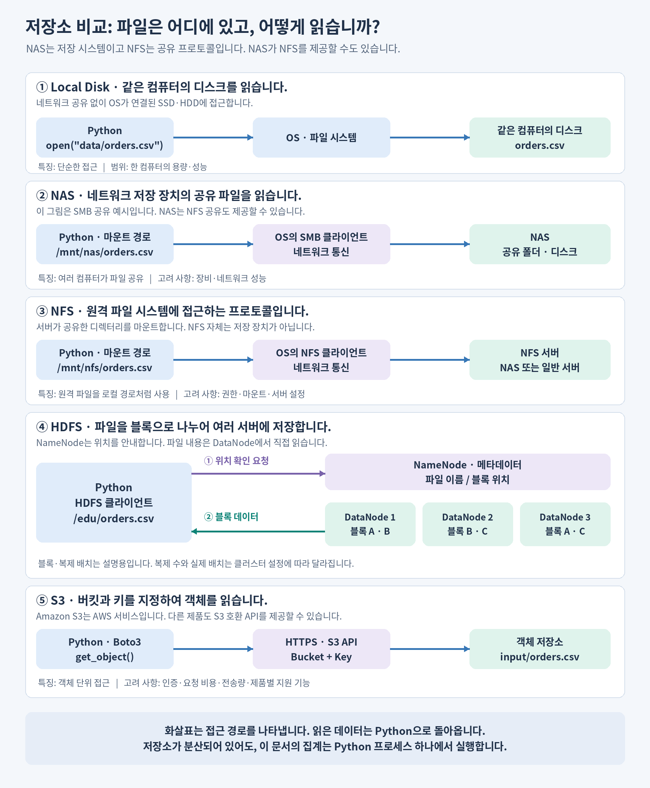
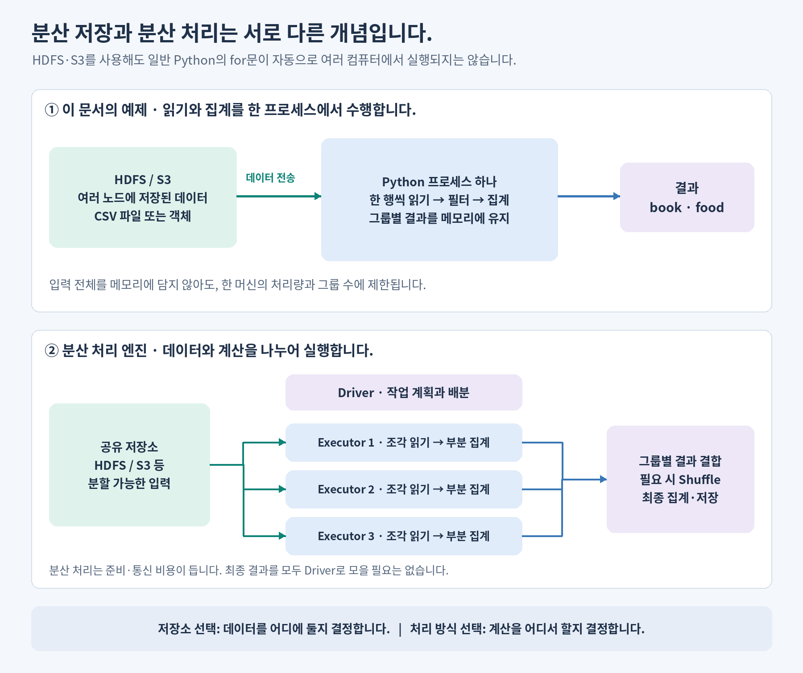

# 저장소 이해하기: Local Disk, NAS, NFS, HDFS, S3

**저장소는 데이터를 어디에 두고 어떻게 읽는지를 결정합니다. Python·PySpark는 읽은 데이터를 어떻게 처리할지를 결정합니다.** 이 문서에서는 저장 구조를 비교하고, 같은 CSV를 Python으로 읽어 집계합니다.

<a id="contents"></a>

## 목차

- [1. 다섯 가지 개념을 그림으로 비교합니다](#storage-overview)
- [2. 각 저장 방식의 장단점을 비교합니다](#tradeoffs)
- [3. 실습 데이터와 공통 집계 함수를 준비합니다](#shared-example)
- [4. Local Disk의 파일을 읽습니다](#local-disk)
- [5. NAS의 공유 파일을 읽습니다](#nas)
- [6. NFS로 공유한 파일을 읽습니다](#nfs)
- [7. HDFS의 파일을 읽습니다](#hdfs)
- [8. Amazon S3와 S3 호환 저장소의 객체를 읽습니다](#s3)
- [9. 분산 저장과 분산 처리를 구분합니다](#storage-vs-compute)
- [10. 용어집](#glossary)

<a id="storage-overview"></a>

## 1. 다섯 가지 개념을 그림으로 비교합니다

**NAS는 네트워크 저장 장치·시스템이고, NFS는 파일 공유 프로토콜입니다.** NAS가 NFS를 제공할 수 있으므로 서로 배타적인 다섯 제품을 비교하는 것은 아닙니다. 아래에서는 접근 경로를 이해하기 위해 NAS의 SMB 공유와 NFS 공유를 따로 표시합니다. [NAS 개념과 공유 프로토콜](https://aws.amazon.com/what-is/nas/)



| 이름 | 무엇입니까? | Python에서 사용하는 주소 예시 |
| --- | --- | --- |
| Local Disk | 실행 중인 컴퓨터에 연결된 SSD·HDD 등의 저장 장치입니다. | `./data/orders.csv` |
| NAS | 여러 컴퓨터에 파일을 공유하는 네트워크 저장 시스템입니다. | 마운트 후 `/mnt/nas/orders.csv` |
| NFS | 원격 파일 시스템을 공유하는 프로토콜입니다. 서버는 NAS 또는 일반 서버일 수 있습니다. | 마운트 후 `/mnt/nfs/orders.csv` |
| HDFS | 큰 파일을 블록으로 나누어 여러 서버에 저장하는 분산 파일 시스템입니다. | HDFS 클라이언트에 `/edu/orders.csv` 전달 |
| S3 | Amazon S3라는 객체 저장 서비스이며, 다른 제품도 S3 호환 API를 제공할 수 있습니다. | 버킷 `my-edu-bucket` + 키 `input/orders.csv` |

**경로의 모양만으로 실제 저장 위치를 알 수는 없습니다.** `/mnt/nas`도 일반 디렉터리처럼 보이지만, OS가 마운트를 통해 네트워크 요청으로 바꿉니다. 반대로 `s3://...`는 Python 기본 `open()`으로 직접 열 수 있는 로컬 경로가 아닙니다.

<a id="tradeoffs"></a>

## 2. 각 저장 방식의 장단점을 비교합니다

| 구분 | 장점 | 단점·제약 | 잘 맞는 상황 |
| --- | --- | --- | --- |
| Local Disk | 접근 방식이 단순하고, 직접 연결한 SSD는 낮은 지연 시간을 기대할 수 있습니다. | 한 컴퓨터의 용량·성능에 제한됩니다. 장비 장애나 임시 디스크 삭제에 대비해야 합니다. | 개인 실습, 임시 파일, 중간 결과 캐시입니다. |
| NAS | 여러 사용자가 같은 파일을 공유하고 권한·백업을 중앙에서 관리하기 쉽습니다. | 네트워크와 장비 성능이 병목이 될 수 있습니다. 확장·고가용성 비용은 제품과 구성에 따라 다릅니다. | 부서 공용 파일, 기존 파일 기반 업무입니다. |
| NFS 공유 | Linux에서 원격 파일을 로컬 경로처럼 사용하는 데 편리합니다. | 네트워크 지연·단절의 영향을 받습니다. 사용자 ID·권한·서버 설정을 맞춰야 합니다. | 여러 Linux 서버의 공유 디렉터리입니다. |
| HDFS | 큰 파일의 순차 읽기와 분산 분석에 적합합니다. 블록 복제로 노드 장애에 대응합니다. | 클러스터 운영이 필요합니다. 작은 파일이 많으면 메타데이터 부담이 커집니다. | Hadoop 환경의 대규모 배치 분석입니다. |
| Amazon S3 | 저장 용량을 확장하기 쉽고, 서버 운영 없이 여러 분석 도구가 같은 객체에 접근합니다. | 일반 파일 시스템과 API가 다릅니다. 저장·요청·데이터 전송 등 사용 조건에 따른 비용이 있습니다. | 데이터 레이크, 원본 데이터 보관, 분석 시스템 간 공유입니다. |

NFS 자체가 복제나 백업을 제공하는 것은 아닙니다. NAS의 RAID·스냅샷도 제품과 설정에 따라 달라집니다. HDFS 블록 복제나 저장소의 내구성은 실수로 지운 데이터를 복원하는 백업 정책과 구분합니다. [NAS 구조](https://aws.amazon.com/what-is/nas/), [HDFS 설계](https://hadoop.apache.org/docs/stable/hadoop-project-dist/hadoop-hdfs/HdfsDesign.html)

AWS에서는 객체 저장에 **Amazon S3**, NFS 기반 공유 파일 시스템에 **Amazon EFS**를 사용할 수 있습니다. EFS는 NFS 클라이언트나 전용 마운트 도우미로 연결합니다. S3 호환 제품은 Amazon S3와 인증·기능·운영 책임이 다를 수 있으므로 해당 제품의 지원 범위를 확인합니다. [Amazon S3 개요](https://docs.aws.amazon.com/AmazonS3/latest/userguide/Welcome.html), [EFS 마운트](https://docs.aws.amazon.com/efs/latest/ug/mounting-fs.html)

어느 저장소가 항상 가장 빠른지는 정할 수 없습니다. 파일 크기, 동시 요청 수, 디스크·네트워크 대역폭, 캐시, 실행 위치에 따라 결과가 달라집니다.

<a id="shared-example"></a>

## 3. 실습 데이터와 공통 집계 함수를 준비합니다

### 같은 CSV로 같은 결과를 만듭니다

아래 내용을 UTF-8 인코딩의 `orders.csv`로 저장합니다. `amount`는 원 단위 정수이고, `status`가 `paid`인 주문만 카테고리별로 집계합니다.

```csv
order_id,category,amount,status
1,book,12000,paid
2,food,15000,paid
3,book,8000,paid
4,food,5000,cancelled
5,toy,9000,cancelled
```

| 대상 | 파일 준비 위치 | 실행 전 준비 |
| --- | --- | --- |
| Local Disk | 현재 작업 디렉터리 아래 `data/orders.csv`입니다. | Python 3만 필요합니다. |
| NAS | NAS의 공유 폴더에 같은 파일을 둡니다. | Linux에서 SMB 공유를 `/mnt/nas`에 마운트하고 읽기 권한을 확인합니다. |
| NFS | 서버가 공유하는 디렉터리에 같은 파일을 둡니다. | NFS 공유를 `/mnt/nfs`에 마운트하고 읽기 권한을 확인합니다. |
| HDFS | HDFS의 `/edu/orders.csv`에 같은 파일을 둡니다. | PyArrow, Hadoop 클라이언트·설정, Java, 인증 환경이 필요합니다. |
| S3 | 버킷 안에 `input/orders.csv` 키로 같은 파일을 업로드합니다. | Boto3, 인증 설정, 객체 읽기 권한이 필요합니다. |

각 예제는 **이미 준비된 저장소에서 파일 하나를 읽는 코드**입니다. 저장소 생성·마운트·파일 업로드를 수행하지 않습니다. NAS·NFS 예제는 Linux 기준이며, 경로와 버킷 이름은 실습 환경에 맞게 변경합니다.

### 공통 함수를 먼저 실행합니다

다음 코드를 노트북의 첫 셀 또는 Python 파일 앞부분에 넣고, 4~8절에서 원하는 저장소의 읽기 코드를 이어서 실행합니다. CSV는 헤더와 값이 위 형식에 맞는다고 가정합니다.

```python
import csv


def summarize_orders(text_stream):
    totals = {}

    # 한 행씩 읽으므로 원본 전체를 리스트에 담지 않습니다.
    for row in csv.DictReader(text_stream):
        if row["status"] != "paid":
            continue

        category = row["category"]
        if category not in totals:
            totals[category] = {"order_count": 0, "total_amount": 0}

        totals[category]["order_count"] += 1
        totals[category]["total_amount"] += int(row["amount"])

    return totals


def print_summary(totals):
    for category in sorted(totals):
        values = totals[category]
        print(category, values["order_count"], values["total_amount"])
```

모든 예제의 출력은 같습니다. 두 번째 값은 주문 수, 세 번째 값은 총액입니다.

```text
book 2 20000
food 1 15000
```

`csv.DictReader`는 CSV의 헤더를 키로 사용하여 각 행을 읽습니다. 파일은 `newline=""`로 열어 CSV 모듈이 줄바꿈을 처리하도록 합니다. [Python CSV 문서](https://docs.python.org/3/library/csv.html)

이 코드는 **입력 전체 대신 집계 결과를 메모리에 유지합니다.** 메모리 사용량은 카테고리 수에 따라 늘어나므로, 그룹이 매우 많으면 이 방식도 메모리가 부족할 수 있습니다.

<a id="local-disk"></a>

## 4. Local Disk의 파일을 읽습니다

Python이 실행되는 컴퓨터의 파일을 OS를 통해 읽습니다. `./data`는 Python 파일의 위치가 아니라 **현재 작업 디렉터리 기준**입니다.

```python
from pathlib import Path

local_path = Path("data/orders.csv")
with local_path.open("r", encoding="utf-8", newline="") as stream:
    totals = summarize_orders(stream)

print_summary(totals)
```

다른 서버에서 같은 경로를 사용해도 같은 파일이 있다는 뜻은 아닙니다. 클러스터 노드의 로컬 디스크도 각 노드에 속합니다.

<a id="nas"></a>

## 5. NAS의 공유 파일을 읽습니다

이 예제는 NAS의 **SMB 공유를 OS에 마운트한 상태**를 가정합니다. Python은 일반 파일 경로를 열고, OS의 SMB 클라이언트가 NAS에서 데이터를 가져옵니다. NAS가 NFS 공유를 제공한다면 다음 절의 접근 방식도 가능합니다.

```python
from pathlib import Path

nas_path = Path("/mnt/nas/orders.csv")
with nas_path.open("r", encoding="utf-8", newline="") as stream:
    totals = summarize_orders(stream)

print_summary(totals)
```

코드는 Local Disk와 비슷하지만, 읽는 동안 네트워크를 사용합니다. 폴더만 만들어서는 NAS에 연결되지 않으므로 실제 마운트와 공유 권한을 먼저 확인합니다.

<a id="nfs"></a>

## 6. NFS로 공유한 파일을 읽습니다

NFS 서버가 공유한 디렉터리를 `/mnt/nfs`에 마운트했다고 가정합니다. **Python이 NFS 통신을 직접 구현하는 것이 아니라 OS의 NFS 클라이언트를 사용합니다.**

```python
from pathlib import Path

nfs_path = Path("/mnt/nfs/orders.csv")
with nfs_path.open("r", encoding="utf-8", newline="") as stream:
    totals = summarize_orders(stream)

print_summary(totals)
```

NAS와 NFS 예제의 Python 코드가 거의 같은 이유는 두 경우 모두 OS에 마운트된 파일을 열기 때문입니다. 읽기 성능과 장애 시 동작은 서버·네트워크·마운트 설정에 영향을 받습니다.

<a id="hdfs"></a>

## 7. HDFS의 파일을 읽습니다

HDFS는 파일을 블록으로 나누어 DataNode에 저장합니다. **NameNode는 파일 이름·블록 위치 등의 메타데이터를 관리하고, 실제 파일 데이터는 클라이언트가 DataNode에서 읽습니다.** 1절 그림의 복제는 대표적인 저장 구성입니다. [HDFS 아키텍처](https://hadoop.apache.org/docs/stable/hadoop-project-dist/hadoop-hdfs/HdfsDesign.html)

PyArrow의 HDFS 연결에는 `pip install pyarrow` 외에도 **Java와 Hadoop 클라이언트의 `libhdfs`**가 필요합니다. `JAVA_HOME`, `HADOOP_HOME`, Hadoop JAR와 설정 디렉터리를 포함한 `CLASSPATH`를 준비합니다. 클라이언트가 NameNode와 DataNode에 접근할 수 있어야 하며, Kerberos 환경에서는 유효한 인증 티켓도 준비합니다. [PyArrow HDFS 연결 준비](https://arrow.apache.org/docs/python/filesystems.html#hadoop-distributed-file-system-hdfs)

```python
import io
from pyarrow import fs

# core-site.xml의 fs.defaultFS와 클러스터 설정을 사용합니다.
# port=0은 기본 포트 또는 HA 논리 이름을 사용하는 설정입니다.
hdfs = fs.HadoopFileSystem(host="default", port=0)

with hdfs.open_input_stream("/edu/orders.csv") as binary_stream:
    with io.TextIOWrapper(
        binary_stream, encoding="utf-8", newline=""
    ) as text_stream:
        totals = summarize_orders(text_stream)

print_summary(totals)
```

`open_input_stream()`은 바이트 스트림을 반환하고, `TextIOWrapper`가 UTF-8 문자열로 변환합니다. 서버 주소를 코드에 고정하는 대신 기존 Hadoop 설정을 사용합니다. [HadoopFileSystem API](https://arrow.apache.org/docs/python/generated/pyarrow.fs.HadoopFileSystem.html)

파일이 여러 서버에 나뉘어 있어도, 이 예제의 집계는 **읽기를 요청한 Python 프로세스 하나**에서 수행합니다. 작은 실습 파일로 API 사용법을 익힌 뒤 대규모 데이터의 분산 집계에는 Spark 같은 처리 엔진을 연결합니다.

<a id="s3"></a>

## 8. Amazon S3와 S3 호환 저장소의 객체를 읽습니다

### Amazon S3에서 읽습니다

S3는 **버킷과 키로 객체를 지정**합니다. 범용 버킷의 `input/orders.csv`에서 `/`는 키의 일부이며, 로컬 파일 시스템의 디렉터리와 같은 구조는 아닙니다. [Amazon S3 개요](https://docs.aws.amazon.com/AmazonS3/latest/userguide/Welcome.html)

`pip install boto3`로 라이브러리를 준비합니다. Boto3는 실행 환경의 IAM 역할이나 로컬 AWS 프로필 등에서 인증 정보를 찾으므로 액세스 키를 코드에 적지 않습니다. 아래에서는 버킷 리전에 맞는 AWS 설정과 해당 객체의 `s3:GetObject` 권한이 준비되어 있다고 가정합니다. 고객 관리 KMS 키로 암호화한 객체는 해당 키의 복호화 권한도 필요합니다. [Boto3 인증](https://boto3.amazonaws.com/v1/documentation/api/latest/guide/credentials.html), [GetObject 권한과 응답](https://boto3.amazonaws.com/v1/documentation/api/latest/reference/services/s3/client/get_object.html)

```python
import io
import boto3


def summarize_s3_object(client, bucket, key):
    response = client.get_object(Bucket=bucket, Key=key)

    # Body를 한꺼번에 read()하지 않고 CSV를 순차적으로 읽습니다.
    with response["Body"] as binary_stream:
        with io.TextIOWrapper(
            binary_stream, encoding="utf-8", newline=""
        ) as text_stream:
            return summarize_orders(text_stream)


s3 = boto3.client("s3")
totals = summarize_s3_object(
    s3,
    bucket="my-edu-bucket",  # 실제 버킷 이름으로 변경합니다.
    key="input/orders.csv",
)
print_summary(totals)
```

`Body`는 네트워크 응답을 읽는 스트림입니다. 이 방식은 파일 전체를 먼저 로컬에 저장하지 않아도 되지만, **객체의 내용은 네트워크를 통해 Python으로 전송됩니다.** `GetObject`가 카테고리 집계를 대신 수행하는 것은 아닙니다. [GetObject 응답](https://boto3.amazonaws.com/v1/documentation/api/latest/reference/services/s3/client/get_object.html)

### S3 호환 저장소에서 읽습니다

S3 API를 지원하는 별도 제품에서는 엔드포인트와 인증 설정을 해당 제품에 맞춥니다. 앞의 공통 함수와 `summarize_s3_object()`를 실행한 뒤 다음 코드를 사용합니다. `s3-compatible`은 사용자가 미리 준비한 프로필 이름이며, 주소·리전·버킷 이름은 예시입니다.

```python
import boto3

session = boto3.Session(profile_name="s3-compatible")
compatible_s3 = session.client(
    "s3",
    endpoint_url="https://s3.example.com",
    region_name="us-east-1",  # 제품에서 요구하는 값으로 변경합니다.
)
totals = summarize_s3_object(
    compatible_s3,
    bucket="edu-bucket",
    key="input/orders.csv",
)
print_summary(totals)
```

일부 제품은 추가 주소 지정 설정이 필요합니다. API가 호환된다는 이유만으로 Amazon S3의 모든 기능·내구성·가용성을 동일하게 제공하는 것은 아닙니다. 클라이언트 연결 옵션은 [Boto3 Session.client](https://boto3.amazonaws.com/v1/documentation/api/latest/reference/core/session.html#boto3.session.Session.client)를 참고합니다.

<a id="storage-vs-compute"></a>

## 9. 분산 저장과 분산 처리를 구분합니다

**HDFS·S3에 데이터를 저장하는 것과, 집계를 여러 컴퓨터에서 실행하는 것은 다른 결정입니다.**



| 실행 방식 | 읽기·집계 위치 | 큰 데이터에서 고려할 점 |
| --- | --- | --- |
| 이 문서의 Python 예제 | 한 프로세스에서 읽고 집계합니다. | 스트리밍으로 입력 메모리를 줄이지만, 한 머신의 처리량과 그룹 수에 제한됩니다. |
| Spark 등 분산 처리 엔진 | 여러 Executor가 데이터 조각을 읽고 부분 집계를 수행합니다. | 작업 준비·통신·Shuffle 비용이 들며, 입력 분할과 권한 설정이 필요합니다. |

저장소만 바꿔서는 Python의 `for`문이 자동으로 병렬화되지 않습니다. 반대로 Spark도 데이터가 작으면 분산 처리의 추가 비용이 이득보다 클 수 있습니다. Spark의 실행 구조는 [클러스터 모드 개요](https://spark.apache.org/docs/latest/cluster-overview.html)를 참고합니다.

Databricks에서도 일반 Python의 파일 읽기는 해당 Python 프로세스에서 수행합니다. 여러 Executor가 읽어야 하는 파일은 각 Executor에서 접근 가능한 저장소와 권한이 필요합니다. 앞 문서의 [Driver·Executor](python-vs-pyspark.md#execution-models)와 [Action·Driver OOM](python-vs-pyspark.md#transformations-and-actions)을 함께 확인합니다.

<a id="glossary"></a>

## 10. 용어집

| 용어 | 의미 |
| --- | --- |
| Local Disk | 실행 중인 컴퓨터에 연결된 디스크입니다. 다른 컴퓨터와 자동으로 공유되지 않습니다. |
| NAS | Network Attached Storage의 약어이며, 네트워크를 통해 파일을 공유하는 저장 시스템입니다. |
| NFS | Network File System의 약어이며, 원격 파일 시스템을 공유하는 프로토콜입니다. |
| SMB | Server Message Block의 약어이며, NAS 등에서 파일 공유에 사용하는 프로토콜입니다. |
| 마운트 | 파일 시스템을 OS의 특정 경로에 연결하는 작업입니다. |
| 파일 시스템 | 파일·디렉터리·메타데이터를 관리하는 체계입니다. |
| HDFS | Hadoop Distributed File System의 약어이며, 파일을 여러 서버에 나누어 저장하는 파일 시스템입니다. |
| 블록 | HDFS가 파일을 나누어 저장하는 단위입니다. |
| NameNode | HDFS의 파일 이름과 블록 위치 등 메타데이터를 관리하는 역할입니다. |
| DataNode | HDFS의 실제 데이터 블록을 저장하고 읽기·쓰기 요청을 처리하는 역할입니다. |
| 복제 | 장애에 대비하여 데이터 사본을 여러 위치에 저장하는 방식입니다. |
| RAID | 여러 디스크를 묶어 성능이나 장애 대응 능력을 높이는 구성입니다. 방식에 따라 특성이 다릅니다. |
| 스냅샷 | 특정 시점의 저장 상태를 보존하는 기능입니다. 독립적인 백업과 같지는 않습니다. |
| 객체 저장소 | 데이터와 메타데이터를 객체 단위로 저장하고 키로 접근하는 저장소입니다. |
| Amazon S3 | Amazon Simple Storage Service의 약어이며, AWS의 객체 저장 서비스입니다. |
| S3 호환 API | S3의 요청 형식을 지원하는 인터페이스입니다. 지원 기능은 제품마다 다를 수 있습니다. |
| 버킷 / 키 | S3에서 객체를 담는 컨테이너와 객체를 식별하는 이름입니다. |
| 엔드포인트 | API 요청을 보내는 서비스 주소입니다. |
| Amazon EFS | AWS가 제공하는 NFS 기반 공유 파일 시스템 서비스입니다. |
| IAM 역할 | AWS 리소스에 접근할 권한을 정의하고 임시 인증 정보로 사용하도록 하는 역할입니다. |
| KMS | 암호화 키를 관리하는 AWS 서비스입니다. |
| libhdfs | Java Hadoop 클라이언트와 연결하는 네이티브 라이브러리입니다. |
| Kerberos | 티켓을 사용하여 사용자·서비스를 인증하는 방식입니다. |
| HA | High Availability의 약어이며, 장애 시에도 서비스를 지속하도록 구성하는 고가용성입니다. |
| 스트림 / 스트리밍 읽기 | 데이터를 순서대로 전달받는 통로와, 전체를 한꺼번에 적재하지 않고 읽는 방식입니다. |
| 대역폭 / 지연 시간 | 단위 시간에 전송할 수 있는 데이터량과, 요청 후 응답까지의 시간입니다. |
| 분산 저장 / 분산 처리 | 데이터를 여러 위치에 저장하는 것과, 계산을 여러 작업자에게 나누는 것을 각각 뜻합니다. |
| Executor / Shuffle | Spark에서 작업을 실행하는 프로세스와, 그룹화 등을 위해 데이터를 작업자 사이에 재분배하는 과정입니다. |

[목차로 돌아갑니다](#contents) · [전체 교육 목차로 돌아갑니다](../README.md)
