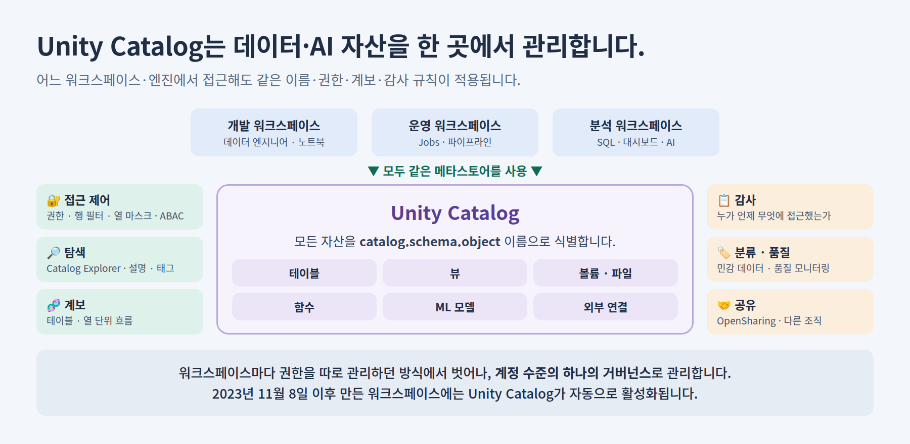
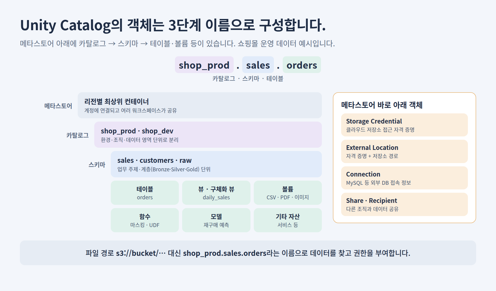
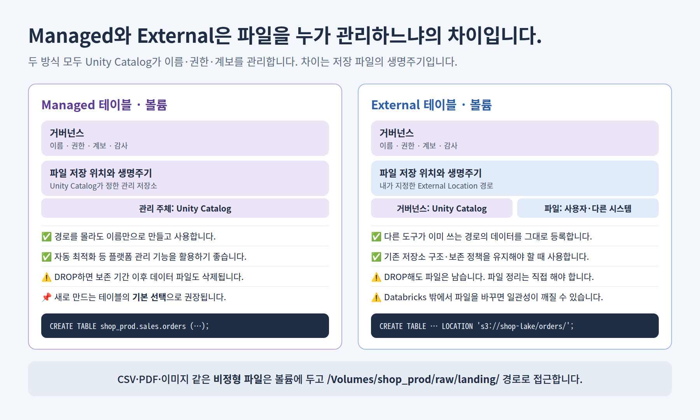
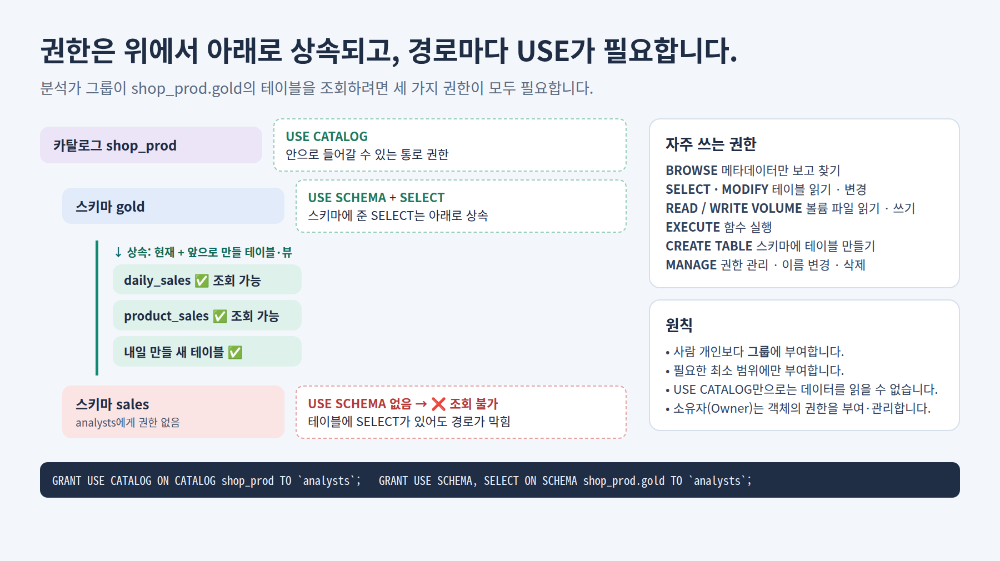
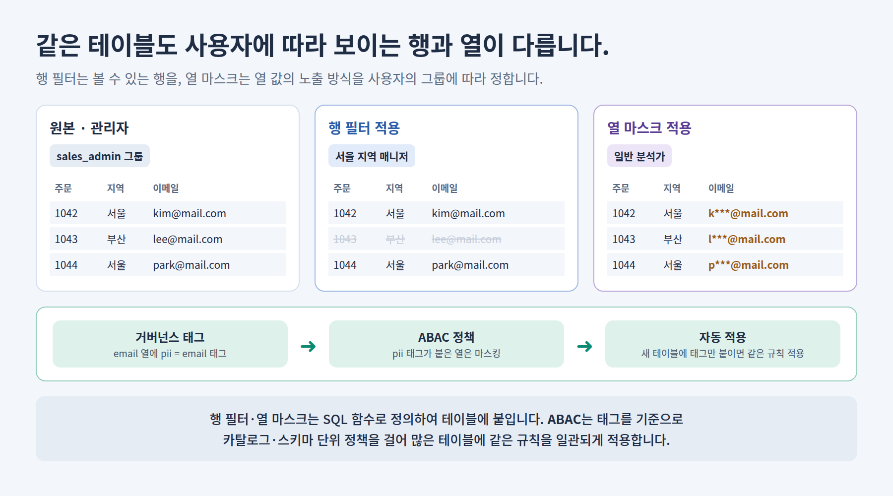
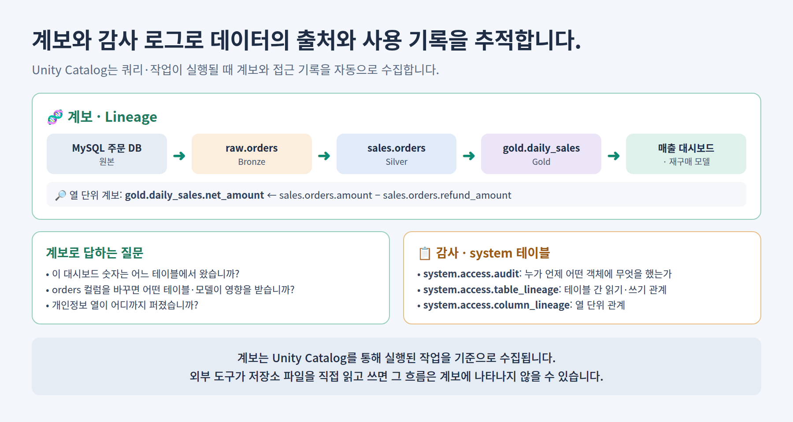
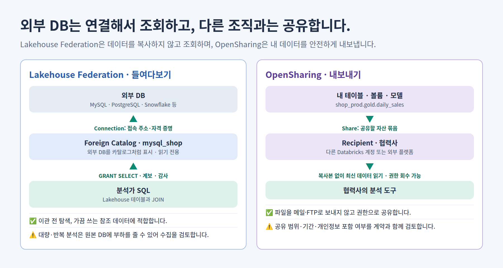
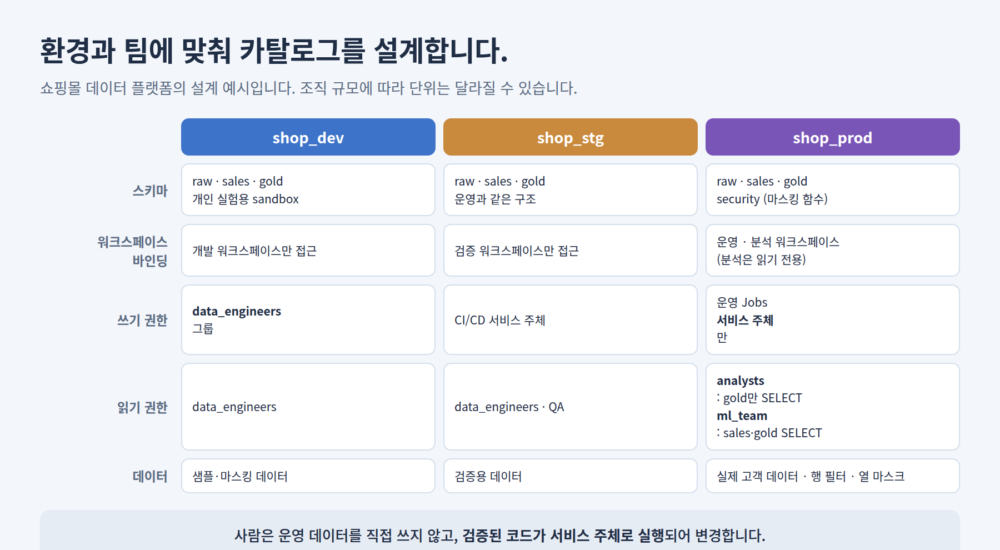

# Unity Catalog로 데이터·AI 자산 관리하기

**Unity Catalog는 Databricks에서 데이터와 AI 자산의 이름·권한·계보·감사를 한 곳에서 관리하는 거버넌스 계층입니다.** 테이블을 “어디에 저장했는가”보다 “무엇이라고 부르고, 누가 쓸 수 있으며, 어디서 왔는가”를 관리합니다.

이 문서는 온라인 쇼핑몰 데이터 플랫폼을 예로 들어 **그림 8장**으로 객체 구조·저장 방식·권한·보안·계보·외부 연결·환경 설계를 설명합니다. SQL 예시는 개념을 보여 주기 위한 것이며, 사용 가능한 기능은 클라우드·워크스페이스 구성과 요금제에 따라 확인합니다.

<a id="contents"></a>

## 목차

- [1. Unity Catalog는 무엇을 해결합니까?](#why)
- [2. 객체는 3단계 이름으로 구성합니다](#object-model)
- [3. Managed와 External은 어떻게 다릅니까?](#managed-external)
- [4. 권한은 어떻게 부여하고 상속됩니까?](#privileges)
- [5. 행 필터·열 마스크·ABAC로 세밀하게 보호합니다](#fine-grained)
- [6. 계보와 감사 로그로 추적합니다](#lineage-audit)
- [7. 외부 DB 연결과 다른 조직과의 공유](#federation-sharing)
- [8. 환경과 팀에 맞춰 카탈로그를 설계합니다](#design)
- [9. 실습: 쇼핑몰 카탈로그를 만들어 봅니다](#hands-on)
- [10. 용어집](#glossary)

<a id="why"></a>

## 1. Unity Catalog는 무엇을 해결합니까?



데이터가 늘어나면 다음 질문에 답하기 어려워집니다.

| 질문 | Unity Catalog가 제공하는 답 |
| --- | --- |
| 매출 테이블은 어디에 있고 누가 관리합니까? | 카탈로그·스키마·테이블 이름, 설명, 소유자, 태그로 찾습니다. |
| 분석가는 어떤 데이터까지 볼 수 있습니까? | 그룹에 부여한 권한과 행 필터·열 마스크로 정합니다. |
| 대시보드 숫자는 어떤 원본에서 왔습니까? | 테이블·열 단위 계보로 확인합니다. |
| 누가 고객 테이블을 언제 조회했습니까? | 감사 로그 system 테이블로 확인합니다. |
| 개발·운영·분석 워크스페이스의 권한이 서로 다르지 않습니까? | 계정 수준의 메타스토어 하나로 같은 규칙을 적용합니다. |

**Unity Catalog를 사용하면 워크스페이스·클러스터·SQL Warehouse 어디서 접근해도 같은 권한과 기록 규칙이 적용됩니다.** 2023년 11월 8일 이후 만든 워크스페이스에는 Unity Catalog가 자동으로 활성화됩니다. [Unity Catalog 개요](https://docs.databricks.com/aws/en/data-governance/unity-catalog/)

### 기존 Hive 메타스토어와 비교합니다

| 구분 | 워크스페이스 Hive 메타스토어 (레거시) | Unity Catalog |
| --- | --- | --- |
| 관리 범위 | 워크스페이스마다 따로 관리합니다. | 계정 수준 메타스토어를 여러 워크스페이스가 공유합니다. |
| 이름 | `database.table` 2단계입니다. | `catalog.schema.table` 3단계입니다. |
| 관리 대상 | 주로 테이블입니다. | 테이블·뷰·볼륨·함수·모델·외부 연결 등입니다. |
| 계보·감사 | 별도 구성이 필요합니다. | 기본 기능으로 제공합니다. |

Unity Catalog를 사용하는 워크스페이스에서도 기존 테이블은 `hive_metastore` 카탈로그로 보일 수 있습니다. 새로 만드는 데이터는 Unity Catalog에 만들고, 기존 테이블은 이관 계획을 세웁니다.

<a id="object-model"></a>

## 2. 객체는 3단계 이름으로 구성합니다



| 객체 | 역할 | 쇼핑몰 예시 |
| --- | --- | --- |
| 메타스토어 | 리전별 최상위 컨테이너이며, 계정에 연결되고 여러 워크스페이스가 공유합니다. | 서울 리전 메타스토어입니다. |
| 카탈로그 | 데이터를 크게 나누는 단위입니다. 환경·조직·데이터 영역으로 나눕니다. | `shop_dev`, `shop_prod` |
| 스키마 | 업무 주제나 데이터 계층 단위의 묶음입니다. | `raw`, `sales`, `gold` |
| 테이블 · 뷰 | 행과 열로 구성한 정형 데이터와, 쿼리로 정의한 가상 테이블입니다. | `sales.orders`, `gold.daily_sales` |
| 볼륨 | CSV·PDF·이미지 같은 파일을 관리합니다. | `raw.landing` |
| 함수 · 모델 | SQL·Python 함수와 MLflow로 등록한 ML 모델입니다. | 마스킹 함수, 재구매 예측 모델 |
| Storage Credential · External Location | 클라우드 저장소 접근 자격 증명과, 그 자격 증명으로 접근하는 저장소 경로입니다. | `s3://shop-lake/` |
| Connection | 외부 DB의 접속 정보입니다. | 주문 MySQL |
| Share · Recipient | 다른 조직과 공유할 자산 묶음과, 공유받는 대상입니다. | 협력사 매출 공유 |

```sql
SELECT order_id, amount
FROM shop_prod.sales.orders      -- 카탈로그.스키마.테이블
WHERE order_date = current_date();
```

**파일 경로(`s3://…`)를 직접 공유하는 대신 이름으로 데이터를 찾고 권한을 부여합니다.** 저장 위치가 바뀌어도 사용자의 코드와 권한은 이름을 기준으로 유지됩니다.

<a id="managed-external"></a>

## 3. Managed와 External은 어떻게 다릅니까?



| 구분 | Managed | External |
| --- | --- | --- |
| Unity Catalog가 관리하는 것 | 거버넌스 + 파일 저장 위치·생명주기입니다. | 거버넌스만 관리합니다. |
| 저장 위치 | Unity Catalog가 정한 관리 저장소입니다. | 사용자가 지정한 External Location 경로입니다. |
| `DROP TABLE` | 보존 기간이 지나면 데이터 파일도 삭제됩니다. | 메타데이터만 삭제되고 파일은 남습니다. |
| 적합한 경우 | 새로 만드는 대부분의 테이블입니다. | 다른 시스템이 같은 경로를 계속 사용하거나, 기존 저장 구조를 유지해야 할 때입니다. |

```sql
-- Managed 테이블: 경로를 지정하지 않습니다.
CREATE TABLE shop_prod.sales.orders (
  order_id BIGINT, customer_id BIGINT, region STRING, amount DECIMAL(12,2), order_date DATE
);

-- External 테이블: External Location 안의 경로를 지정합니다.
CREATE TABLE shop_prod.raw.legacy_orders
LOCATION 's3://shop-lake/legacy/orders/';
```

**새 테이블은 Managed를 기본으로 선택합니다.** Databricks는 Managed 테이블에 자동 최적화 같은 플랫폼 관리 기능을 적용할 수 있습니다. External 테이블은 Databricks 밖에서 파일을 직접 바꾸면 테이블 상태와 어긋날 수 있으므로 쓰기 주체를 정해 둡니다. [Managed와 External 비교](https://docs.databricks.com/aws/en/tables/managed)

### 파일은 볼륨으로 관리합니다

주문 CSV, 상품 PDF, 리뷰 이미지처럼 테이블이 아닌 파일은 볼륨에 둡니다. 볼륨도 Managed와 External로 나뉘며, 테이블과 같은 방식으로 권한을 부여합니다.

```sql
CREATE VOLUME shop_prod.raw.landing;
GRANT READ VOLUME ON VOLUME shop_prod.raw.landing TO `data_engineers`;
```

```python
orders = spark.read.csv("/Volumes/shop_prod/raw/landing/orders/", header=True)
```

<a id="privileges"></a>

## 4. 권한은 어떻게 부여하고 상속됩니까?



**테이블을 조회하려면 테이블의 `SELECT`와 함께, 상위 카탈로그의 `USE CATALOG`와 스키마의 `USE SCHEMA`가 모두 필요합니다.** `USE CATALOG`·`USE SCHEMA`는 안으로 들어가는 통로 권한이며, 그것만으로는 데이터를 읽을 수 없습니다. [권한 목록](https://docs.databricks.com/aws/en/data-governance/unity-catalog/manage-privileges/privileges)

```sql
GRANT USE CATALOG ON CATALOG shop_prod TO `analysts`;
GRANT USE SCHEMA, SELECT ON SCHEMA shop_prod.gold TO `analysts`;

SHOW GRANTS ON SCHEMA shop_prod.gold;                   -- 부여된 권한 확인
REVOKE SELECT ON SCHEMA shop_prod.gold FROM `analysts`; -- 권한 회수
```

권한은 상위 객체에서 하위 객체로 상속됩니다. 위 예시처럼 스키마에 `SELECT`를 주면 **그 스키마의 현재 테이블·뷰와 앞으로 만들 테이블·뷰**를 모두 조회할 수 있습니다. 편리하지만 범위가 넓으므로, 민감 데이터가 섞인 스키마에는 테이블 단위로 부여합니다.

| 권한 | 대상 | 의미 |
| --- | --- | --- |
| `USE CATALOG` / `USE SCHEMA` | 카탈로그 / 스키마 | 하위 객체에 접근하기 위한 통로 권한입니다. |
| `BROWSE` | 카탈로그 | 데이터를 읽지 않고 메타데이터를 보고 찾을 수 있습니다. |
| `SELECT` / `MODIFY` | 테이블·뷰 (상위에 부여하면 상속) | 데이터 읽기 / 추가·수정·삭제입니다. |
| `READ VOLUME` / `WRITE VOLUME` | 볼륨 | 볼륨 파일 읽기 / 쓰기입니다. |
| `EXECUTE` | 함수 | 함수를 실행합니다. |
| `CREATE SCHEMA` / `CREATE TABLE` / `CREATE VOLUME` | 카탈로그 / 스키마 | 하위 객체를 만듭니다. |
| `MANAGE` | 대부분의 객체 | 권한 관리·이름 변경·삭제 등 관리 작업을 합니다. 데이터 읽기 권한이 자동으로 생기지는 않습니다. |
| `ALL PRIVILEGES` | 대부분의 객체 | 해당 객체에 적용 가능한 권한을 한 번에 부여합니다. 일부 권한은 포함하지 않습니다. |

권한 부여 원칙은 다음과 같습니다.

- **개인보다 그룹에 부여합니다.** 사람이 팀을 옮기면 그룹 구성만 바꿉니다.
- **필요한 최소 범위에 부여합니다.** 분석가에게는 `gold`만, ML 팀에는 `sales`·`gold`의 읽기만 줍니다.
- **운영 데이터의 쓰기는 서비스 주체에게만 부여합니다.** 사람이 아닌 검증된 Job이 데이터를 변경합니다.
- 객체의 **소유자(Owner)** 는 권한을 부여·관리할 수 있으므로, 소유자도 개인보다 그룹으로 지정합니다.

<a id="fine-grained"></a>

## 5. 행 필터·열 마스크·ABAC로 세밀하게 보호합니다



테이블 권한만으로는 “서울 매니저는 서울 주문만 본다”나 “분석가에게는 이메일을 가린다”를 표현할 수 없습니다. 이때 **행 필터와 열 마스크**를 사용합니다. 둘 다 SQL 함수로 규칙을 정의하고 테이블에 붙입니다. [행 필터와 열 마스크](https://docs.databricks.com/aws/en/data-governance/unity-catalog/filters-and-masks/)

```sql
-- 행 필터: 관리자는 전체, 그 외에는 서울 주문만 봅니다.
CREATE FUNCTION shop_prod.security.region_filter(region STRING)
RETURN is_account_group_member('sales_admin') OR region = '서울';

ALTER TABLE shop_prod.sales.orders
SET ROW FILTER shop_prod.security.region_filter ON (region);

-- 열 마스크: pii_readers 그룹이 아니면 이메일 앞부분을 가립니다.
CREATE FUNCTION shop_prod.security.mask_email(email STRING)
RETURN CASE WHEN is_account_group_member('pii_readers') THEN email
            ELSE regexp_replace(email, '^(.)[^@]*', '$1***') END;

ALTER TABLE shop_prod.sales.customers
ALTER COLUMN email SET MASK shop_prod.security.mask_email;
```

실제 운영에서는 지역을 코드에 고정하지 않고 “사용자·그룹 ↔ 허용 지역” 매핑 테이블을 조회하도록 함수를 만듭니다. 그래야 매니저가 바뀌어도 함수를 수정하지 않습니다.

### 테이블이 많아지면 ABAC로 정책을 겁니다

테이블마다 마스크를 하나씩 붙이면 새 테이블에서 빠뜨리기 쉽습니다. **ABAC(속성 기반 접근 제어)** 는 열·테이블에 붙인 **거버넌스 태그**를 기준으로 카탈로그·스키마·테이블 수준의 정책을 겁니다. 태그가 붙은 객체에는 정책이 자동으로 적용됩니다. [ABAC 개요](https://docs.databricks.com/aws/en/data-governance/unity-catalog/abac/)

| 방식 | 규칙을 연결하는 단위 | 적합한 경우 |
| --- | --- | --- |
| 테이블별 행 필터·열 마스크 | 개별 테이블·열 | 대상 테이블이 적고 규칙이 테이블마다 다를 때입니다. |
| ABAC 정책 | 태그 + 카탈로그·스키마·테이블 정책 | 개인정보처럼 같은 규칙을 많은 테이블에 일관되게 적용할 때입니다. |

```sql
-- 열에 태그를 붙이면, 해당 태그를 대상으로 하는 ABAC 정책이 적용됩니다.
ALTER TABLE shop_prod.sales.customers ALTER COLUMN email SET TAGS ('pii' = 'email');
```

ABAC의 일부 기능(메타스토어 수준 정책, DENY 정책 등)은 Beta로 표시되어 있으므로, 운영에 적용하기 전에 기능 상태를 확인합니다.

<a id="lineage-audit"></a>

## 6. 계보와 감사 로그로 추적합니다



**계보(Lineage)** 는 데이터가 어디서 와서 어디로 가는지 보여 줍니다. Unity Catalog는 쿼리·Job이 실행될 때 테이블과 열 단위 계보를 자동으로 수집하며, Catalog Explorer에서 그래프로 볼 수 있습니다. [데이터 계보](https://docs.databricks.com/aws/en/data-governance/unity-catalog/data-lineage)

| 상황 | 계보로 확인하는 내용 |
| --- | --- |
| 대시보드 숫자가 이상합니다. | 숫자의 원천 테이블·열과 변환 경로를 거슬러 올라갑니다. |
| `orders.amount` 컬럼 정의를 바꾸려 합니다. | 영향을 받는 하위 테이블·대시보드·모델을 미리 찾습니다. |
| 개인정보 열이 퍼진 범위를 점검합니다. | `email`을 사용한 하위 테이블을 찾습니다. |

```sql
-- gold.daily_sales는 어떤 테이블에서 만들어졌습니까?
SELECT DISTINCT source_table_full_name, entity_type, event_time
FROM system.access.table_lineage
WHERE target_table_full_name = 'shop_prod.gold.daily_sales'
ORDER BY event_time DESC;

-- 최근 7일 동안 Unity Catalog에서 누가 무엇을 했습니까?
SELECT event_time, user_identity.email, action_name, request_params
FROM system.access.audit
WHERE service_name = 'unityCatalog'
  AND event_time >= current_timestamp() - INTERVAL 7 DAYS
ORDER BY event_time DESC;
```

system 테이블은 관리자가 활성화하고 권한을 부여해야 조회할 수 있습니다. **Unity Catalog를 거치지 않고 외부 도구가 저장소 파일을 직접 읽고 쓰면 그 흐름은 계보에 나타나지 않을 수 있습니다.** 계보를 믿으려면 데이터 접근 경로를 Unity Catalog로 모읍니다. [system 테이블](https://docs.databricks.com/aws/en/admin/system-tables/)

<a id="federation-sharing"></a>

## 7. 외부 DB 연결과 다른 조직과의 공유



| 구분 | Lakehouse Federation | OpenSharing |
| --- | --- | --- |
| 방향 | 외부 DB를 **들여다봅니다**. | 내 데이터를 **내보냅니다**. |
| 핵심 객체 | Connection, Foreign Catalog | Share, Recipient |
| 데이터 이동 | 복사하지 않고 조회 시 외부 DB에 질의합니다. | 파일을 보내지 않고 권한으로 읽게 합니다. |
| 적합한 경우 | 이관 전 탐색, 가끔 쓰는 참조 데이터입니다. | 협력사·자회사와의 정기 데이터 제공입니다. |
| 주의할 점 | 대량·반복 분석은 원본 DB에 부하를 주므로 수집을 검토합니다. | 공유 범위·기간·개인정보 포함 여부를 계약과 함께 검토합니다. |

```sql
-- Lakehouse Federation: 주문 MySQL을 읽기 전용 카탈로그로 연결합니다.
CREATE CONNECTION mysql_conn TYPE mysql
OPTIONS (host 'orders-db.internal', port '3306',
         user secret('shop', 'mysql_user'), password secret('shop', 'mysql_password'));
CREATE FOREIGN CATALOG mysql_shop USING CONNECTION mysql_conn;

-- OpenSharing: 일별 매출을 협력사에 공유합니다.
CREATE SHARE partner_sales;
ALTER SHARE partner_sales ADD TABLE shop_prod.gold.daily_sales;
CREATE RECIPIENT partner_a;
GRANT SELECT ON SHARE partner_sales TO RECIPIENT partner_a;
```

접속 비밀번호는 코드에 쓰지 않고 secret으로 관리합니다. Foreign Catalog의 테이블에도 일반 테이블처럼 `SELECT` 권한을 부여하며, 조회 기록은 감사 로그에 남습니다. [Lakehouse Federation](https://docs.databricks.com/aws/en/query-federation/), [OpenSharing](https://docs.databricks.com/aws/en/delta-sharing/)

<a id="design"></a>

## 8. 환경과 팀에 맞춰 카탈로그를 설계합니다



**카탈로그는 권한과 격리의 경계로 쓰기 좋습니다.** 환경(dev·stg·prod)으로 나누는 방식이 가장 흔하며, 조직이 크면 사업부·데이터 영역으로도 나눕니다.

| 설계 항목 | 권장 방향 |
| --- | --- |
| 카탈로그 | 환경별로 `shop_dev`·`shop_stg`·`shop_prod`처럼 나눕니다. |
| 스키마 | `raw`·`sales`·`gold`처럼 계층·주제별로 나누고, 환경마다 같은 구조를 유지합니다. |
| 워크스페이스 바인딩 | 운영 카탈로그는 운영·분석 워크스페이스에서만 접근하게 제한하고, 분석 워크스페이스에는 읽기 전용으로 연결할 수 있습니다. |
| 쓰기 권한 | 운영 데이터는 사람 대신 Job의 **서비스 주체**에게만 줍니다. |
| 읽기 권한 | 역할별 그룹(`analysts`, `ml_team`)에 필요한 스키마만 줍니다. |
| 민감 데이터 | 운영에만 실제 데이터를 두고, 개발에는 샘플·마스킹 데이터를 사용합니다. |

코드에서 카탈로그 이름을 변수로 두면 같은 파이프라인을 dev → stg → prod로 승격할 수 있습니다.

```python
catalog = dbutils.widgets.get("catalog")   # shop_dev / shop_stg / shop_prod
spark.sql(f"USE CATALOG {catalog}")
orders = spark.table("sales.orders")
```

<a id="hands-on"></a>

## 9. 실습: 쇼핑몰 카탈로그를 만들어 봅니다

1. `shop_dev` 카탈로그와 `raw`·`sales`·`gold` 스키마를 만들고 Catalog Explorer에서 구조를 확인합니다.
2. `raw.landing` 볼륨에 주문 CSV를 올리고, 이를 읽어 Managed 테이블 `sales.orders`를 만듭니다.
3. `gold.daily_sales`를 만들고, 테이블·주요 열에 설명(COMMENT)과 태그를 붙입니다.
4. `analysts` 그룹에 `gold`만 조회 권한을 주고, 분석가 계정으로 `sales.orders` 조회가 거부되는지 확인합니다.
5. 고객 테이블의 `email`에 열 마스크를, 주문 테이블에 지역 행 필터를 붙여 그룹별 결과를 비교합니다.
6. Catalog Explorer의 계보 그래프와 `system.access.table_lineage`로 `gold.daily_sales`의 원천을 확인합니다.

```sql
CREATE CATALOG IF NOT EXISTS shop_dev;
CREATE SCHEMA IF NOT EXISTS shop_dev.raw;
CREATE SCHEMA IF NOT EXISTS shop_dev.sales;
CREATE SCHEMA IF NOT EXISTS shop_dev.gold;

COMMENT ON TABLE shop_dev.gold.daily_sales IS '일별 순매출. 결제 - 취소 - 환불 기준';
```

카탈로그·권한 생성에는 메타스토어나 카탈로그의 관리 권한이 필요합니다. 교육 환경에서는 강사가 미리 카탈로그를 만들고 수강생에게 스키마 생성 권한을 주는 방식으로 운영할 수 있습니다. 앞 문서의 [Lakehouse와 AI](data-engineering-lakehouse-ai.md#databricks)에서 Unity Catalog가 전체 구조의 어디에 있는지 함께 확인합니다.

<a id="glossary"></a>

## 10. 용어집

| 용어 | 의미 |
| --- | --- |
| Unity Catalog | Databricks의 데이터·AI 자산에 대한 이름·권한·계보·감사를 관리하는 거버넌스 계층입니다. |
| 거버넌스 | 데이터의 소유·정의·품질·권한·보존 등 관리 원칙과 운영 체계입니다. |
| 메타스토어 | Unity Catalog의 최상위 컨테이너입니다. 리전별로 만들고 여러 워크스페이스가 공유합니다. |
| 카탈로그 / 스키마 | 3단계 이름의 첫째·둘째 단계이며, 데이터 자산을 묶는 단위입니다. |
| 3단계 이름 | `catalog.schema.object` 형식으로 자산을 식별하는 방식입니다. |
| Securable object | 권한을 부여할 수 있는 Unity Catalog 객체입니다. |
| Managed / External | Unity Catalog가 파일 저장 위치·생명주기까지 관리하는 방식과, 거버넌스만 관리하는 방식입니다. |
| 볼륨 | 테이블이 아닌 파일을 관리하고 `/Volumes/...` 경로로 접근하게 하는 객체입니다. |
| Storage Credential | 클라우드 저장소에 접근하기 위한 자격 증명 객체입니다. |
| External Location | Storage Credential과 저장소 경로를 묶어 접근을 관리하는 객체입니다. |
| 권한 상속 | 상위 객체에 부여한 권한이 하위 객체에 적용되는 방식입니다. |
| 서비스 주체 | 사람이 아닌 Job·애플리케이션이 사용하는 계정입니다. |
| 소유자 | 객체를 관리하고 권한을 부여할 수 있는 사용자·그룹입니다. |
| 행 필터 / 열 마스크 | 사용자에 따라 볼 수 있는 행을 제한하는 규칙과, 열 값을 가리거나 변형하는 규칙입니다. |
| ABAC | 태그 같은 속성을 기준으로 정책을 적용하는 속성 기반 접근 제어입니다. |
| 거버넌스 태그 | 정책 조건에 사용하도록 관리되는 태그입니다. |
| 계보 | 데이터가 어디서 왔고 어떤 변환을 거쳐 사용되는지 나타내는 관계입니다. |
| 감사 로그 | 누가 언제 어떤 객체에 어떤 작업을 했는지 기록한 로그입니다. |
| system 테이블 | 감사·계보·사용량 등 플랫폼 운영 정보를 조회할 수 있는 Databricks 제공 테이블입니다. |
| Catalog Explorer | 카탈로그 객체를 찾고, 권한·계보·설명을 확인하는 Databricks UI입니다. |
| Lakehouse Federation | 외부 DB를 복사하지 않고 Unity Catalog를 통해 조회하는 기능입니다. |
| Connection / Foreign Catalog | 외부 DB 접속 정보 객체와, 외부 DB를 카탈로그처럼 보여 주는 읽기 전용 카탈로그입니다. |
| OpenSharing | Databricks의 데이터 공유 플랫폼·프로토콜입니다. |
| Share / Recipient | 공유할 자산 묶음과, 공유받는 대상입니다. |
| 워크스페이스 바인딩 | 특정 카탈로그에 접근할 수 있는 워크스페이스를 제한하는 설정입니다. |
| Hive 메타스토어 | Unity Catalog 이전에 워크스페이스마다 사용하던 레거시 테이블 메타데이터 저장소입니다. |

[목차로 돌아갑니다](#contents) · [전체 교육 목차로 돌아갑니다](../README.md)
